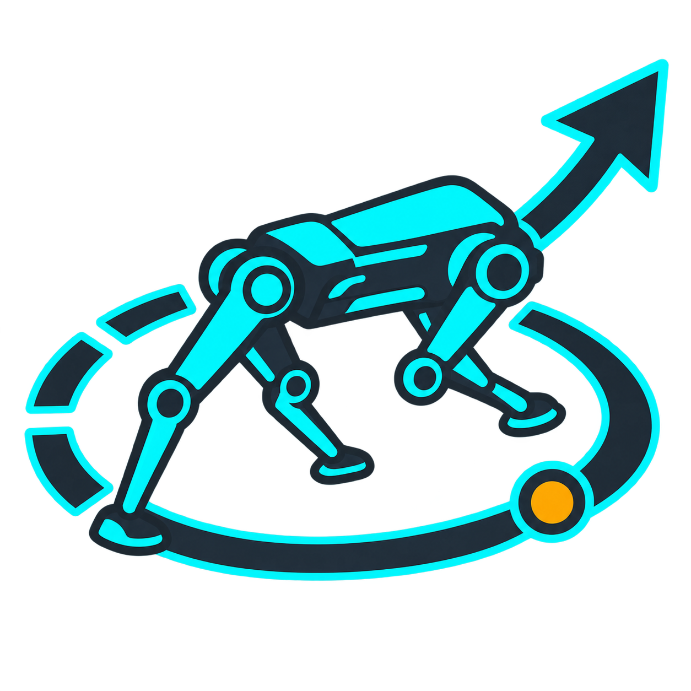
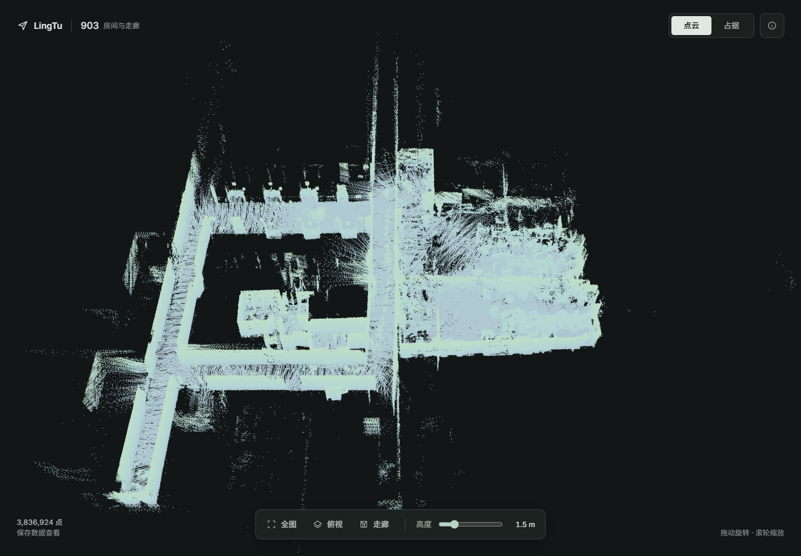
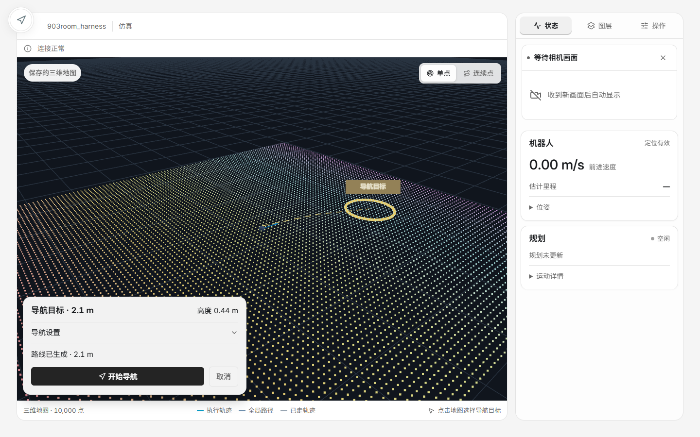
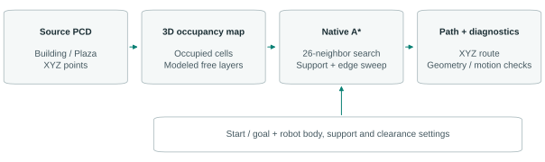
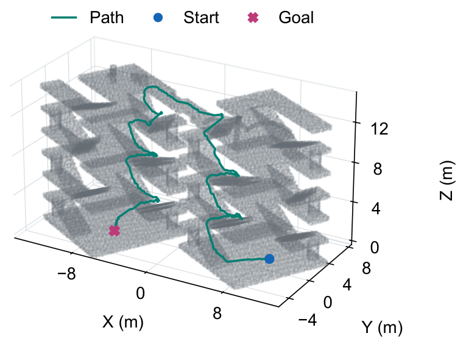
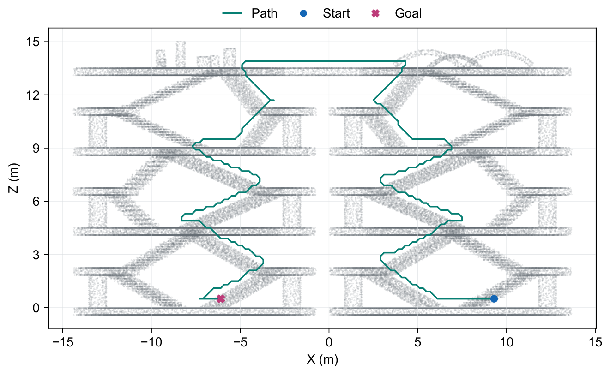
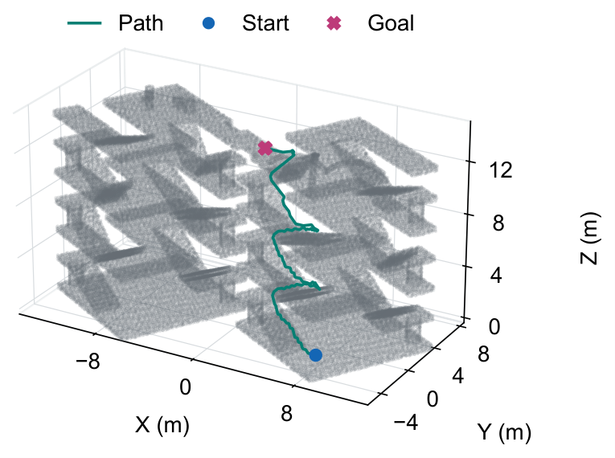
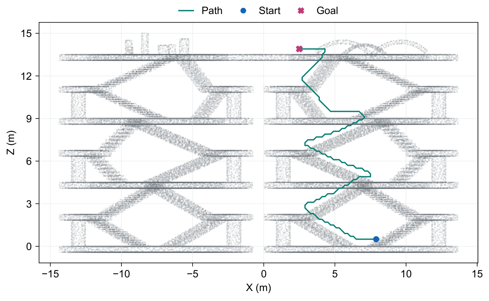
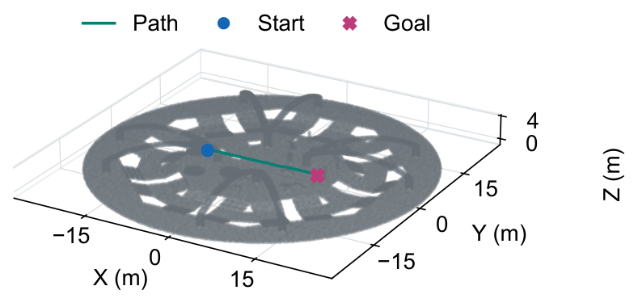
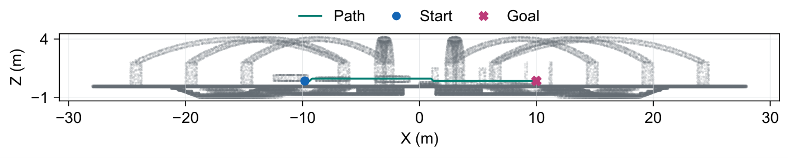

# LingTu

<p align="center">
  
</p>

<p align="center">
  <strong>ROS-free native navigation for quadruped robots.</strong>
</p>

<p align="center">
  <a href="https://github.com/Kitjesen/MapPilot/actions/workflows/test-python.yml"></a>
  <a href="https://github.com/Kitjesen/MapPilot/actions/workflows/nav-core-tests.yml"></a>
  
  
</p>

<p align="center">
  <a href="#mapping-and-navigation-interface">Demo</a> ·
  <a href="#global-planning-results">Planning</a> ·
  <a href="docs/getting-started.md">Quick start</a> ·
  <a href="docs/architecture.md">Architecture</a> ·
  <a href="docs/roadmap.md#current-delivery-cycle">Status</a>
</p>

LingTu runs LiDAR, SLAM, map services, planning and motion control as **native
C++ services over CycloneDDS, without a ROS runtime**. Python provides task
reasoning and external APIs; LingTu's Web console handles maps, goals and robot
status. ROS adapters are retained for explicit compatibility and replay only.

The shared workflow is **mapping → save/reload → localization → autonomous
navigation → safe stop**, with cancellation and manual takeover. Inspection
and semantic tasks build on the same navigation core.

Field qualification is in progress. [Product scope](docs/product.md) and the
[current roadmap](docs/roadmap.md#current-delivery-cycle) distinguish implemented
capabilities from verified results.

Factory inspection is **not yet accepted end to end**. The current
[sensor delivery ledger](docs/design/sensor-delivery-status.md) separates
implemented measurement/recording code, real-engine checks, unimplemented sensor
types, and the remaining same-Product Factory/navigation acceptance gates.

## Mapping and navigation interface

**903 room and corridor · field point cloud**



3,836,924 saved XYZ points, captured with the native DDS mapping pipeline.
The viewer clips display height to reveal the room and corridor structure.

**LingTu navigation console · goal and route preview**



Select a 3D goal, inspect its route, then start navigation. This screenshot
shows LingTu's Web components with a mock Gateway and synthetic test cloud.

| Recorded test | Input | Result |
| --- | --- | --- |
| Field map save · Sep 30 | 903 native DDS capture | 3,836,924 saved points from 605 patch/pose records |
| Product map viewer · Oct 15 | Real 903 PCD through local Gateway routes; test MapClient | 8/8 browser cases; 500,000 display samples; no write requests |
| Navigation UI · Oct 9 | Web components with mock Gateway | 4/4 interaction cases; preview/cancel sends no motion goal; Start sends one |

[Screenshots and test records](docs/assets/demo/README.md)

## Global planning results



Sample PCDs become a 3D occupancy map with occupied cells and modeled free layers
above support surfaces. Start/goal coordinates and robot geometry feed the
native 26-neighbor A* search, which checks body clearance, support and edge
sweep before accepting a connection. The returned path is checked and exported.

Offline routes generated by LingTu's native OctoPlanner3D integration on the
upstream Building and Plaza sample point clouds. Green: planned route;
blue: start; magenta: goal. Both views use equal metric scaling.
Click a figure for the publication PDF.

| 3D point cloud and route | X–Z elevation |
| --- | --- |
| [](docs/assets/planning/building-cross-3d.pdf)<br>**Building · cross-building** | [](docs/assets/planning/building-cross-xz.pdf)<br>89.78 m route · Z: 0.5–13.9 m |
| [](docs/assets/planning/building-stairs-3d.pdf)<br>**Building · ascent** | [](docs/assets/planning/building-stairs-xz.pdf)<br>38.37 m route · Z: 0.5–13.9 m |
| [](docs/assets/planning/plaza-3d.pdf)<br>**Plaza · crossing** | [](docs/assets/planning/plaza-xz.pdf)<br>20.36 m route · Z: 0.4–0.6 m |

## Start here

Start with the [installation and first-run guide](docs/getting-started.md).

| Task | Guide |
| --- | --- |
| Map, save/reload, navigate, take over or stop | [Operations](docs/operations.md) |
| Integrate a client or develop a component | [API](docs/api.md) · [Development](docs/development.md) |
| Run simulation and assess results | [Simulation](docs/simulation.md) · [Testing](docs/testing.md) |
| Review current work and remaining gaps | [Roadmap](docs/roadmap.md#current-delivery-cycle) |

[All documentation](docs/README.md) · [Source layout](src/README.md) ·
[Build](scripts/build/README.md) · [Deploy](scripts/deploy/README.md)

## Architecture

```text
LiDAR / IMU → native SLAM → saved map + localization
                                  ↓
Operator goal → OctoPlanner3D global route → SCAN local trajectory
             → navigation execution / recovery → motion arbitration → driver
```

C++ owns the field sensor, SLAM, map, planning and driver hot paths, communicating
through typed CycloneDDS. Python owns the Host, task reasoning and external APIs.
ProductControl owns Product lifecycle; native navigation owns final motion
arbitration. Perception and semantic tasks use these existing interfaces.
See [Architecture](docs/architecture.md) and [Runtime](docs/runtime.md).

The environments are `real` and `sim`; RobotConfig selects hardware, devices and
calibration. The [robot catalog](config/robots/README.md) contains `unitree/go2`
and `doso/thunder_v4`, with availability and validation recorded per environment.
Field releases target Linux/CycloneDDS. Simulation and physical robot tests
provide separate evidence.

## References

| Project | Role |
| --- | --- |
| FAST-LIO2 | Reference for the LingTu LTLIO frontend; original notices are retained. |
| Livox SDK2 / livox_ros_driver2, CycloneDDS | Sensor integration, compatibility and native transport. |
| OctoPlanner3D / OctoMap, DUFOMap | 3D planning, occupancy maps and optional save-time cleanup. |
| TARE / CMU exploration stack | Exploration reference and compatibility target. |
| MobileCLIP / CLIP, YOLO-World / YOLOE, Grounding DINO | Registry-selected semantic perception backends. |
| MuJoCo, ROS 2 Humble | Simulation; explicit ROS compatibility and replay paths. |
| [DimOS](https://github.com/dimensionalOS/dimos) | Validation and runtime evidence inspiration. |

## Project License

A project-level license has not yet been declared. Vendored and third-party
components retain their own notices and licenses; do not assume a license for
the complete checkout.
