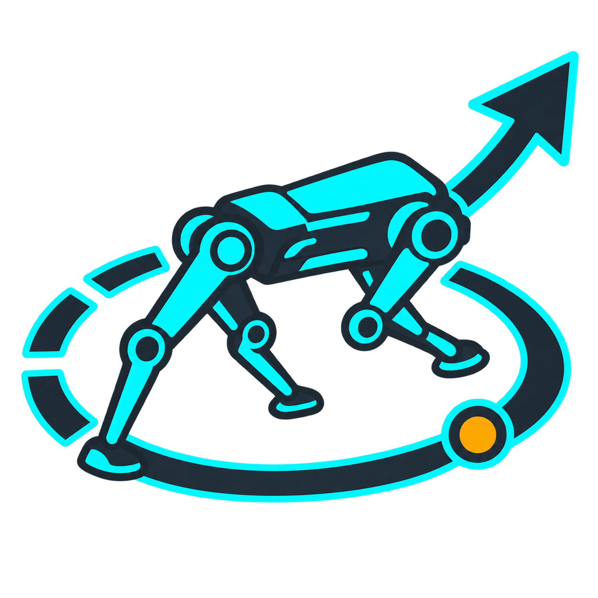
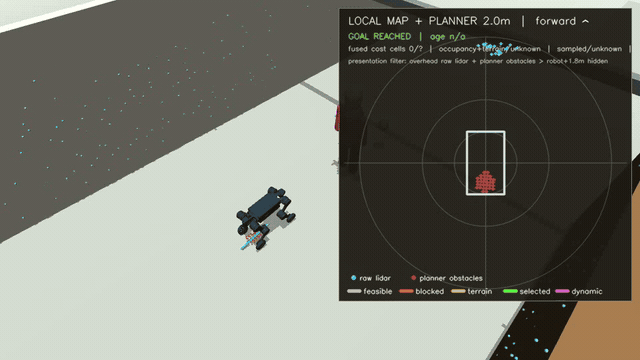
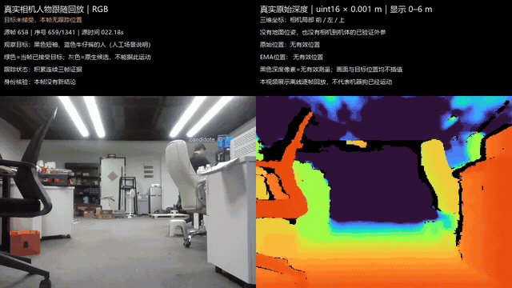
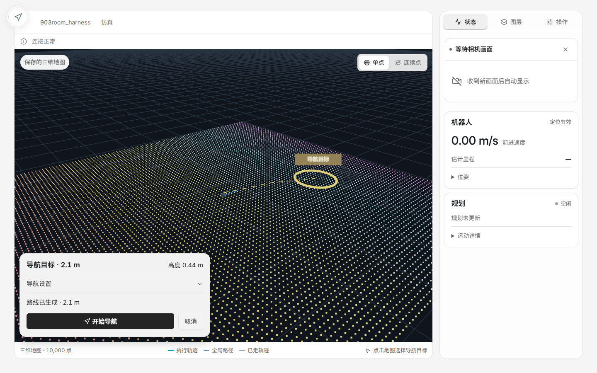
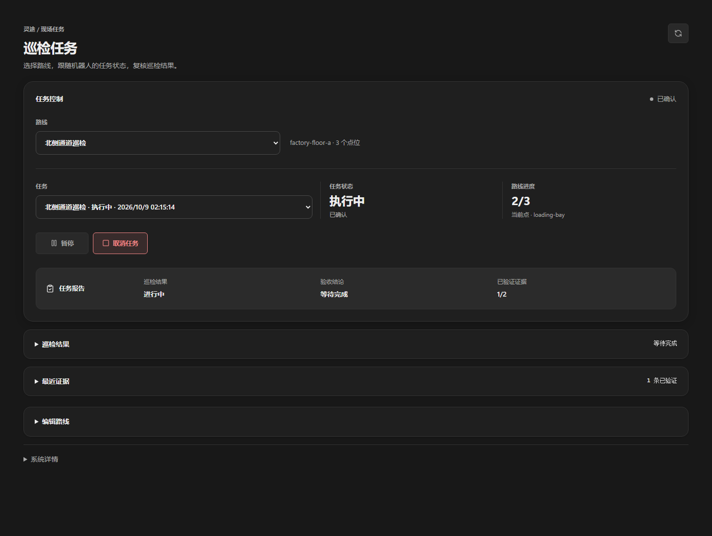

# LingTu

<p align="center">
  
</p>

<p align="center">
  <strong>Native autonomous navigation for quadruped robots.</strong><br>
  Mapping, localization, planning, perception, simulation, and field control in one product runtime.
</p>

<p align="center">
  <a href="https://github.com/Kitjesen/MapPilot/actions/workflows/test-python.yml"></a>
  <a href="https://github.com/Kitjesen/MapPilot/actions/workflows/nav-core-tests.yml"></a>
  <a href="https://github.com/Kitjesen/MapPilot/actions/workflows/native-motion-build.yml"></a>
  <a href="https://github.com/Kitjesen/MapPilot/actions/workflows/slam-aarch64-build.yml"></a>
</p>

<p align="center">
  
  
  
  
  
  <a href="#project-license"></a>
</p>

<p align="center">
  <a href="docs/getting-started.md">Quick start</a> ·
  <a href="docs/architecture.md">Architecture</a> ·
  <a href="docs/operations.md">Operations</a> ·
  <a href="docs/testing.md">Validation</a>
</p>

## Overview

LingTu is an autonomous-navigation system for quadruped robots. The shared
product workflow is **mapping → save/reload → localization → navigation → safe
stop**. Supported hardware is selected through `RobotConfig`; simulation and
real robots use the declared Product interfaces.

The field hot path is ROS-free: native C++ services own LiDAR, SLAM, maps,
planning and final motion arbitration over typed CycloneDDS. A Python Host owns
semantic understanding, task coordination and external APIs.

## Demos and test evidence

These are dated development recordings, not a claim that every capability has
passed on a physical robot. Click a preview for its full MP4. The GIF excerpts
play directly in the README; full-resolution MP4 files are also available to
open or download.

| **SIM · Native Follow in MuJoCo** | **REAL INPUT · Recorded RGB-D tracking replay** |
| --- | --- |
| [](docs/media/sim-follow.mp4) | [](docs/media/real-replay.mp4) |
| **2026-10-09 · 34.75 s.** Controlled shirt-color detection → RGB-D projection → Follow → native navigation → simulated motion and stop. | **2026-10-12 · 45 s.** Go2/NX D435i recording → YOLO/CLIP/DINO/Qwen research-GPU replay. **The robot did not move during this capture.** |
| 12 accepted goals; simulated travel **3.52 m**; zero recorded collision contacts; terminal zero applied in simulation. | **1,341 RGB-D pairs**, 617 accepted target observations; native ID changed from 1 to 9 after occlusion. Positions are camera-local, not qualified map coordinates. |
| [Full SIM video](docs/media/sim-follow.mp4) · [Method and limits](docs/media/README.md#sim-native-follow) | [Full tracking replay](docs/media/real-replay.mp4) · [Original RGB-D preview](docs/media/real-rgbd.mp4) · [Method and limits](docs/media/README.md#real-recording-and-replay) |

The SIM run uses a controlled visual detector and does not establish learned
person recognition or field following. The REAL INPUT run contains one person
and is offline inference, not an on-robot closed-loop navigation test. Original
capture data and reports remain archived locally; the selected media and
[public result summary](docs/media/results.json) are versioned here.

### Operator interface

**Navigation preview — actual Web components with a simulated Gateway,
2026-10-09.** Picking a goal previews a route; only the separate **开始导航**
action submits motion. This screenshot is a browser interaction test, not a
field map or navigation result.

[](docs/media/navigation-ui.png)

<details>
<summary>Inspection workbench: route, task state and evidence review</summary>



Actual `InspectionWorkbench` component, recorded with a mock Gateway on
2026-10-09. Route, task and report values in this UI fixture are synthetic.

</details>

### What the tests actually do

| Step | Recorded procedure | Evidence |
| --- | --- | --- |
| Acquire | Record synchronized color/depth from the physical D435i while the robot remains stationary. | [Unlabelled RGB-D video](docs/media/real-rgbd.mp4); 1,341 paired frames. |
| Observe and identify | Replay the same frames in source order; expose accepted targets, missing observations and identity-verification decisions. | [Annotated replay](docs/media/real-replay.mp4); rejected/unknown results remain visible. |
| Plan and move | Use controlled RGB-D target observations to drive Follow and the native planner in MuJoCo. | [SIM video](docs/media/sim-follow.mp4); motion, contacts and final stop in [results](docs/media/results.json). |
| Exercise the UI | Select a goal, preview, start, cancel, change the selection and reject delayed responses. | [Navigation screenshot](docs/media/navigation-ui.png) and [browser test record](docs/media/README.md#web-interface-checks). |

**These are separate experiments, not one end-to-end field qualification.**
See the [test process, input provenance, results and limitations](docs/media/README.md).
The videos predate the 2026-10-14 observation-contract changes; publishing them
does not rerun or qualify those changes.

## System ownership

```text
Camera → RGB-D perception → semantic observations / memory → task execution
                                                           ↓ goals and cancel
LiDAR / IMU → native SLAM → native 3D maps → native navigation → robot driver
                                                           ↑ task feedback
```

| Responsibility | Owner |
| --- | --- |
| Product lifecycle, readiness and map activation | `ProductControl`, using one resolved `RunPlan` in `env=real` or `env=sim` |
| Physical sensors and calibration | Selected `RobotConfig` and device adapters |
| SLAM, live/saved map geometry, global/local planning | Native C++ services; 3D collision and ground-support checks remain authoritative |
| Semantic intent, object memory and task coordination | Python Host Modules, using typed runtime messages and registered capabilities |
| Final motion arbitration | Native navigation; only the selected robot driver forwards checked commands |
| Operator access | Web UI, HTTP/SSE/WebSocket, SDK and MCP through Gateway |

Products include `teleop`, `teleop_avoid`, `map`, `explore`, `nav`, `tracking`
and `inspection`. A declaration or running process is not proof that a Product
is ready to move. See [Architecture](docs/architecture.md) and
[Runtime](docs/runtime.md) for ownership and execution boundaries.

## Getting started

The development baseline is Python 3.10+, Node.js 24, C++17 and the native
platform toolchain. Local Windows and Linux field builds have separate native
dependencies; optional perception models and hardware SDKs require their own
setup.

1. Follow [Getting started](docs/getting-started.md) for the supported host setup.
2. Use [Simulation](docs/simulation.md) for MuJoCo packages and validation gates.
3. Use [Operations](docs/operations.md) for target-side build/deploy, mapping,
   saved-map loading and supervised robot operation.

Product lifecycle is operated through `python -m lingtu.control`. For example,
resolve a simulation Product without starting it:

```bash
python -m lingtu.control switch teleop --robot doso/thunder_v4 --env sim --dry-run --json
```

Physical deployments use the selected robot profile and target-platform
artifacts. Do not use a simulation pass as permission for field motion.

## Validation and source layout

| Path | Contents |
| --- | --- |
| `src/lingtu/`, `src/runtime/` | Product control, Host assembly, Modules and messages |
| `src/drivers/`, `src/localization/`, `src/maps/`, `src/nav/` | Devices, SLAM/localization, 3D maps and native navigation |
| `src/perception/`, `src/decision/`, `src/memory/` | Visual observations, semantic tasks and persistent knowledge |
| `src/gateway/`, `web/` | External APIs and operator interface |
| `sim/`, `tests/` | Simulation packages, native/component tests and acceptance tools |
| `docs/media/` | Selected, versioned screenshots/videos and their evidence record |
| `build/`, `artifacts/` | Local generated outputs and larger evidence bundles; not GitHub media links |

Run the narrowest tests for the behavior being changed. Existing local Python
entry points include:

```bash
python -m pytest tests/runtime/ -q
python -m pytest tests/decision/ -q
```

Native changes also require the owning C++ build and tests. Validation levels
are kept distinct: **local contract → native simulation → field no-motion →
supervised field motion**. See [Testing and evidence](docs/testing.md) for
commands, evidence requirements and current qualification rules.

## Documentation

- [Documentation index](docs/README.md)
- [Screenshots, videos and test process](docs/media/README.md)
- [Architecture](docs/architecture.md) · [Runtime](docs/runtime.md)
- [Simulation](docs/simulation.md) · [Operations](docs/operations.md)
- [Testing](docs/testing.md) · [Delivery roadmap](docs/roadmap.md)
- [Development and contribution rules](docs/development.md) · [Repository instructions](AGENTS.md)

## Referenced Projects And Acknowledgements


LingTu is an integration-heavy robotics runtime. The table below names the main
external projects, algorithms, and systems that this checkout references,
adapts, vendors, or uses as validation inspiration. It is not a substitute for
the license files inside vendored subtrees.

| Project | LingTu role |
| --- | --- |
| [DimOS](https://github.com/dimensionalOS/dimos) | Evidence bar and benchmark inspiration for simulation closure, runtime dataflow checks, and readiness gating. LingTu uses DimOS-style validation ideas; DimOS is not a runtime dependency. |
| FAST-LIO2 | LiDAR-inertial odometry and mapping reference under `src/localization/fastlio2/`, with LingTu wrapping the runtime boundary for native/DDS use. |
| Livox SDK2 / livox_ros_driver2 | MID-360 LiDAR device protocol, SDK integration, and ROS compatibility source under `src/drivers/real/lidar/`. |
| CycloneDDS | Typed DDS transport used by native services and message definitions. |
| OctoPlanner3D / OctoMap | 3D saved-map global planning backend and occupancy-map runtime. |
| TARE / CMU exploration stack | Exploration architecture and compatibility target; the external CMU runtime is not vendored as a normal Python dependency. |
| DUFOMap | Optional saved-map cleanup and dynamic-obstacle filtering reference used by the map-save pipeline. |
| MuJoCo | Simulation backend for local validation, sensor generation, and route execution gates. |
| MobileCLIP / CLIP, YOLO-World / YOLOE, Grounding DINO | Semantic perception and open-vocabulary perception backends used behind registry-selected modules. |
| ROS 2 Humble | Compatibility, replay, and algorithm-check surface only; not the default runtime API. |

Thanks to the DimOS project in particular for setting a stronger standard for
robotics evidence: claims should be backed by explicit runtime gates, dataflow
proof, and reproducible artifacts instead of only code-path inspection.

## Project License

This checkout does not currently declare a project-level license in a root
`LICENSE` file. Do not assume MIT/open-source redistribution rights until that
file is added. Vendored and third-party components keep their own license files
inside their subtrees.
