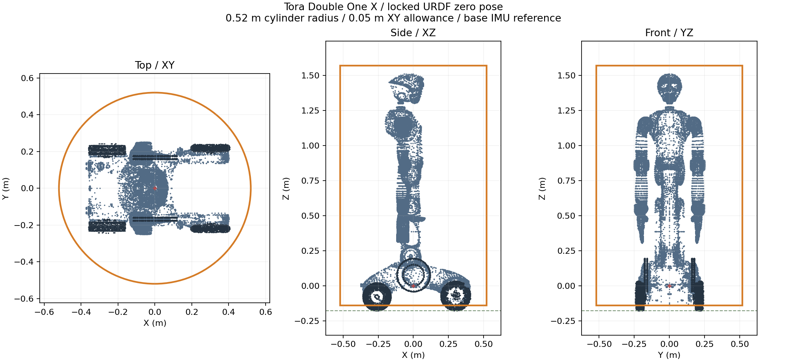

# Paxini Tora Double One X

已导入用户提供的 `tora_double_one_x_description(1).zip`，保留原始 URDF、
全部视觉／碰撞网格和 `package.xml`。来源版本 **1.0.13**，原始许可证为
**Proprietary**。没有执行包内 ROS launch，也没有为 LingTu 增加 ROS 依赖。

用户于 2026-11-06 确认：导航采用此 URDF 的零位姿，行走时上身关节锁定。
这里记录的是该固定姿态的几何，不负责向真实关节发送锁定命令。

| 文件 | 用途 |
| --- | --- |
| [model.yaml](model.yaml) | 现有模型发现入口，ID 为 `paxini/tora_double_one_x` |
| [原始 URDF](description/urdf/tora_double_one_x.urdf) | 87 个 link、86 个 joint，保留供应方网格引用 |
| [navigation.yaml](navigation.yaml) | 使用现有 GeometryConfig 字段的离线导航包络配置 |
| [envelope.json](envelope.json) | 全量 collision 网格计算的尺寸、坐标变换与覆盖依据 |
| [preview.png](preview.png) | 模型与简化包络的俯视、侧视、正视图 |

## 简化包络

采用一个竖直圆柱。复用项目现有双圆柱表示，将前后偏移设为零，使两个圆柱重合。
全局半径、局部圆柱半径及地图膨胀半径均可使用 **0.52 m**，不新增碰撞类型。

原始模型零位姿外形约 **0.77948 × 0.50200 × 1.69185 m**。
以底盘上固定的 `base_imu_link_0` 为几何参考，全部碰撞网格的最大水平半径为
**0.464488 m**。加 5 cm 水平余量并按厘米向上取整得到 **0.52 m**，直径 **1.04 m**。
`collision_hard_margin=0`，因为余量已经包含在半径中。这是较保守的简单外包络，
会牺牲部分窄门通过空间。

相对该参考点，模型 Z 范围为 **[-0.177985, +1.513860] m**。
行驶包络采用 **[-0.14, +1.57] m**：包含全部非轮刚性几何，上方留约 5 cm 余量。
轮胎水平外形仍全部计入半径，最低约 3.8 cm 作为正常接地层。
地图按现有 5 cm 体素处理时，上下膨胀会取整；配置编译输出的全局向下／向上
净空为 **0.15 / 1.60 m**。地图障碍膨胀的上下方向与机身净空相反。



## 坐标与实机边界

原始 `base_link` 原点几乎就在地面。`base_imu_link_0` 相对它的平移为
`[0.0195, 0, 0.178000853265161] m`，旋转为单位阵。
`support_height` 使用这个模型高度；`support_height_tolerance=0` 表示本离线配置
没有加入实测起伏余量。这里没有证明真实 DDS 的 body 就是该 IMU 坐标系。

原始全轮包络 `below=0.18` 已在同一地下车库真值地图中复现
`goal_snap_exhausted`，局部规划未启动。保持地面、水平半径与上界不变，只改
`below=0.14` 后，全局和 SCAN 理想底盘闭环到达。非轮刚性几何最低点距地面约
4.74 cm，仍在新下界上方约 9.36 mm。原始轮胎网格、原始下界和失败记录全部保留。
这是固定姿态平地行驶模型，**没有验证最低 3.8 cm 内的门槛、路沿和轮胎接触能力**。

头部雷达位于可动的腰、颈、头关节之后。用户约定的锁定姿态下可以计算固定变换，
但包内没有雷达型号、时间同步或实测标定证据；也没有底盘运动／停止接口。
本次保留 `robot.yaml` 缺失时的现有启动拒绝行为，避免默认 Go2／Thunder 参数
被当作 Tora 适配。模型可发现，**实机 Product 与轮胎动力学 session 尚未接入**。

官方 SCAN 的固定对照为
[`348e8a590a50a5a6bbab8d8c6dcfd171f009be26`](https://github.com/wuyi2121/SCAN-Planner/blob/348e8a590a50a5a6bbab8d8c6dcfd171f009be26/src/planner/plan_manage/launch/advanced_param.xml)。
这里的尺寸与 5 cm 余量来自本次模型适配，不是官方 Tora 参数，也没有修改全局／局部算法。

## 复算与检查

在仓库根目录运行：

```powershell
.\.venv\Scripts\python.exe tools/robot/tora_geometry.py
$env:PYTHONPATH = 'src'
.\.venv\Scripts\python.exe -m pytest tests/tools/test_tora_geometry.py tests/lingtu/assembly/test_tora_model.py -q
```

几何计算使用全部 86 个 collision STL 的 1,128,377 个三角形，不只检查外接盒角点。
圆柱是凸体，所有三角顶点被包含即可证明三角面被包含；预览为显示效率抽样，
覆盖检查始终使用全量数据：所有部件验证 XY 和上界，非轮部件还验证行驶下界；
完整轮胎 Z 范围另行保留。检查还覆盖全部视觉资源引用、模型发现、缺实机配置时
明确拒绝，以及现有原生导航／地图编译器接收这组包络参数。

2026-11-06 本地结果：3 项几何检查、2 项模型／配置检查通过；新增 Python 文件
的 Ruff 检查通过。

同日后续已完成[地下车库全局／局部算法闭环](../../../../docs/research/tora-garage-navigation-20261106.md)。
实体模型通过 MuJoCo 渲染真实原生反馈记录，原三视图是用于检查覆盖的抽样点图。
本轮地图是同场景几何真值，底盘为理想速度积分，尚无实机或轮胎物理验证。
