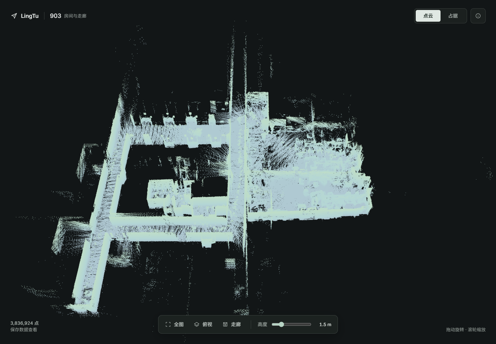
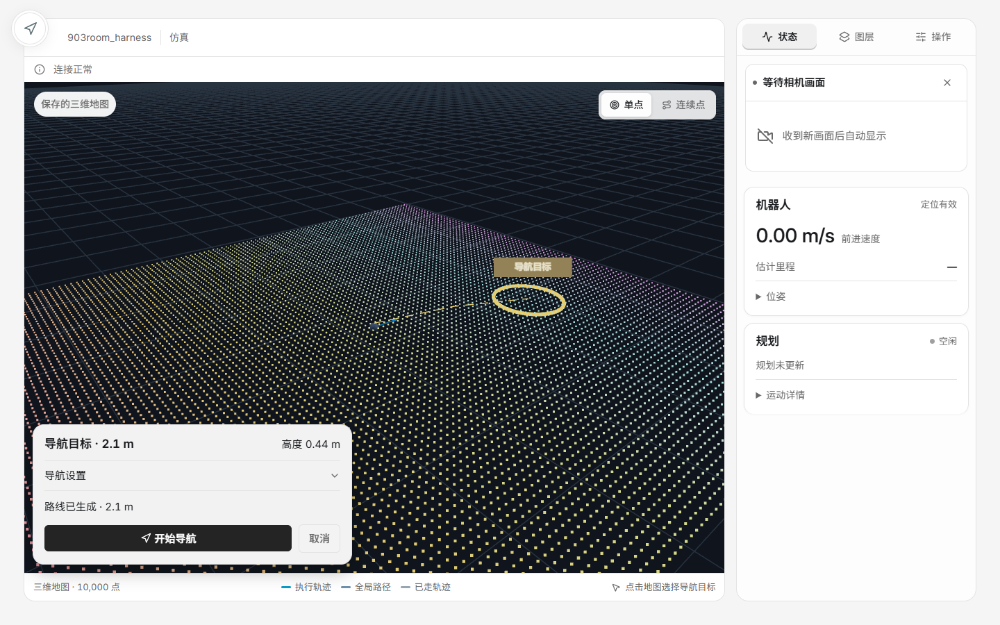
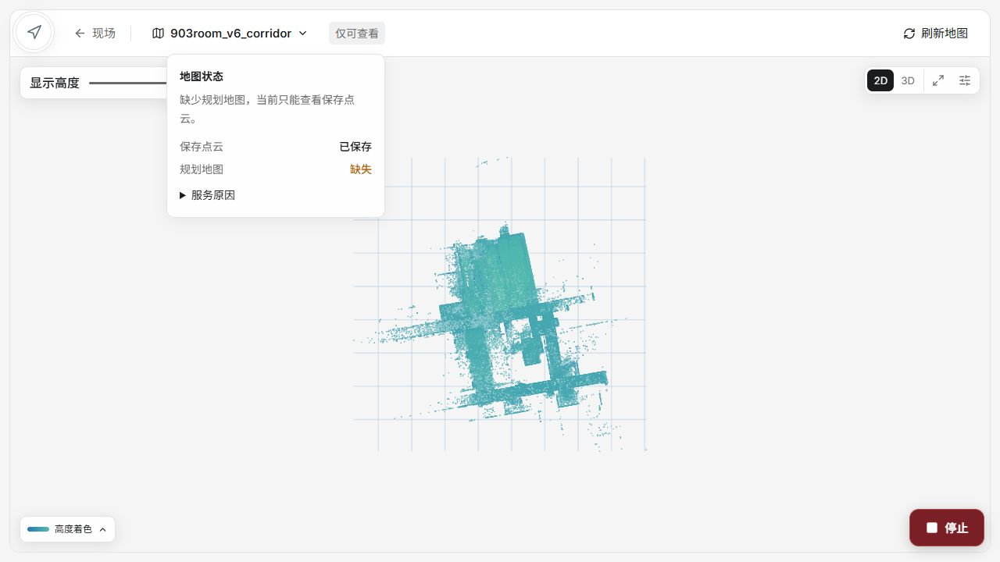

# Mapping and navigation demonstrations

Selected historical screenshots and results for the project README, assembled
on 2026-10-16. Full run data remains in the local paths listed below.

## 903 field point cloud

Map `903room_v6_corridor` contains 3,836,924 saved XYZ points in the `map` frame.
The 2026-09-30 save record identifies `data_source=field` and
`source_profile=native_dds`, with 605 patch/pose records. Save-time cleanup
reduced 4,452,709 points to 3,836,924.

This screenshot is the offline viewer captured on 2026-10-14. Display height
is limited to 1.5 m; the original PCD is unchanged. Color represents height.
Source: `build/readme-review-20261014/ui/pointcloud-903.png`, originating from
`build/go2-map-save-v6-20260930/viewer-desktop.png`.
The PCD, save metadata and source result remain in that original map directory.

## Navigation interface

Captured on 2026-10-09 using the actual Topbar and SceneView Web components,
a mock Gateway and a 10,000-point synthetic cloud. The scene name and robot
status are fixture values. The interface is LingTu's Web console; its native
navigation backend is C++, while this screenshot tests the client in isolation.

| Browser interaction | Preview requests | Motion-goal requests | Result |
| --- | ---: | ---: | --- |
| Automatic preview, pose/parameter changes, then Start | 5 | 1 | Pass |
| Rapid goal replacement | 2 | 0 | Pass |
| Escape/cancel while preview is pending | 2 | 0 | Pass |
| Failed preview, then retry | 2 | 0 | Pass |

Source image: `build/readme-review-20261014/package/docs/media/navigation-ui.png`.
Original report: `build/ui-simple-goal-20261009/report.md`.
These are UI interaction results, not a DDS, simulation or robot motion run.

## Product map service test

On 2026-10-15 the actual Web build loaded the real 903 PCD through production
Gateway routes with a local test MapClient. It sampled 500,000 of the 3,836,924
points for display. All eight browser cases passed with no HTTP write requests:
legacy-entry redirect, late-response rejection, same-map version refresh,
session changes, invalid identity handling, narrow-screen controls, unavailable
map handling and the tool's service-mode entry.

The newer product map page is shown below; it is separate from the offline
viewer above. The capture is from 2026-10-16 and shows the missing planning-map
status for this local preview dataset.

Sources: `build/map-service-20261015/README.md` and `browser-check.json`;
`build/map-status-20261016/README.md` and `after.jpg`.
The native Linux mapd file-descriptor chain and field motion were not part of
these browser tests. Test content versions are not real map release versions.

The [planning gallery](../planning/README.md) records the separate upstream
PCD planning experiments, their exact inputs and remaining motion diagnostics.
