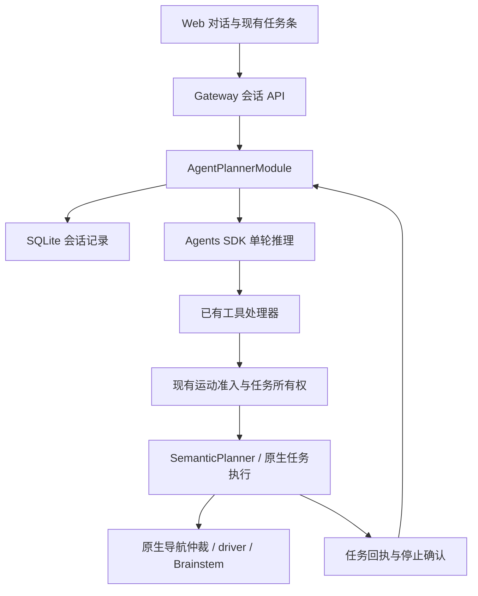

# LingTu 对话 Agent

本轮目标：让现有 Web 可以持续对话、补充任务信息、查看工具进展，并复用机器人任务的准入、执行和停止确认。采用 OpenAI Agents SDK 0.24.0；不采用 LangGraph。

2026-11-12：已从 Hermes v0.23.1 迁入 Codex 设备码登录与令牌刷新功能，入口在对话栏“管理模型连接”。订阅模型标识 `codex:gpt-6.1-sol`，独立于 API Key 模型；推理直接走 Codex Responses，沿用本页的单一工具循环。详见 [迁移与登录接口](hermes-core-migration.md)。不再启动或依赖 Hermes Gateway，尚未进行真实账号授权与推理验收。

## 分工与调用关系

- **Web**：管理输入草稿、历史和重试 ID，显示已有任务的真实状态。切换业务页不会重新创建会话状态。
- **Gateway**：校验外部请求，通过运行中的 Agent Module 调用会话方法；为运动工具提供既有准入函数。没有 Agent 时返回明确错误，不回退为伪造对话。
- **AgentPlannerModule**：拥有会话与机器人任务的关系。普通答复或澄清不创建运动任务；真正的动作工具通过准入后才绑定现有 AgentRun。
- **SDK**：负责一次输入的模型调用、串行工具执行、文本/工具事件和终止。`ask_user` 结束当前轮并等用户补充；`done` 必须通过原有完成证据检查。
- **原生执行链**：继续负责规划、运动仲裁、停止与设备反馈。模型没有直接发送电机/速度命令的入口。

新会话入口只有一个 SDK Runner；不会再在它的工具里面调用另一套完整 AgentLoop。旧 instruction API 仍兼容其现有调用者。

当前对话可调用已有的坐标/对象/方向导航、对象查找、检测、记忆查询和任务状态；任务控制沿用现有查询/取消逻辑。建图、地图保存和巡检编排尚未开放为对话工具，不应在界面承诺这些能力。

持续跟随暂不暴露到新会话：旧 Follow 在等待期间不受有限推理时限限制，而本次 SDK turn 有总超时。直接挂上它会把持续跟随错误地截断。原 `/api/v1/instruction` 与 Follow API 保留；后续应先将长期任务等待与对话轮次解耦，再接入新入口，不能用普通导航冒充持续跟随。

## 身份与事实来源

| 字段 | 唯一职责 |
| --- | --- |
| `conversation_id` | 一段持久会话 |
| `message_id` | 消息请求去重；相同 ID、正文、模型、思考和附件重试返回原结果 |
| `turn_id` | 一次用户输入及其推理过程 |
| `run_id` | 现有机器人任务的所有者，可跨多个对话轮次 |
| `task_id` | 原生执行子任务，终态和停止证据由执行端提供 |

“消息已接收”“推理已结束”“机器人已完成任务”是三个不同事实。聊天回复不会替代任务状态；取消回执也不等于停止确认。已有运动未结束时，新对话不会偷偷替换它。

## 接口

| HTTP | 路径 | 返回 |
| --- | --- | --- |
| GET | `/api/v1/agent/options` | 供应商、可用模型、思考选项和附件限制 |
| POST | `/api/v1/agent/conversations` | 新 `conversation_id` |
| GET | `/api/v1/agent/conversations/{id}` | 有序 messages、turns 与当前任务 |
| POST | `/api/v1/agent/conversations/{id}/attachments` | 附件 ID、名称、类型与大小 |
| POST | `/api/v1/agent/conversations/{id}/messages` | 202 + 原消息 ID、turn ID、状态 |
| GET | `/api/v1/agent/conversations/{id}/turns/{turn_id}` | 单轮当前结果 |
| POST | `/api/v1/agent/conversations/{id}/approvals/{approval_id}` | 当前动作的确认结果，body 为 `{approved: boolean}` |

引用追问支持整条回复或选中文字；选中文字保存在 `reply_quote`，由 `reply_to_message_id` 关联原消息，输入正文只保留本轮问题。发送重试沿用原引用，刷新后可恢复。

提交消息格式：`{message_id, text, model?, reasoning?, attachment_ids?, reply_to_message_id?, reply_quote?, client_id?}`。Web 使用现有任务接口跟进 `run_id`，保持任务取消和停止确认只有一个展示来源。附件格式、限制与 Kimi 官方参考见 [API 文档](../api.md#conversation-models-and-attachments)。

公开消息按单调 `seq` 合并；模型输入记录由后端保存，不发给浏览器。SQLite 默认路径为 `$XDG_STATE_HOME/lingtu/conversations.sqlite3`，未设置时使用用户的 `.local/state`；可通过 `LINGTU_CONVERSATION_DB_PATH` 或 Module 的 `conversation_db_path` 指定。

Web 在展开历史或推理进行期间每秒获取快照用于恢复，并通过现有 SSE 的 `agent_message` 接收实时正文。SDK 文本增量合并后更新同一条持久消息，SSE 使用完整累积正文、消息身份和递增 revision；终态覆盖为最终答复，迟到的旧快照不覆盖新正文。没有新建第二套 SSE 通道，文本到达不表示机器人动作已完成。

重启将未完成轮次标记为 `interrupted`，不会自动重放工具或恢复运动。HTTP 结果不明时，Web 保留原消息 ID 供重试核对；这不承诺进程崩溃期间外部工具副作用的 exactly-once。

## 工具权限

新消息包含 `permission_mode`，与正文、模型、思考和附件一起固定到该轮。未指定时使用 `default`。更改输入栏选择只影响之后提交的消息，不会恢复旧任务或撤销正在执行的动作；当前任务仍使用现有取消入口。

| 模式 | 动作工具行为 |
| --- | --- |
| `read_only` / 只读 | 后端拒绝导航、转向、主动查找等动作；查询和取消仍可用 |
| `default` / 执行前确认 | 每个动作产生绑定当前会话、轮次、工具调用及参数的审批，批准后才检查执行准入 |
| `full_access` / Full access | 自动进入当前已开放工具的执行准入；不会绕过急停、状态、所有权或服务端约束 |

`GET /api/v1/agent/options` 声明 `permission_modes` 和 `default_permission_mode`，Web 校验后才启用发送，避免连接旧服务时权限字段被静默忽略。快照的 `approvals` 给出审批 ID、轮次 ID、工具名、参数和 `pending/approved/denied/cancelled` 状态。相同决定可重试，冲突决定和跨会话确认被拒绝。

取消、超时或服务重启会关闭待确认审批；旧审批不能重新启用动作。审批等待沿用现有 SDK turn 的总超时，过期需用户重新提交。审批记录属于应用执行边界，保持原 Runner/future 的取消链；没有新增第二套 Runner。SDK 自带 `needs_approval`/RunState 机制，但本轮不引入跨请求序列化和恢复 SDK 执行状态。

参考官方实现：

- [Codex 审批与执行环境类型](https://github.com/openai/codex/blob/c875667eb837663697d5ffa32d375043434e73b4/codex-rs/protocol/src/protocol.rs)：审批策略与环境权限分别建模，代码为 [Apache-2.0](https://github.com/openai/codex/blob/c875667eb837663697d5ffa32d375043434e73b4/LICENSE)。本轮参考语义，没有复制其执行器。
- [Codex App Server](https://developers.openai.com/codex/app-server/)：审批关联 thread/turn/item，工具开始、结束和轮次终态分别上报。适合后续逐字文本和工具活动增量更新。
- [Claude SDK 权限](https://code.claude.com/docs/en/agent-sdk/permissions)：allow/deny 与工具回调可作为交互参考；不能把可能跳过的用户审批回调当成硬件执行检查。[Claude Code 仓库许可](https://github.com/anthropics/claude-code/blob/6e1e44f6433bfa17d198e932bff53373aa229eea/LICENSE.md) 为 Commercial Terms；Python SDK 的 [MIT 源码许可](https://github.com/anthropics/claude-agent-sdk-python/blob/3cf3446b0fa6c97042e85b245bba07459f22f946/LICENSE) 与其产品使用条款需分别遵守。

## 多会话与只读分享

最新输入栏按用户参考改为 24 px 外圆角、柔灰底和浅边界，桌面实际高 78 px。附件、权限和会话入口在左，模型与思考在右；菜单默认及选中背景透明，悬停才使用轻灰反馈。Full access 使用琥珀色文字，非默认思考强度使用轻紫图标。历史和弹出菜单分别用 20 px、16 px 圆角。桌面截图为 `artifacts/ui/conversation-sessions-20261110/formal-composer.png`。

会话管理参考 Codex 的 `thread/list/start/read/name/set/archive/unarchive`，在现有 SQLite 和 Gateway 内实现；没有引入另一套 Agent runtime。[官方协议](https://learn.chatgpt.com/docs/app-server)、[固定源码](https://github.com/openai/codex/blob/c875667eb837663697d5ffa32d375043434e73b4/codex-rs/app-server-protocol/src/protocol/common.rs#L575)。

| 操作 | API |
| --- | --- |
| 最近或归档列表 | `GET /api/v1/agent/conversations?archived=false/true` |
| 新建 | `POST /api/v1/agent/conversations` |
| 重命名、归档、恢复 | `PATCH /api/v1/agent/conversations/{id}`，body 为 `title` 或 `archived` |
| 创建固定分享 | `POST /api/v1/agent/conversations/{id}/share` |
| 撤销分享 | `DELETE /api/v1/agent/conversations/{id}/share` |
| 阅读分享 | `GET /api/v1/agent/shares/{token}` |

每个会话保存独立的正文、附件元数据、模型、思考、权限和待确认请求。切换只读取历史，不启动推理、不重放待确认请求，也不替换运动 run。已开始的发送、上传和审批期间禁止切换；超时但尚未确认的请求可随会话保存，回到原会话后以原 message_id 重试。旧会话的迟到快照通过切换代数隔离，不会覆盖新会话。

旧 SQLite 会话记录保留并补充 metadata。缺少历史时间字段的旧会话采用迁移时间；标题由原第一条用户正文摘要恢复，后续手动标题不会被自动覆盖。归档保留历史，恢复后可继续输入；有运行中轮次或停止尚未确认的自有任务时，归档返回 409。

分享是用户显式创建的固定快照，只含标题、创建时间，以及已结束轮次中用户和助手的文本。工具原始输出、模型内部记录、附件内容、审批和实时机器人状态均不发布。后续消息及重命名不改变旧链接；撤销后原 token 返回 404，重新创建使用新 token。Codex 产品采用相同的固定快照思路，但所查开源协议未提供完整公共分享服务，本项目实现自己的只读接口。[官方分享说明](https://learn.chatgpt.com/docs/use-chatgpt#share-a-read-only-snapshot-of-a-codex-thread)

`/?conversation-share={token}` 顶层直接渲染只读页面，不挂载 Dashboard、控制按钮、模型设置或机器人事件订阅。分享依赖接收方能访问当前服务；本机 4326 绑定 127.0.0.1，生成的本机链接不是公网分享地址。

当前会话标题栏在原有 Bot 入口旁提供纯图标分享入口，悬停提示与无障碍名称标明“分享对话”；会话列表中当前会话的更多菜单保留“分享”。两个入口打开同一个预览卡片，打开卡片不创建链接；显式生成时复制链接，剪贴板成功后显示成功反馈。已有链接提供“查看会话”，在新标签页打开完整快照；可复制或撤销，切换会话关闭原分享卡。

接收页采用独立只读会话阅读布局，支持手机长页滚动，不提供继续对话或机器人操作。加载成功后可“保存为 PDF”，调用浏览器打印窗口，由用户选择另存为 PDF；在线页面与打印内容使用同一份固定快照。打印前加载正文图片，缺图时提示并允许用户选择继续保存。此功能不上传到 ChatGPT、不打包附件或地图；正文原有图片链接仍依赖其服务可达。撤销影响之后的链接读取，无法收回已打开的页面或已保存的 PDF。

本轮后端原有与新增测试共 38 项通过；Web 会话与任务测试 50 项、会话 UI 6 项、只读页 3 项通过，生产构建通过。浏览器 8 项通过，覆盖每会话草稿、重命名/归档/恢复、显式分享/复制/撤销、只读页仅请求分享接口及桌面/窄屏交互；页面异常和未匹配写请求均为 0，测试浏览器已关闭。最终输入卡桌面 78 px、390 px 触屏 134 px，触控菜单仍至少 44 px，横向溢出为 0。正式 4326 服务完成创建／列表／重命名／归档恢复及冻结分享／撤销检查，仅使用合成标题和走快捷路径的状态查询，没有外部模型或机器人动作。结果位于 `artifacts/ui/conversation-sessions-20261110/real-service-results.json` 与 `browser-results.json`。

## 空会话与布局修正（2026-11-10）

正式 4326 服务上的 MutationObserver 复现了每秒刷新在“正在读取会话”和空会话说明间切换，约两分钟有 227 次文本变化。加载态现在仅用于初次没有快照时，后台刷新保留当前显示；空历史不再填充解释段。

920 × 900 桌面视口中，空历史与输入区总高从 236.39 px 减为 132 px（历史 40 px，间隔 6 px，输入 86 px），两张卡圆角均为 14 px。输入单行起步，随草稿增高至 120 px，更多内容在内部滚动。保留附件、模型、思考深度、Markdown 与任务条。

修正后在同一正式服务连续记录 71.784 秒，空会话文本变化 0 次。实际 options 返回三种权限声明；不存在的审批 ID 返回 `404 approval_not_found`，确认路由已接入本机服务。本轮新增权限后端检查 32 项、Web 会话与任务检查 47 项、新 UI 检查 3 项通过；原接口缺少权限能力时禁止发送的回归也通过。生产构建通过，隔离浏览器 8 项通过：三模式随消息提交、审批允许／拒绝与双击去重、连续轮询无闪烁、任务按钮可见、窄屏菜单可操作。390 px 触屏工具栏使用两行布局，输入卡 138 px，控件至少 44 px，无横向溢出。没有调用外部模型或发起实机动作。证据目录为 `artifacts/ui/agent-permissions-20261110/`。

## T3 Code 的复用边界

研究对象：[pingdotgg/t3code](https://github.com/pingdotgg/t3code)。采用其对话、轮次、工具进展和任务状态分开的思路。已局部复用思考图标与 Markdown 分块函数，固定提交和 MIT 声明保存在组件目录；没有安装名为 T3 的 Agent SDK。

| T3 内容 | 本项目选择 |
| --- | --- |
| 对话历史、工具状态、运行终态的分离 | 映射为上述 conversation / turn / run |
| 断线后补拉历史 | 用现有 HTTP 快照和消息序号恢复 |
| 流式 Markdown 分块等独立小组件 | 复用独立分块函数和 React memo；仍使用现有安全 Markdown 渲染器，标题与代码围栏保留全文渲染以保持编号和语义 |
| client-runtime、contracts、provider-core | 内部 workspace 包，耦合 Effect/T3 RPC；不整体移植 |
| coding agent 的 worktree、终端、文件编辑权限 | 不用于机器人任务控制 |

上游依据：[内部架构](https://github.com/pingdotgg/t3code/blob/main/docs/internals/overview.md)、[连接运行时](https://github.com/pingdotgg/t3code/blob/main/docs/internals/connection-runtime.md)、[client-runtime 包](https://github.com/pingdotgg/t3code/blob/main/packages/client-runtime/package.json)、[MIT 许可](https://github.com/pingdotgg/t3code/blob/main/LICENSE)。后续如果复制具体代码，需要固定 commit 并保留许可。

## 环境与验收

SDK 以可选 `agent` extra 安装，不要求普通地图/导航 Host 加载它。沿用现有 `LLMConfig` 的 model、API key 环境变量和 base_url；OpenAI-compatible 协议适配并不等于所有供应商工具调用均已验收。SDK tracing 默认关闭。

最初用隔离 `.venv-agent`（Python 3.10.12）验证固定版本 SDK；后续在项目 `.venv` 安装已声明的 `agent` extra 所需 SDK，用于本地工作区真实 Kimi 验证，不改变全局 Python。机器人或生产 Product 的启用仍走现有配置与 ProductControl；浏览器预览不自动切换 Product。

推进清单：

- [x] 核对 T3 Code，确定局部参考范围，排除 LangGraph。
- [x] 接入固定版本 SDK、会话持久化与 Gateway 会话接口。
- [x] 接入正式 Web 输入、历史和现有任务状态条。
- [x] 完成 SDK、后端生命周期、Web 状态及浏览器验收。
- [x] 修正正式页面空会话轮询闪烁，缩小圆角和默认高度。
- [x] 接入只读／执行前确认／Full access，后端逐工具执行，确认后重查运动准入。
- [x] 接入多会话列表、新建、切换、独立草稿、重命名、归档与恢复。
- [x] 接入可撤销的只读分享快照，分享页与控制页面独立挂载。
- [x] 使用 Kimi K2.6 与 K3.1 Pro Highspeed 完成真实问答、附件读取及只读工具调用；不代表所有运动工具均已实测。
- [ ] 为持续跟随建立独立长期任务等待，再接入建图与巡检的已有工具能力。
- [ ] 在目标主机完成无运动检查，再做现场监督的动作/取消验收。

本机 4326 工作区已加载正式 `AgentPlannerModule` 与会话 API，使用 Kimi 官方服务。它没有机器人 Product 或导航模块，只放行地图编辑与会话写请求；对话可用不代表 Agent 已在机器人上线。原 `Only saved-map editing is available here` 来自该工作区的旧写请求限制，现已为会话入口接通，其他写请求限制保留。

真实服务验证补充（2026-11-10）：

- K2.6 快速模式读取合成 TXT，返回 `TURTLE-42`；相同消息 ID 重试返回原 turn。默认思考模式也成功返回。
- K3.1 Pro Highspeed 低思考读取合成 PDF、DOCX 和纯红图片，正确返回两份文档识别码与红色，单轮约 3.11 秒。该耗时不是受控的模型速度对比。
- 通过 SDK 实际调用 `get_agent_status` 并返回空闲状态，验证 Kimi 工具轮次的推理记录回放。
- 正式 Web 经文件选择器上传 TXT 与 PNG，实际回复同时包含识别码和颜色；发送后附件草稿清空，模型与思考选择保留。
- 本轮只上传合成测试文件，未提交用户私有文档或发起机器人运动。证据位于 `artifacts/web/conversation-20261110/`。
- 会话与 Gateway 最终验证 24 项通过；SDK 与附件输入验证 28 项通过，相关 Ruff 检查通过。
- Web 会话行为 17 项通过，受影响文件 ESLint 与 TypeScript/Vite 正式构建通过；保留已有 Three.js 大包提示。
- 同一历史和四附件草稿在 390×640 下，卡片顶部由 -106.84 px 修正为 20 px，输入工具栏完整落在卡片内；844×390 横屏下标题仍可用，输入区受高度约束滚动。刷新恢复历史、模型、思考与附件草稿。最终截图为 `artifacts/web/conversation-20261110/conversation-final.jpg`。

本轮离线验证记录（2026-11-10）：

- SDK：Python 3.10.12、真实 `openai-agents==0.24.0` 配合 FakeModel，14 项通过。
- 会话与 Gateway：15 项通过，覆盖推理期间取消、迟到工具、重试、重启、参数拒绝、运动准入每次重查。
- SDK + HTTP 拼接：在 `.venv-agent` 中真实运行 SDK，两轮澄清/回答/状态工具，1 项通过；未调用外部模型或机器人。
- Web 会话与既有任务条：35 项通过；受影响文件 ESLint 和生产 TypeScript/Vite 构建通过。
- 正式构建的隔离浏览器验收：10 项通过，无页面异常；覆盖两轮历史、澄清/工具结果、关闭/刷新恢复、切页保留草稿、15 秒超时后原 ID 重试、503、任务结束按钮不被历史遮挡。接口数据明确标为 fixture，无机器人动作。
- 旧任务生命周期与 instruction 回归：合并运行 70 项通过、1 项因 1 秒等待口超时失败；该项单独复跑通过。没有将它记录为无条件稳定的全量通过。

测试文件：`tests/decision/test_sdk_agent.py`、`tests/decision/test_agent_conversations.py`、`tests/gateway/test_conversations.py`、`web/tests/agentConversation.test.ts`、`web/tests/instructionTask.test.ts`。本机浏览器证据位于 `artifacts/ui/agent-conversations-20261110/`。
