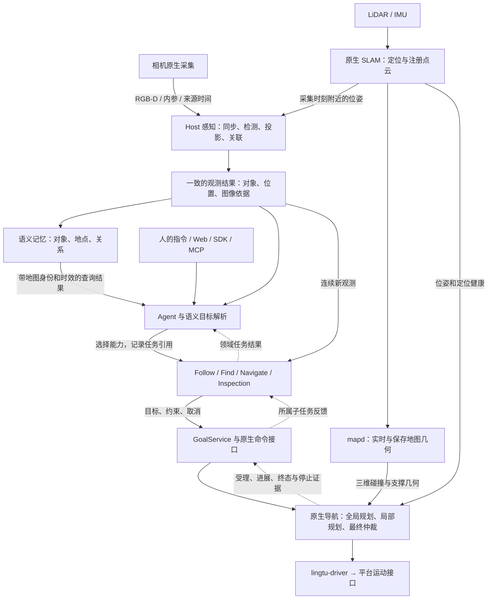

# 从相机到语义任务，再到运动执行

日期：2026-10-16。状态：总体设计；相机来源 → 共同观测已接入 Follow 和找物规划器。
验证范围为本地契约与组件集成，另有 Linux SHM 测试；没有部署或新增实机运动证据。
本设计补充 [架构总览](../architecture.md)，承接 [任务契约](../research/tasks.md)。
实施顺序见 [升级计划](../research/plan.md)。各目录是职责位置，不代表新增进程。

找物规划器现在直接消费 `SemanticObservation`，同一观测绑定图像、对象、地图位姿和
来源代次；相机重启使旧目标查询及视觉回复失效，并请求取消旧接近任务。
临时缺帧会清除视觉确认，但不延长重试预算。Agent 的场景摘要和记忆仍待迁移。

## 1. 先固定系统的分工

相机提供可追溯的观测，感知解释观测，语义层把人的目标交给领域执行者，
原生导航决定如何运动并提供执行事实。结果沿原路返回，而不是发出一次命令就结束。

图中的 Find 是现有语义查找职责，不表示已经新增独立 Find 服务或完整任务 API。
直接点击导航、直接选择人物跟随，也可以直接调用相应领域入口，不强制经过大模型。
浏览器图传从相机输出分支出去；不把浏览器解码的视频再送回机器人作为导航传感器。

### 数据流、任务调用和运行管理分别处理

| 路径 | 承载内容 | 规则 |
| --- | --- | --- |
| 观测数据流 | 图像、深度、位姿、检测和对象 | 有界缓冲，保留原始来源；实时消费者优先处理最新有效观测 |
| 任务调用与反馈 | start/query/cancel、受理回执、阶段和终态 | 明确执行归属；终态事件不能用“只留最新一条”覆盖掉 |
| Product 运行管理 | 进程、配置、就绪、地图激活 | 仍由 ProductControl 根据一次解析的 RunPlan 管理 |

Host 内复用类型消息和已有注册能力；原生进程之间继续使用 DDS。
同机大图像沿用 SHM，Web 图传沿用 WHEP/WebSocket，外部业务入口沿用 HTTP/MCP。
先固定这些路径的含义，再根据测量选择传输，不能用统一协议代替职责设计。

### 部署不等于分层

相机、感知、语义和规划是职责层，不要求分别部署四个服务。现有默认 SHM 路径要求
相机采集和读取者在同一台机器；不能把 Host 地址改到服务器就假定共享内存仍然可读。
首选保留机器人端采集、时间/空间绑定、任务执行和原生运动闭环，按设备能力选择模型后端。

若板端推理不足，可把检测、特征或低频 VLM 请求交给已有远端推理服务：携带观测来源，
结果返回后仍在 Host 按原始深度和固定变换形成三维结果。服务器不取得运动控制权。
本地后端同样可用，不强制依赖服务器；断网时对应模型能力报告不可用，执行者按现有
目标丢失/取消规则处理，原生控制和人工停止不能依赖模型请求返回。
具体进程位置、后端和资源由选定 Product/RunPlan 与 RobotConfig 决定，不能在 Gateway
或 Agent 中偷偷启动另一套模型、相机或导航进程。

## 2. 相机服务：一次采集，多个消费者

设备 SDK 只由相机采集所有者打开。当前原生采集经 camera record 协议进入
`lingtu_camera_dds`，默认写 color/depth/info SHM；Python `DdsCameraModule` 默认读 SHM，
名字中的 DDS 不表示大图像必须通过 Python DDS 传输。具体设备由 RobotConfig 选择。

相机输出的最小契约：

| 内容 | 必须说清楚什么 |
| --- | --- |
| RGB 和 Depth | 尺寸、编码、深度单位、无效深度；属于哪一个采集批次 |
| RGB-D 配准 | 时间配对和深度到彩色像素注册分别报告，不能由尺寸相同推断已配准 |
| 内参 | 对应哪种图像尺寸和光学坐标系；不能把原深度内参用于已对齐彩色的深度图 |
| 时间 | 源时间的含义和时钟域，以及 Host 接收时间；不能将接收时间标成曝光时间 |
| 来源 | 保留每条流的序号和源时间；明确生产者重启代次，不能以某一流序号代替 RGB-D 批次 |
| 标定 | camera → body 的实际变换及其验证状态，来源是选定 RobotConfig |

现状与边界：

- RealSense 路径显式将深度对齐到彩色；RGB、Depth 和内参使用同一批次的主机接收时间。
  这不是已经完成相机与 LiDAR 硬件时间同步的证明。
- Orbbec 适配的时间同步、depth-to-color 配准和所用内参还需要逐项核对；当前代码
  审查没有确认与 RealSense 等价的配准调用，不能仅凭服务启动就声明该契约成立。
- SHM 新生产者启动时生成三流共享的 `source_generation`，各流 `source_sequence` 独立；
  reader 接受新代次的重用序号，并把来源写入 Image/CameraIntrinsics。RGB-D 仍按已有
  配对时间/批次契约组合，不能假定 color sequence 等于 depth sequence。
  `created_timestamp_ns` 保留为 ring 创建时间，不充当进程身份。旧生产者的 generation=0
  没有可证明的重启隔离；完整资格要求更新 producer 与 reader。既有 binary Image 编码
  不携带这些 Host-local 字段，本轮默认 SHM → Host 路径不经过该编码。
- 正常 semantic Host 的启动前检查会拒绝未验证的相机标定；当前 Go2 相机标定仍为
  unverified。运行时应复用检查结果，分别展示“图像新鲜”和“世界三维坐标具备使用条件”。
  此状态只是目标输入资格，最终运动放行始终归原生导航。
- `run_startup_checks=false` 的开发路径不能成为实机运动资格证据。

代码：[原生相机说明](../../src/drivers/real/camera/README.md)、
[RealSense](../../src/drivers/real/camera/impl/realsense/README.md)、
[SHM 适配](../../src/drivers/real/camera/dds_module.py)、
[标定检查](../../src/runtime/utils/calibration_check.py)。

## 3. 感知：让图像、对象和坐标指向同一次观测

已经存在的 `SynchronizedFrame` 配对 RGB-D、内参和附近时刻的位姿，固定
`map_from_body` 与 `map_from_camera`。投影使用这份固定变换，不在推理结束时取最新位姿。
`PerceptionOutcome` 已经聚合场景图、三维检测和机器人位姿。继续以它们为基础，
不让 Agent、Follow 和记忆各自重新同步 RGB-D 或各自再算一遍三维投影。

数学方向明确为：`T(map←camera) = T(map←body) × T(body←camera)`。
深度单位、像素注册、相机内参和光学轴约定都必须与这条变换一致。

对上层交付“一次观测”的共同含义，优先扩展现有结果，而非增加 Frame Service：

- **来源引用**：绑定 `product_session_id`，保留本次图像与各输入的内部来源、序号和时间；
  进程 boot/sequence 留在内部，不能代替外部任务 ID。
- **空间依据**：采集时使用的相机到地图变换、坐标系、活动 `map_id + content_epoch`。
- **感知内容**：检测、可用掩码、来源 detection/track ID、外观证据、三维位置及其有效性。
- **结果性质**：有效正观测、有效负观测、降级或输入不可用；未看到目标不等于相机失效。
- **时效**：源时间、完成时间、当前帧龄及处理状态；对象的最后观测位置不能冒充当前位置。

已增加 runtime 的 `SemanticObservation`，通过 `PerceptionModule.observation` 一次发布，
Follow 已直接消费；decision 不导入 perception 私有实现。原来的图像、位姿、检测和场景图
端口仍给其他消费者使用，来自同一次计算。Agent 和记忆的消费迁移留在后续切片。
地图身份从原生 NavigationState 取得，在同步帧形成时固定，并填入输出 SceneGraph；
处理期间换图或相机重启会立即发布不可用通知，旧推理结果随后丢弃。地图未绑定的观测
仍可显示，但 Follow 不从中形成地图导航目标。缓存淘汰和迟到旧帧只记录诊断，不误停新跟随。
大图像复用只读引用；现有 SHM 到 NumPy 的必要拷贝保留，不能引用会被采集者覆盖的槽位。
稳定的 `target_identity_id` 仍由 Follow/PersonTracker 为锁定目标维护，Perception 不再
建立第二套人物身份状态。相机来源、观测、人物身份、Follow 任务和 Agent run 各有其含义。
切换上下文时，具备可靠身份参考的 Follow 保留参考并重新核验；缺少该依据的 Follow
沿已有生命周期取消，等待用户显式重新选择，不凭复用的检测 ID 自动换人。

### 推理节奏与资源

感知现在使用单 worker、一个待处理完整帧；忙时覆盖中间帧，这是实时策略。
相机、模型、语义任务和控制循环各按自己的节奏运行，不要求逐帧等待 LLM。
人物三帧核验指按采集顺序的有效观测证据；重复同帧和过期结果不能凑成三次确认。

| 模型或算法 | 所有权与用途 |
| --- | --- |
| 检测 / 分割 | 感知产出候选框、标签和可用掩码；模型是否提供分割取决于实际后端 |
| CLIP | 文本与对象外观检索；不能据此断言身份已确认或目标可通行 |
| DINOv3 / 跟踪 | 外观匹配与身份关联；轨迹 ID 可变，人物身份与 Follow 任务 ID 分开 |
| VLM | 对有来源的图像进行描述、歧义消解或身份核验；结果仍需关联原观测 |
| 语言模型 | 理解指令、提出符号目标和调用步骤；不凭空生成可执行三维坐标 |

模型只由实际推理所有者加载，Agent 读取已有观测；本地和远端后端维持同一输入/输出含义。
当前远端 `/observe`、`/embed`、`/chat` 共用推理锁，长 VLM 请求能阻塞检测；仅把队列
限制为最新一帧并不能消除正在执行的阻塞。先拆清检测、特征和长推理的资源预算，
验证短任务不会因长模型请求而过期。是否分进程、分设备或使用模型 API，由测量决定。

代码：[同步帧](../../src/perception/frames.py)、[结果管线](../../src/perception/pipeline.py)、
[感知 Module](../../src/perception/module.py)、[远端客户端](../../src/perception/remote.py)、
[推理服务](../../tools/inference/follow_service.py)。

## 4. 语义理解与任务执行：模型提议，执行者报告事实

这部分保留三个清晰职责：

1. **指令理解**：把“跟着灰衣服的人”“先去会议室再找水瓶”变成动作、目标描述、
   关系和结束条件。能用规则处理的指令不强制调用模型；歧义才请求澄清或追加观测。
2. **场景落地**：通过当前观测和语义记忆，将“会议室”“桌子旁的水瓶”定位到有来源的
   地点或对象。模型选择候选，感知与地图提供实际空间依据。
3. **任务执行**：Agent 保存所属领域任务引用，等待执行结果，再决定下一步；Follow、
   语义查找、原生导航和巡检各自推进自己的执行。

SemanticPlanner 已经承担语义目标解析、查找验证和所属导航，不将它一下子重写成纯解析器。
Agent 负责组合这些能力，不再建立平行的导航或 Follow 状态机。
持续 Follow 从最新观测更新子目标，不需要 LLM 每次批准一次转向。

语义记忆保存对象、地点、关系、时间和来源观测，并绑定地图身份。
旧记忆可以帮助选择去哪里观察；它不能成为当前目标位置、当前人物身份或通路畅通的证明。
Live map、保存地图、碰撞几何和地面支撑继续归原生 map/nav 所有。

当前 VectorMemory 已检查同时间的场景/位姿及有效地图绑定；SemanticMapper、Episodic
和 Temporal 仍有取最新位姿、墙钟或使用共享保存位置的路径，尚未统一隔离地图上下文。
迁移时复用共同观测，并按 `map_id + content_epoch` 组织空间记录。历史文字可用于线索，
但不能将另一地图的坐标用于导航；不因此合并成新的统一地图数据库。

任务边界沿用 [现有 Follow 契约](../research/tasks.md)：
Agent `run_id` 关联 `kind + product_session_id + 领域任务 ID`；记录实际受理结果。
调用方区分受理、执行阶段、业务结果和停止证据；取消只针对自己的任务，旧回调不能作用于新任务。
Host 重启不自动重放运动。暂停/恢复只由真正支持的领域提供。

### Product 装配是能力的一部分

当前 `tracking` 声明了相机、感知、Follow 和原生导航，但没有完整 Agent/SemanticPlanner
组合，且明确禁止 SemanticPlannerModule。配置一个 LLM 型号不代表 Agent 已接通。
`inspection` 已声明 semantic_planning，可作为优先验证 Agent 与领域任务组合的装配入口。
但 Agent/SemanticPlanner 当前通过可选导入加入，且不在 inspection 的 critical_modules 中；
Product ready 不能单独证明两者就绪。验收必须显式确认这两个 Module 已装配且 ready。

本期先用现有装配验证；如产品要求在 tracking 内直接使用 Agent，再明确调整 capability
与禁止项并验证依赖。不能由 Gateway 临时创建缺失模块，也不让所有带相机的 Product
自动加载语义任务系统。导航的机器安全门控始终保留。

代码：[Agent](../../src/decision/modules/agent_planner.py)、
[语义执行](../../src/decision/modules/semantic_planner.py)、
[Follow](../../src/decision/modules/visual_servo.py)、
[对象记忆](../../src/memory/modules/vector.py)、
[语义地图记忆](../../src/memory/modules/semantic.py)、
[tracking 声明](../../config/system/products/tracking.yaml)、
[inspection 声明](../../config/system/products/inspection.yaml)。

## 5. 运动规划：独立接收目标，独立判断执行条件

原生几何链始终独立存在：LiDAR/IMU → SLAM → mapd → 导航。
相机语义帮助选择目标，不能替代三维碰撞、地面支撑、未知空间和机器人运动约束。

领域执行者向 GoalService 提交带身份的目标/取消，原生命令接口负责送达 navd。
navd 内部直接调用全局规划、局部规划、跟踪和安全逻辑，不把每个算法拆成网络服务。
任务 ACK 只确认受理；定位、输入新鲜度、运动控制权和驱动条件仍会影响实际执行。

全局规划负责到目标的路线；局部规划根据实时几何生成可执行轨迹；最终仲裁决定输出。
当前 inspection 默认 OctoPlanner3D + SCAN，tracking 默认 CMU 并声明 SCAN 可选。
这属于已有配置差异，本设计不悄悄切换算法；统一的是三维目标、几何和任务反馈契约。
`tick_hz=100` 是配置，Follow 默认 2.5 Hz 是目标更新设置，两者都不等于已测得实机频率。

只有 lingtu-driver 转发经过检查的运动命令。自动任务取消与全局急停分开；
人工接管由原生控制权处理，Agent 不能通过不断重发目标争夺控制。

反馈继续使用 `NavigationGoalStatus` 和已有原生状态：GoalService 负责账本与事件顺序，
领域执行者按所属子任务消费；Agent 和网页查询这些事实。
停止屏障按平台配置核对终端零输出、驱动确认及需要的里程计证据，不能把任意任务的
CONFIRMED 或一次取消 ACK 展示成本任务已经实测停稳。

代码：[GoalService](../../src/nav/services/goals.py)、[导航所有权](../../src/nav/README.md)、
[原生导航](../../src/nav/cpp/README.md)、[驱动](../../src/drivers/real/README.md)。

## 6. 用具体失败来检查交接是否完整

| 场景 | 应有的行为 |
| --- | --- |
| 有 RGB，深度无效或外参未验证 | 区分可看图与合格三维目标；不使用默认深度或借用另一机型外参发布目标 |
| 推理期间机器人移动 | 三维结果使用原帧固定的变换；结果过期时不再用于新运动目标 |
| RGB/Depth 时间接近但未注册 | 不把同尺寸像素视为对应点；报告配准契约未满足 |
| 长 VLM 请求占住推理资源 | 相机和原生控制继续运行；视觉输入过期触发既有取消/保持路径 |
| 人离开视野后返回 | 复用多视角和三次有效观测核验；未经确认不换人，旧位置不伪装为实时位置 |
| 地图或 Product 切换 | 清除当前空间上下文；新目标匹配当前地图和运行，旧任务仍保留真实历史 |
| 定位 DEGRADED / 人工接管 | 原生导航保持或拒绝运动；语义层显示原因，不靠无限重试伪造进度 |
| 取消 A 后启动 B，A 的事件迟到 | 只更新 A 的所属记录；没有 B 的引用就不能取消 B |

## 7. 小步实施与证据

1. **先确认观测契约**：复用 SynchronizedFrame/PerceptionOutcome，保留来源与固定变换；
   明确各相机时间/配准语义，把现有标定检查结果用于能力呈现。一次发布共同观测，先迁移
   Follow，再迁移其他消费者及记忆的地图分区。先做本地错配、迟到、地图切换和重连测试。
2. **再接 Agent 任务归属**：沿用 Follow start/query/cancel，记录和等待实际任务引用；
   在实际装配 Agent 的 Product 上验收，不能用模块单测代替 Product 验收。
3. **形成可看的产品闭环**：跟人场景展示身份、三维位置、路径、运动与取消；
   找水瓶场景展示候选、来源图像、接近过程和最终复核。语义正确和运动可执行分别记录。
4. **补目标平台证据**：原生仿真、实机静止标定/输入检查、受监督运动分别过关；
   模型服务失联、目标丢失和取消都必须出现在相应平台的记录中。

性能记录至少分开：采集/接收、同步等待、预处理、检测/分割、特征、VLM、发布与目标受理。
同时记录结果帧龄、排队与覆盖数，不能只报 FPS 或模型内核耗时。
本阶段不新建通用任务总线、统一地图数据库或全量事件存储；需要回放时使用现有录制
与领域任务记录，把观测引用关联进去。该关联先服务上述两个场景，再决定是否扩展。
