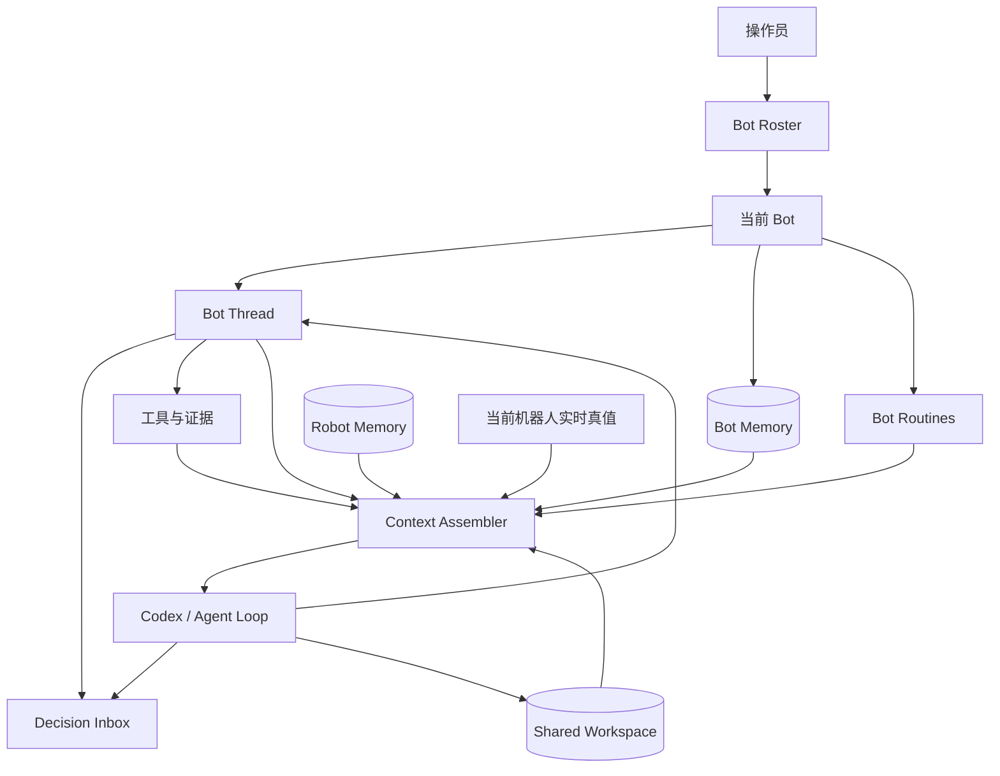

# LingTu Bot roster 与长期上下文

## 参考结论

OpenGrokBot 的产品单位是一个有名字和职责的 Bot，而不是一条聊天记录。侧栏展示 Bot roster；每个 Bot 有自己的 thread、记忆和 routines；Bot 之间通过共享 workspace 交接文件和结果。需要用户决定的动作进入审批，而不是混在普通回复里。

参考：[OpenGrokBot](https://github.com/nickylin/OpenGrokBot)。它的公开说明包括 named roster、per-Bot `MEMORY.md`、shared workspace、scheduled routines、routine run history、group thread 和 handoff。

## LingTu 的目标模型

`Bot Memory` 记录 Bot 自己的身份、偏好、流程和工作上下文；`Robot Memory` 记录地图、空间、任务、巡检和设备历史。`S` 的实时真值优先级高于两类历史记忆。

| 对象 | 作用域 | 内容 |
| --- | --- | --- |
| BotProfile | 一个 Bot | 名称、形象、角色、能力和记忆策略 |
| BotThread | Bot × 任务 | 用户消息、工具回执、审批、分享快照 |
| BotMemory | Bot / workspace / operator | 已确认的偏好、空间事实、情节、流程和工作上下文 |
| BotRoutine | 一个 Bot | 触发器、提示词、审批策略、最近运行结果 |
| Workspace | 机器人团队或项目 | 地图、文件、记录、连接器和共享结果 |
| DecisionInbox | 当前操作者 | 待确认的动作和表单，确认只覆盖本次动作 |

## 上下文组装顺序

每一轮 Bot 请求按以下顺序拼接上下文：

1. 当前用户消息和明确引用；
2. 当前 Thread 的短期上下文；
3. `working` memory（有 TTL）；
4. 当前 Bot 的 `operator`、`procedural`、`episodic` memory；
5. 当前 Workspace 的相关 `spatial` 和文件索引；
6. 当前传感器、地图和导航实时状态；
7. 工具权限、审批状态和本轮预算。

记忆只提供线索和历史来源，不能替代当前传感器真值、地图版本或运动权限。跨 Bot 共享应通过 Workspace 或显式 handoff，不能默认把每个 Bot 的私有记忆全部注入。

## 对当前实现的映射

- `BotProfile` 和 `BotStudio` 已经提供单 Bot 的名称、形象和角色入口；下一步需要把它扩展为 roster。
- `ConversationStore.robot_memories` 已经提供五层记忆、来源、置信度、TTL 和遗忘；下一步增加 `bot_id`、`workspace_id` 和 memory visibility。
- `AgentConversation` 已经提供 Thread、审批、工具时间线、分享和决策收件箱。
- `InspectionCalendar` 已经提供部分定时计划；下一步让 routine 明确归属一个 Bot，并记录每次运行。
- 地图、传感器和巡检证据属于 Workspace / runtime truth，不应写进 Bot 私有偏好记忆。

## 第一阶段落地顺序

1. 先把当前机器人记忆表增加 `bot_id` 和 `scope`，旧数据迁移到默认 Bot；
2. 将侧栏从“历史会话”提升为 Bot roster，打开 Bot 后再显示该 Bot 的 Thread；
3. 将 routines 绑定到 Bot，并把运行记录渲染为工具结果卡；
4. 增加显式 handoff：只把用户选择的摘要、文件和证据送入另一个 Bot；
5. 最后再接跨应用 Connector 和完整 Computer Use。

这样长期上下文会逐渐沉淀在 Bot 和 Workspace 上，而不是继续堆在一条无限增长的聊天记录里。
