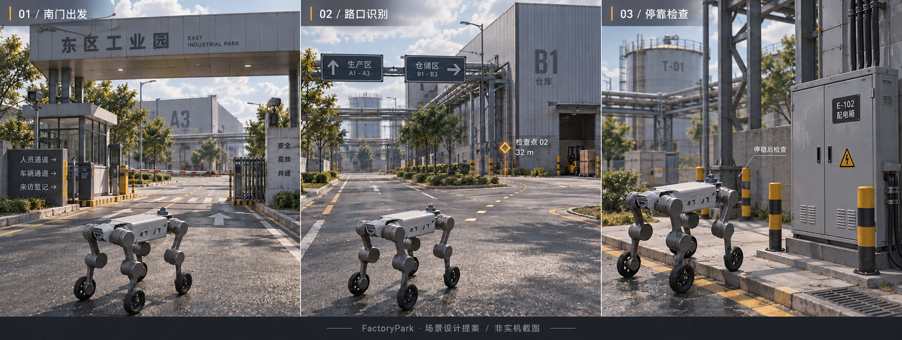

# FactoryPark 场景设计

日期：2026-10-15。状态：**设计与制作简报，不是已实现或已验收的关卡。**

2026-10-16 接线进展见 [巡检场景运行接线](inspection-integration.md)：目标与任务控制正在接入，材质生成代码已支持烘焙法线/粗糙度并通过 UE 隔离导入。下文“当前事实”保留 10 月 15 日设计基线，不能据此判断最新源码；正式地图及完整自主巡检尚未验收。

目标：沿用现有机器狗和 FactoryPark，把一段道路做成可辨认、可驾驶、可观察、可恢复的巡检体验。先打磨南门到装卸区这一段，不扩地图，不用堆模型数量代替真实感。

## 1. 当前事实与缺口

- 场地为 220 × 180 m，现有南门净宽 18 m、入口大道 12 m、环路 10 m、装卸前场 8 m。数据来自 `sim/tools/worlds/factory_park_hf/README.md` 和同源 `generated/expanded-layout.json`。
- 当前世界包 `factory_park_hf@1.2.1` 引用实例化地图 `/Game/RobotSim/Generated/FactoryParkHF/Maps/FactoryPark_HF_Instanced_9d314c86ef83ea06`。
- 美术源地图由 `build_factory_park_hf.py` 生成，实例化地图由 `compile_factory_park_visual_instances.py` 投影。二者不是可以随意互换的版本号；修改源后必须核对实际消费地图，不能只改包内 level 字符串。
- 当前原生主材质连接底色、金属度、单一粗糙度、高光；没有法线输出或纹理采样路径。配方中的 normal、磨损、污渍声明不等于这些细节已进入 UE 材质。`normal_strength` 数据存在也不等于着色器使用它。
- 已有驾驶 HUD、速度读取、任务进度投影及相机操作基础。世界空间目标、完整路径投影与到点交互仍需接线；本简报不宣称它们已实现。
- 有机器人、行人、叉车的路线声明，不代表动态角色已经在同一会话参与碰撞。

## 2. 美术方向：有使用痕迹的工业园

视觉中心是机器人、可行驶道路和当前检查对象。采用中性日光、可读的阴影、克制的工业标识，不做霓虹控制台，也不把整条路变成湿镜面。

| 层级 | 重点 | 不做什么 |
| --- | --- | --- |
| 近景 0–15 m | 沥青颗粒、接缝、轮胎橡胶、设备涂层、接触阴影 | 满地高反射水洼、密集独立小 Actor |
| 中景 15–60 m | 厂房编号、门洞、装卸雨棚、管廊轮廓、路口标识 | 每栋楼同样的颜色和细节密度 |
| 远景 60 m 以外 | 罐体与屋顶地标、降低对比的轮廓 | 与近景争夺注意力的高频纹理和特效 |

距离是制作分区，不是硬编码剔除距离。实际剔除、LOD、Nanite 与阴影设置依据目标机器实测。

地面细节分三种尺度：整段道路的色差与修补、中尺度接缝和轮迹、小尺度颗粒法线。不得用一张高频噪声覆盖所有材质。涂漆表面以非金属涂层为主，裸露金属仅用于确有露底的区域。

## 3. 空间节奏与检查点

**出发看清方向 → 路口作出选择 → 接近后减速观察 → 停稳采集 → 复核或继续。**

以下位置是已有语义检查点的参考坐标，单位 m、MuJoCo 右手 Z-up。它们不是已验证停靠位姿，也不是可以直接送给控制器的路径。

| 段落 | 已有地点/尺度 | 驾驶与观察目的 | 设计处理 | 恢复方式 |
| --- | --- | --- | --- | --- |
| 出发 | `checkpoint_gate`，(0, -76, 0)；入口大道 12 m | 熟悉驾驶、相机和目标方向；观察门岗标识 | 门岗与雨棚框景，远处厂房形成第一地标；保留现有出生净空 | 停止后原地调整镜头；不自动开始运动 |
| 识路 | 入口大道至中央路口；沿已有道路 | 在驶入路口前辨认转向，不临到目标才急转 | 建筑编号和路边导向牌提前可见；HUD 只提示下一目标 | 路径不可用时收起旧线；由导航重规划或人工接管 |
| 装卸区检查 | `checkpoint_warehouse`，(50, 7, 0)；前场 8 m | 观察阴影下的设备/标识，验证相机视角与停车空间 | 细节集中在目标设备与前场；不把托盘、护柱摆进现有通行带 | 未停稳或证据不合格则保留当前点，允许重新停靠/重拍 |
| 罐区检查 | `checkpoint_tank_farm`，(88, -36, 0) | 从安全可达位置观察管线与阀件；不能把围堰当成可穿越面 | 以罐体和管廊作终段地标；观察位置需现场几何复核 | 不可达则明确受阻，不用 UE 传送或穿墙完成任务 |
| 收尾 | 原生任务终态与证据复核 | 分开说明路线执行与证据接受 | 简短结果页；缺失证据显示待复核，不显示全通过 | 重检或新任务沿已有任务合同执行 |

第一批只制作出发、识路、装卸区的视觉切片。完整巡检验收至少包含南门、装卸区、罐区三个观察条件不同的点。碎石区先作为可选分支，不作为新手必经路段。

路线是有序目的地；执行路径由导航生成。不得把检查点用直线连接后称为可通行路线，也不得直接把叉车/行人示意线当机器人路径。

## 4. 尺度与停靠约束

- 保留当前世界道路、护柱、围堰、坡道和减速带的物理尺寸。纯美术批次不改 MuJoCo 几何。
- 现有配方的 1.2 m 最小通道、1.4 m 围堰通道是环境设计值，不是机器狗已验证的通行能力。
- 最终停靠位姿要用当前机器人包的包络、转弯/制动实测和实际相机外参复核。现阶段不冻结未经测量的制动距离、坡度能力或最小回转半径。
- 观察目标必须落入实际相机视场，文字/特征大小按输出图像检查；不能以第三人称镜头看得见替代机器人相机看得见。
- 需要新增有碰撞的设备或护柱时，经同源实体图 → MuJoCo/UE 两侧导出。视觉装饰不得占据机器人需要经过的空间，亦不得被宣传为已参加 LiDAR/深度几何验证。

## 5. 驾驶 HUD 与场景协作

- 左侧只给当前目标、当前阶段、已验证进度。靠近检查点再展开操作解释。
- 上方方向尺来自同代位姿和目标；世界目标被遮挡或离屏时，用受控边缘提示，不把标记直接画穿设备。
- 地面引导为短段、细线、低亮度，保留真实路面可见性；失效即隐藏。建议引导不宣称已验证可通行。
- 路口与目标设备自身提供编号和标识，关闭 HUD 后仍能通过地标辨认区域。
- `W/S/A/D/Q/E` 与既有自定义键位保持不变；不把 E 又绑定成检查。相机滚轮、右键、C/中键仍沿已有输入合同。
- 到点、停稳、采集、验证、接受分别显示；UE overlap、视觉靠近或命令 ACK 都不能自行完成巡检点。

## 6. 权威与数据流

| 内容 | 权威/所有者 | 场景与 UE 的职责 |
| --- | --- | --- |
| 世界实体、碰撞与高程 | 同源 WorldPackage + MuJoCo | 投影同一实体与变换，不另开 Chaos 物理 |
| 位姿、速度、接触、仿真时间 | Physics Runtime | 读取不可变快照；跟随相机只改变观看方式 |
| 检查点顺序、到达、执行终态 | 原生 inspection executor | 展示投影，不新增 UE 任务状态机 |
| 规划、避障与运动许可 | 原生导航与安全链 | 路线展示和输入意图，不批准通行 |
| 证据及接受结果 | 既有证据/复核合同 | 显示新鲜度、缺失、待复核与结果 |
| 材质、标识、光照和镜头 | UE 离线美术生成与呈现 | 不推断物理或任务事实 |

延用现有 C++ 状态投影、Slate HUD、Visual Subsystem 和 Editor Python 生成脚本，不新建 GameMode、任务协调器或另一套包解析器。设计师可编辑的标识/镜头可后续用 Blueprint 表现，但它们不拥有任务真值。

实际任务运行仍需冻结 `map_id + content_epoch + route_revision`；现有世界检查点不是一份已经发布的巡检路线。实际 RGB 证据的质量阈值和停稳位姿尚待绑定，不能从此设计文档生成默认验收结论。

## 7. 制作顺序与验收

| 批次 | 最小交付 | 验收看什么 |
| --- | --- | --- |
| A：单段材质 lookdev | 一块道路、一段路缘、一台设备和机器狗的同光照样片 | 底色/法线/粗糙度真实进入材质；近看不平，远看不闪；高光不过曝 |
| B：场景投影 | 源地图与实际实例化运行地图中同一段更新 | 两侧内容对应；静态视觉 NoCollision；不重建成大量独立 Actor |
| C：驾驶体验 | 南门至装卸区的一次真实驾驶与停车 | 不靠 Shift；镜头不被装饰遮住；转弯、停车与碰撞来自同会话 MuJoCo |
| D：任务闭环 | 三点巡检、证据复核、终态、重试 | 不用动画或 HUD 制造完成；缺证据不显示已接受 |

画面和性能同时看：维持当前 1920×1080 视口与 640×480@30 Hz RGB/depth 配置，不通过降低传感器配置掩盖美术开销。先录目标段的帧时间和传感器实际频率，再决定细节密度；这些是后续验收目标，不是本轮已测结果。

必须覆盖：正常执行、证据缺失/无效、定位或传感器失效、状态过期、受阻后恢复、暂停/取消/人工接管、地图修订不匹配、原生重启对账，以及三次干净重试。执行成功与证据接受分别报告。

本轮不运行 UE/Blender/MuJoCo，不生成新物理地图，不改变包版本或已验证场景。当前交付限于源码核对、此制作简报与概念图；材质落地、运行截图和驾驶验证仍未完成。

## 8. 视觉参考与边界

配套图：`assets/factory-park-scene-concept-20261015.png`。由内置图像生成工具产生，使用前一版机器狗 HUD 概念作为参考。图中建筑构图、标识、设备和光照是设计意图，不是 1:1 复刻当前世界几何，也不是可直接导入的三维资产。

生成提示摘要：同一工业园的南门出发、路口识别、停靠检查三段；保留现有轮足机器狗外形；中性日光与可读阴影；干燥为主的分层道路材质；稀疏低亮度引导；无武器、无动态交通、无虚构遥测。

最后一轮编辑提示：仅把中间图的厚亮色块路线改成较窄、低亮度、无泛光的短段白/琥珀色断续引导，保留目标标记、三段构图、机器狗、标识和“非实机截图”声明。生成图不保证逐像素保持，材质细节仍以实际 UE 样片为准。

暂不包含：动态行人/车辆完成声明、自动充电、热成像诊断、资产自动晋升、Tripo 付费生成、天气物理、成品发行资格。
