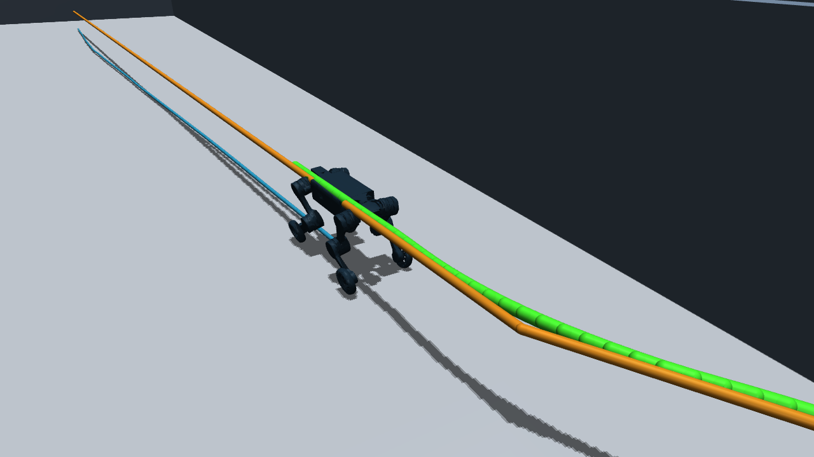

# Thunder 约 30 m 导航录像

[播放完整录像](thunder-30m-navigation.mp4)

本段为本机 Windows MuJoCo 原生组件仿真，使用 OctoPlanner3D 全局规划、SCAN 局部规划和 Thunder CTS v39 策略。定位输入采用 MuJoCo 真值位姿。机器人在连续地面仓库中绕过墙端，实际 XY 路程 **29.738 m**，完成原生到达与终止停车验收。

| 录像与运行 | 记录 |
| --- | --- |
| 视频 | 30.05 s，1280 × 720，20 fps，H.264 |
| 源运行 | `artifacts/nav/speed-tracking-20261108/runs/u_turn-formal` |
| 原始 driving 时序 | sim 2.84 → 32.83 s，共 1501 条记录 |
| 完整 driving 跨度 | 29.99 s |
| 有效轨迹跟踪统计窗口 | 29.32 s |
| SCAN 前进上限 | 1.2 m/s |
| 规划与路径跟踪加速度 | 0.75 m/s² |
| SCAN 位置增益 | 1.5 |
| 最终 XY 目标误差 | 10.19 cm |
| XY 跟踪 RMSE | 6.31 cm |
| XY 跟踪 P95 / 最大误差 | 12.15 / 18.44 cm |
| 输入就绪比例 | 100% |
| 非支撑接触 | 0 步，观测 6368 个物理步 |
| 原生目标到达 / 终止停车 | 通过 / 通过 |
| 组件验收 | 通过，阻塞项为空 |

录像依据已保存 qpos 离线回放，follow 相机保留完整 driving 时间轴和其中的停顿。20 fps 重采样包含末帧保持，因此编码时长略长于原始首末时间跨度。两者与有效 tracking 统计窗口分别记录在 `run.json`。预览图直接取自同轮录像中帧。

本机组件仿真与真值定位尚不能证明实机运动、NX 性能或 LTLIO 定位表现。较长的同仓库 `long_s-formal` 路线虽触发目标到达，完整组件验收仍因控制循环峰值超时失败，具体条目为 `navigation_loop_overrun_peak_above_threshold`。本段视频的成功范围应按该次 U 弯运行理解。

`run.json` 摘录原始 report、sensor report、render report 和任务相关参数，来源均使用仓库相对路径。后续提交 GitHub 时可以直接保留本目录的四个文件。
