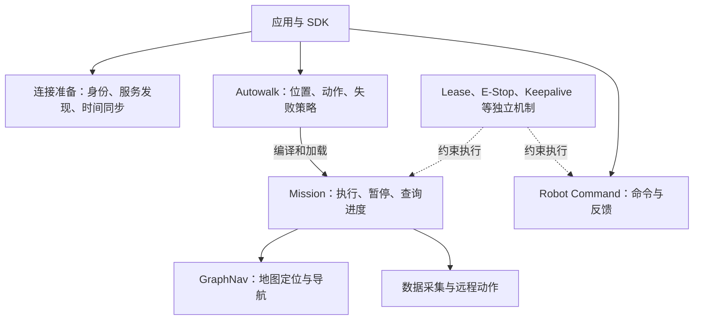
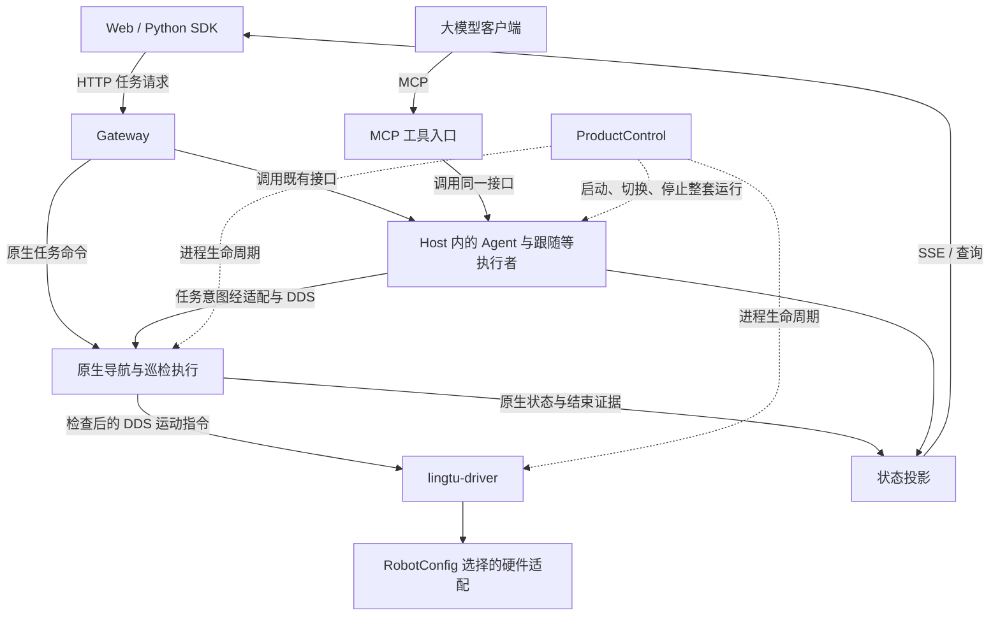

# Spot 公开架构与 LingTu 调整方案

核对日期：2026-10-13。本文是官方接口研究与设计提案，不是新版本部署记录。
本轮不连接机器人、不修改运行协议，也不把本地接口测试记为实机能力。
当前系统约束仍以 [Architecture](../architecture.md)、[Runtime](../runtime.md)
和 [AGENTS.md](../../AGENTS.md) 为准。

结论：借鉴 Spot 的服务契约、控制权、命令时效和任务反馈；保留 LingTu 的
ProductControl、Host、原生 3D 导航和 DDS。先补完整的跟随任务，再关联自然语言
执行、统一客户端行为，最后通过实测决定是否局部引入 gRPC。

具体的共享接口职责、任务描述与执行实例分工，见 [LingTu 任务接口设计](tasks.md)。
本文保留官方依据和逐项对照；该提案负责约束后续实现，两者都不代表已完成部署。

## 1. 协议栈与机器人架构是两个问题

Spot 的公开网络文档描述了以下协议关系。Protobuf 定义消息，gRPC 定义远程调用，
HTTP/2 承载请求流，TLS/TCP/IP 提供连接和传输。这不揭示机器人的内部控制总线。

```text
业务：创建任务、下发命令、查询反馈
                     ↓
gRPC 服务方法 + Protobuf 消息
                     ↓
HTTP/2 → TLS → TCP → IP → 有线 / 无线网络
```

HTTP/2 的多路复用不等于无线网络下的实时截止保证；官方也讨论了 TCP 在不稳定
网络中的局限。换协议不自动解决推理排队、重复编码、过时数据或停止确认。[S1]

“波士顿动力全部使用 gRPC”不准确：Spot 的大多数公开机器人 API 使用 gRPC；
Spot CAM 的实时音视频有 WebRTC 通路；Orbit 提供 HTTPS 资源接口。[网络][S1]、[媒体][S11]、[Orbit][S12]
这里的服务是公开的逻辑职责，不应直接画成独立进程、独立计算机或内部微服务。

## 2. Spot 公开接口呈现的职责分工

以下是依据公开契约绘制的逻辑关系，不是 Spot 私有软件的部署图。



| 公开职责 | 官方提供的含义 | 对 LingTu 的具体启发 |
| --- | --- | --- |
| RobotId / Directory | 识别机器人，发现已注册服务及其接口类型 | 沿用 RobotConfig、RunPlan、Registry 与已有 capabilities；不再增加服务发现进程 |
| Auth | 确认调用者可访问服务 | 与运动控制权分开理解；本研究不改变本项目现有访问策略 |
| Lease | 资源的当前控制者，保留、转交、撤销控制权 | 复用当前原生控制权、会话和单写入者约束；入口受理不能替代原生放行 |
| TimeSync | 估计客户端与 Robot Time 的偏差 | 明确采集、接收、有效期属于哪个时钟；耗时使用本地单调时钟 |
| Robot Command / Feedback | 提交命令，随后查询该命令的执行反馈 | 请求回执、业务结果、运动观测分别报告 |
| GraphNav | 地图工件、定位、导航命令和反馈 | 保留 mapd、SLAM、原生导航的现有所有权及 3D 几何约束 |
| Autowalk / Mission | 可编辑任务描述，以及编译后的执行与状态 | 复用现有巡检和任务执行者，补跟随生命周期；不复制一套通用行为树引擎 |
| Data Acquisition / RemoteMission | 采集数据或调用外部动作，再查询完成状态 | 将图片、观测、模型结论关联到任务步骤；外部模型可用性属于该步骤的运行条件 |

身份、发现、时间与资源控制的依据为 [Base Services][S2]、[Lease][S3]；命令反馈见 [S4]；
导航和任务见 [Autowalk][S5]、[GraphNav][S6]、[Mission][S7]；外部动作见 [S8]。
Directory 的 `authority` 是服务路由标识，不能与运动控制权混为一谈。[S2]

## 3. 比统一通信协议更重要的契约

### 3.1 一次请求有三种不同结果

```text
传输成功：对端收到了请求并返回响应
受理成功：请求通过当前业务检查，得到请求/命令标识
执行结果：任务到达、失败、取消，及对应的运动停止证据
```

Spot 的导航请求返回后，执行会继续，通过 command ID 查询 NavigationFeedback。
Mission 的播放请求也要结合 GetState 理解结果。这些语义使“收到回执”和“完成任务”
可以分开处理。[Robot Services][S4]、[GraphNav][S6]、[Mission][S7]、[消息协议][S15]

LingTu 已有相同方向：导航任务、巡检任务、地图操作、Product 切换分别有自己的
回执和结果。继续由各自执行者给出事实，Gateway 和客户端不根据 HTTP 200、进程存活
或画面中有人来推断运动完成。

### 3.2 控制权、命令新鲜度与停止策略分别存在

Lease 表示当前资源控制者；时间同步使命令有效期可比较；E-Stop、Keepalive 和
AutoReturn 有各自的行为。Lease 续约不是命令完成证明，也不能把所有心跳失联都解释
成同一种停止动作。[Base Services][S2]、[Lease][S3]、[E-Stop][S9]、[Keepalive][S10]、[AutoReturn][S13]

LingTu 保留现有的导航仲裁、运动命令时效、驱动单写入者和停止反馈。浏览器的控制
租约只约束入口；最终运动仍由原生导航和驱动批准。本轮不引入另一套租约、认证或
通用失联策略。断开一个 HTTP/gRPC 查询连接也不等于向机器人发送取消任务。

### 3.3 机器人本地执行不等于任何失联下都继续

Autowalk 文档描述 Mission 可在机器人上持续执行。必须同时考虑 Mission 的
`pause_time`、控制权及已配置的安全策略；存在远程动作时还依赖那个动作服务。
不能从“客户端不用逐步发送指令”推导出“断网后任务一定继续完成”。[Autowalk][S5]、[播放协议][S15]、[远程动作][S8]

LingTu 的断线含义应按连接分别解释：

| 事件 | 设计要求 |
| --- | --- |
| 页面状态连接断开，执行者和原生运行仍健康 | 不把 UI 断线伪装成任务完成；重连查询同一任务；若该客户端持有运动租约，仍按现有租约策略处理 |
| 远程视觉服务失联 | 跟随观测会过期，复用已有停止路径；不能继续按旧人物位置刷新运动目标 |
| Host / Product 重启 | 旧任务不能自动重新发运动目标；旧执行结果未确认时标为中断或未知，不能恢复一个看似仍在跟随的状态 |
| 遥控输入停止更新 | 继续由原生输入时效与控制权规则决定停止，不等待 UI 给出结果 |

这些是 LingTu 的拟定行为边界，并非已经新增并验收的恢复功能。阶段一仅保证当前
运行中的查询与重连；跨 Host 重启的历史查询和自动恢复不属于第一批承诺。

### 3.4 图像、坐标和时间属于同一份观测

Spot 的传感数据使用坐标系名称和采集时的变换树快照。它为观测位置提供时间与
几何上下文。[S14] LingTu 的人物三维投影同样需要成对 RGB-D、内参、外参和匹配
采集时刻的位姿。晚到的推理结果必须仍指向原图像，不能和“最新机器人位姿”随意
组合。协议换成二进制也不能修复坐标或时间错误。

这个原则不代表本项目外参已标定或深度遮挡已解决；当前实际缺口继续记录在
[人物跟随实验](person-follow.md)。

### 3.5 地图工件、运行地图与动作证据分别管理

GraphNav 公开地图由 waypoint、edge 及传感快照构成；上传地图、初始化定位、下发
导航是不同操作。这并不公开它的 SLAM 或局部规划实现。[S6]、[S16]
LingTu 继续用现有地图身份与保存操作，mapd 管理地图，SLAM 提供定位，导航以 3D
几何和可执行约束判断运动。地图图结构只能按实际需求提供检索或路由信息，不能替代
现有碰撞、地面支撑和跨高度判断。

Spot 数据采集也有发起、状态查询与取消；“已提交采集”不等于数据已完成保存。[S15]
LingTu 已有巡检证据和报告，应复用它们关联任务、观测与结果，而不是把一条模型回复
当成整个业务任务的完成证据。

## 4. LingTu 的目标结构：保留执行者，收敛调用方式



上图表示职责与消息方向，不表示 Gateway 直接导入 nav、decision 或 driver 包。
Host 内通过现有 Module 接口、类型消息和注册机制连接；跨进程沿用原生 DDS。
巡检的执行者已经在原生侧，不能为了统一接口再搬到 Python。

| 连接 | 本轮设计决定 |
| --- | --- |
| 业务提交、查询、地图工件 | 保留 Gateway HTTP/JSON 与 OpenAPI |
| Web 任务状态 | 保留 SSE；重连读取快照或已知任务结果 |
| 相机、点云、遥控 | 沿用现有 WebRTC / WebSocket 通道与有界缓冲，不混入任务结果流 |
| MCP | 调用同一执行者，不复制另一套任务状态机 |
| 原生服务与驱动 | 保留 DDS IDL、时效检查与最终运动所有权 |
| 同进程调用 | 使用普通调用或 Module 消息，不增加网络服务 |
| 独立视觉计算服务器 | 当前 HTTP 保留；阶段四才比较连接复用、二进制负载和 gRPC |
| Product 生命周期 | 继续使用 ProductControl；本机 5051 转发通道不成为通用任务执行器 |

当前代码依据：

- [产品声明与过程边界](../getting-started.md)、[ProductControl](../../src/lingtu/README.md)。
- [外部请求与实时通道](../../src/gateway/README.md)、[请求/返回类型](../../src/gateway/schemas.py)。
- [DDS 消息定义](../../src/message/README.md)、[原生驱动](../../src/drivers/real/motion/README.md)。
- [视觉服务器](../../tools/inference/follow_service.py)和[远程客户端](../../src/perception/remote.py)。

## 5. 按四个可验收阶段推进

### 阶段一：跟随任务的开始、查询与取消

2026-10-13 更新：这一阶段的本地实现已完成。`POST /api/v1/visual_servo`
调用 VisualServo 的任务受理方法，返回 Follow 与 Product session 的稳定引用。
查询、按引用取消、导航子任务归属及强类型原生终态已接通；Web/MCP 使用同一所有者。
细节与验证边界见 [已落地的 Follow 边界](tasks.md#已落地的-follow-边界)。
以下为实现遵循的职责约束，不表示仿真或实机验收已经通过。

首个验收入口采用已有的 [tracking Product](../getting-started.md)：
它已经声明相机、感知、VisualServo、保存地图定位、原生导航和驱动。
普通 `nav`/`nav:camera` 不因“有相机”就自动具备跟随能力；本阶段不扩大这些 Product。
Product 配置存在也不代表模型、外参或现场输入已满足运行条件。

拟议的最小范围：

1. 由 VisualServo 创建和维护稳定的跟随任务标识。刷新内部导航目标不改变这个标识。
   保存它与人物身份、当前原生导航任务的关联，不把这些 ID 合并。
2. 在现有视觉命令边界保留 `request_id`、`client_id`，返回执行者确认的跟随标识。
   重复调用沿用已有 CommandJournal；不宣称它跨进程重启仍可去重。
3. 增加按跟随标识查询和取消的接口，网页与 MCP 调用同一执行者。
   第一批不承诺暂停/恢复；没有实现的能力不出现在可用操作中。
4. 取消只针对该跟随任务拥有的导航目标。若有运动需要取消，等待关联的原生结束
   和停止证据；其他任务留下的 `CONFIRMED` 不能作为本任务停稳证明。
   若尚未发出导航目标，可以结束选人任务，但不凭此宣布整机已停稳。
5. 保留 `goal_status` 的请求回执，补接已有的类型化流
   `nav.goals.task_status -> VisualServoModule.navigation_goal_status`。
   `NavigationGoalStatus` 保留 `task_id`、`request_id`、`boot_id` 和 `sequence`。
   `boot_id`/`sequence` 只用于内部事件关联，Product 身份仍是 `product_session_id`。
   对已接受子任务的取消，只有所有归属子任务的匹配终态到达，
   且异步识别不能再发新目标，才结束跟随任务。不能让 decision 导入 Gateway 的投影。

原生导航的相关 Goal 终态通过 `MotionStopBarrier` 后才提交。因此应消费这份领域
证据，而非复制页面对全局导航状态的判断。需区分“按配置完成原生停止确认”和
“实测整机物理沉降”：停止证据策略可涉及驱动 ACK 和静止里程计，不能仅凭一个
终态布尔值泛化为任何平台、任何姿态下都已物理停稳。任务字段应表达原生停止证据，
机体运动观测单独保留。依据见[终态事务](../../src/nav/cpp/endpoint/nav/status/goal_terminal_transaction.cpp)
与[停止证据投影](../../src/nav/cpp/endpoint/nav/status/nav_status_writer.cpp)。

Host 重启时，[GoalService](../../src/nav/services/goals.py) 会恢复当前 Product session
中尚未终止的视觉子任务集合。由于人物参考和 Follow 所有者已丢失，当前实现把这些
子任务交给现有按 ID 取消接口收敛，并等待原生结果；不得只禁止新目标却遗留旧目标，
也不得伪造终态。其他来源、其他 Product session 的任务不属于此清理范围。
旧高层 Follow 查询可以报告所有者不可用；本阶段不承诺跨 Host 重启的任务历史。

| 改动职责 | 现有文件 |
| --- | --- |
| Follow 任务记录、子目标归属、开始/查询/取消 | [visual_servo.py](../../src/decision/modules/visual_servo.py) |
| 保留身份的命令与回执、对外请求和返回 | [commands.py](../../src/gateway/routes/commands.py)、[schemas.py](../../src/gateway/schemas.py)，以及现有运行时消息定义 |
| 原生任务类型化反馈接线 | [semantic.py](../../src/lingtu/assembly/wires/semantic.py) |
| 当前运行内孤儿视觉子任务取消 | [goals.py](../../src/nav/services/goals.py) |
| Web、SDK、MCP 同一入口与状态解释 | 现有客户端和工具方法；复用执行者而非复制状态机 |
| 验收入口 | 既有 `tracking` Product 的装配与相关契约测试 |

导航/巡检不换执行引擎，不增加统一任务守护进程或通用数据库。

局部验收：重复提交只启动一次；页面重连查询同一任务；人物离开再出现时跟随标识
不变且仍需身份核验；内部导航目标更新不改变外部任务；取消 ACK 不直接成为已停稳；
旧目标的终止事件不能结束新任务；在任务尚未驱动导航时取消不虚构物理停止；
Host 重启后不重新发目标，并取消恢复出的、当前运行中的孤儿视觉子任务。
这些先用本地契约测试和连续录像验收，实机运动须另行验证。

### 阶段二：自然语言指令关联到执行结果

当前 `/api/v1/instruction` 的回执表达提交成功，内部 Agent 有自己的 `run_id`。
计划把外部请求与现有 Agent 执行记录关联，提供解析步骤、当前步骤、已调用的领域
任务和结果。语言解析完成、导航到达、找到了物体分别由相应执行者报告。
复用已有运行标识和状态，不新建一个与导航/巡检竞争的 Mission 引擎。

验收使用“去会议室，再检查桌子旁是否有水瓶”：分别呈现解析失败、导航受阻、
到达但未找到、找到且有图像证据。取消高层指令后，仍能追踪其拥有的运动任务。

### 阶段三：对齐 Web、SDK、MCP 的任务语义

复用现有导航与巡检接口，对齐公共字段的含义：请求是否接受、任务执行状态、
原因、已完成结果、可用操作、原生运动证据。保持各领域状态的细节和所有权。
Pydantic/OpenAPI 是 HTTP 契约来源，DDS IDL 是原生消息来源；不要手写第三套
平行状态定义。客户端类型生成只在确定现有工具能支持后实施，新增依赖另行决定。

验收同一任务从网页发起、SDK 查询、MCP 取消，三个入口得到一致事实。
Product 的 `product_session_id` 只标识整套运行；Agent、领域任务、人物身份和每次
请求分别保留原有语义。

### 阶段四：只优化被测量证明有开销的传输

当前远程视觉客户端使用 JPEG、Base64 和 JSON。先分别测量编码、连接/上传、服务器
排队、推理、返回和最终观测帧龄，并检查现有特征复用。积压时丢弃旧的待处理实时帧，
但保留用于身份核验的连续三帧和多视角参考。

如需协议对比，在相同视频、模型、编解码、硬件与负载下比较 HTTP 连接复用、二进制
负载或 gRPC。报告端到端 P95/P99、帧龄、吞吐和错误身份接受情况。协议改变与压缩、
批处理、模型/队列调整分别计量。当前没有证据支持“全量改 gRPC 会更快”的结论。

gRPC 如被选中，只作为既有接口的一个传输适配；不获得 Product、地图或运动的
新所有权。数据面和媒体面保留各自合适的协议。

## 6. 官方参考与核对范围

页面在检索时主要标为 Spot 5.2.0；版本行为按各页说明，不以 URL 推断内部实现。
以下链接是研究证据，不表示 LingTu 已复现对应能力。

[S1]: https://dev.bostondynamics.com/docs/concepts/networking.html
[S2]: https://dev.bostondynamics.com/docs/concepts/base_services.html
[S3]: https://dev.bostondynamics.com/docs/concepts/lease_service
[S4]: https://dev.bostondynamics.com/docs/concepts/robot_services.html
[S5]: https://dev.bostondynamics.com/docs/concepts/autonomy/autowalk_service.html
[S6]: https://dev.bostondynamics.com/docs/concepts/autonomy/graphnav_service.html
[S7]: https://dev.bostondynamics.com/docs/concepts/autonomy/missions_service.html
[S8]: https://dev.bostondynamics.com/python/examples/remote_mission_service/readme
[S9]: https://dev.bostondynamics.com/docs/concepts/estop_service.html
[S10]: https://dev.bostondynamics.com/docs/concepts/keepalive_service.html
[S11]: https://dev.bostondynamics.com/python/examples/spot_cam/readme
[S12]: https://dev.bostondynamics.com/docs/concepts/orbit/orbit_api.html
[S13]: https://dev.bostondynamics.com/docs/concepts/autonomy/auto_return.html
[S14]: https://dev.bostondynamics.com/docs/concepts/geometry_and_frames
[S15]: https://dev.bostondynamics.com/protos/bosdyn/api/proto_reference.html
[S16]: https://dev.bostondynamics.com/docs/concepts/autonomy/graphnav_map_structure

- [S1：网络与协议分层][S1]
- [S2：身份、发现与时间同步][S2]
- [S3：控制权 Lease][S3]
- [S4：机器人命令与反馈][S4]
- [S5：Autowalk][S5]
- [S6：GraphNav][S6]
- [S7：Mission][S7]
- [S8：远程任务动作][S8]
- [S9：E-Stop][S9]
- [S10：Keepalive][S10]
- [S11：Spot CAM][S11]
- [S12：Orbit][S12]
- [S13：AutoReturn][S13]
- [S14：坐标系与采集时变换][S14]
- [S15：导航、Mission 与采集消息协议][S15]
- [S16：GraphNav 地图结构][S16]
