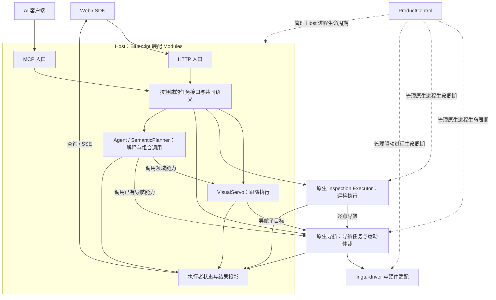

# LingTu 任务接口设计

日期：2026-10-13。状态：总体架构提案；Follow 的首批生命周期已实现，验证层级为本地契约。
本文把 [Spot 公开架构研究](spot.md) 收敛为 LingTu 的职责和接口约定。
现有实现、依赖方向与运动所有权仍以 [Architecture](../architecture.md) 为准。
本轮在已有 Host 和原生导航接口上补 Follow，不迁移协议、不新增运行进程、不部署机器人。
后续 Agent、入口对齐、巡检复用和分层资格验证见 [下一阶段升级计划](plan.md)。

## 已落地的 Follow 边界

VisualServo 现在拥有稳定的 `follow_task_id`，并绑定当前 `product_session_id`。
HTTP `POST /api/v1/visual_servo` 的 `mode=follow`、MCP `start_follow` / `follow_person`
调用同一执行者；按引用查询和取消使用 `get_follow_task` / `cancel_follow_task`，
HTTP 对应 `GET /api/v1/follow/{follow_task_id}` 和 `POST .../cancel`。
查询和取消必须携带原 Product session。具体请求见 [API](../api.md)。

状态采用最少的三种：`running -> cancelling -> cancelled`。选人、跟随、暂时丢失、
重识别、导航受阻是运行阶段，不因一个子目标到达就把持续跟随标记完成。
取消先使旧视觉回调失效，再按 ID 取消尚未结束的导航子目标；ACK 只表示受理，
匹配的强类型 `NavigationGoalStatus` 才能确认子任务终态。
取消失败或反馈未知时保持未结束；显式再次取消可以重试仍属该任务的目标。

同一时刻只接纳一项视觉执行。旧 Follow 尚未结束时新请求返回 `follow_busy`，
不增加并行任务调度器；结束后可开始新任务，旧取消和延迟事件不会影响它。
网页保存并使用明确引用，无引用的旧 `stop` 不能取消 Follow；Find 保留原有停止入口。
语义 Follow 交接也保留引用，旧指令取消不再发布无范围的 Follow stop。
完整 Agent 父任务结果传播仍属于下一阶段。

记录仅保留在本次 Host 的最近 64 次 Follow 执行中；每项保留最近 128 个已结束
导航子任务及所有尚未结束的子任务。提供 client/request ID 时，保留记录内的相同
start 返回原任务，参数冲突拒绝；Gateway 另沿用原 CommandJournal 窗口。
不承诺重启后的请求去重或自动恢复。重启时 GoalService 先取消同一 Product session
账本中遗留的视觉子任务，收齐原生终态前拒绝新 Follow。

本地回归入口：
[Follow 生命周期](../../tests/runtime/test_follow_lifecycle.py)、
[导航受理和恢复](../../tests/nav/services/test_goal_service.py)、
[Gateway](../../tests/gateway/test_gateway_commands.py)、
[连续观测与重识别](../../tests/runtime/test_follow_person_selection.py)。
这些测试使用原有 Host 端口和任务账本，并以可控原生反馈验证契约；不证明原生进程、
仿真物理或机器狗实测通过。以下通用 TaskDef/TaskView 名称仍是设计用语，没有引入
五个统一类、任务数据库或 Mission 引擎。

## 1. 这一层负责什么

目标：让 Web、SDK 和 MCP 用相同的业务规则调用已有能力，查询由执行者确认的进展，
并取消自己指定的任务。它是一组按领域组织的稳定接口，不预设一个统一任务管理进程。

它维护能力说明、请求/结果的共同含义、领域任务引用及对外状态投影。
运行中的任务状态仍由各领域执行者维护。具体业务校验、失败策略和任务终态由执行者
裁定，接口入口不得另外推进一份状态机。

它的实际收益应当可观察：同一个取消动作不会在网页和 MCP 中产生不同含义；
调用方不用知道 Follow 每次刷新了哪个原生导航目标；重连后能够定位同一项执行；
命令 ACK、动作完成和原生停止证据不再互相替代。

如果一个新增类只是转发方法，而没有集中这些规则，就不单独建立该类。
同进程模块继续通过已有注册接口和类型消息连接，跨进程继续沿用 DDS。

对外能力按实际业务分组，不把每个分组做成新进程，也不把所有操作都改造成 Task：

| 业务入口 | 内容与既有所有者 | 此次整理方式 |
| --- | --- | --- |
| 机器人状态与控制 | 原生状态、控制权、停止/急停，Gateway 投影 | 沿用已有权威状态与独立控制入口 |
| 地图与地点 | mapd 的地图工件、保存操作、地点；SLAM 的定位事实 | 地图保存继续使用已有 `operation_id`，不伪装成导航任务；活动地图切换仍归 ProductControl |
| 导航 | 目标、预览、任务状态及任务控制 | 保留现有导航任务契约 |
| 巡检 | Route、执行、采集证据与报告 | 保留 Route 与一次执行的分离 |
| 跟随 | 目标人物、重识别、导航子目标 | 补齐 VisualServo 的执行身份、查询与取消 |
| 感知与记忆 | 场景对象、图像、观测、语义记忆查询 | 作为数据查询或被任务调用的能力，不因一次读取而创建任务 |
| 语义任务 | 指令解释、Agent 执行与领域任务关联 | 接入已存在的 Agent/语义所有者，并补执行结果关系 |
| 产品运行管理 | ProductControl 的切换、就绪、进程生命周期 | 与业务任务分开；不并入公共任务执行层 |

模型服务是感知/决策能力的计算依赖，不直接获得运动控制权。
下面的共同任务契约只适用于具有执行生命周期的业务；状态查询、媒体流和地图操作
继续使用各自已有的接口。这避免将“统一入口”做成无所不包的任务对象。

图中 Contract 表示共同接口约定，不是新增服务或允许 Gateway 跨层导入实现。
巡检已在原生端执行，不搬进 Host；MCP 与 HTTP 都通过已有装配和注册边界找到执行者。

## 2. 描述、执行、请求、证据分开

| 概念 | 回答的问题 | 对应现有内容 |
| --- | --- | --- |
| 任务描述 | 要做什么，参数和失败策略是什么？ | 巡检 `Route`；语义 `TaskPlan/SubGoal`；跟随目标描述 |
| 本次执行 | 这次执行到哪，谁拥有它，是否结束？ | 原生导航/巡检 `task_id`；Agent `run_id`；待补的 Follow 执行标识 |
| 控制请求 | 哪一次开始、暂停、取消请求？是否只是重复提交？ | `request_id` 与现有命令回执 |
| 观测和结果 | 完成的依据是什么，采集于何时何地？ | 原生反馈、人物身份/位置、巡检证据与报告 |

同一巡检 Route 可以启动多次执行；每次启动使用明确的路线版本和地图身份。
一项 Follow 执行可以产生多个导航子目标；人物重新识别不自动创建新 Follow 执行。
修改 Follow 的目标人物属于目标替换，不能悄悄重写旧任务的历史。

现在 `TaskPlan` 同时含有步骤描述、状态和重试字段。阶段二接入真实执行时，应把
运行进度归到已有 Agent/语义执行记录中，保留描述的含义；不为此先构建通用工作流 DSL。
既有任务描述和场景解析仍不能代表完整计划已自动执行；阶段二必须接入真实完成反馈。

任务引用使用领域种类和该领域已有的 ID，避免再生成一套平行公共 ID：

- 导航和巡检引用自己的 `task_id`，Agent 引用现有 `run_id`。
- Follow 的独立执行标识由 VisualServo 管理，为 `follow_task_id`。
- `product_session_id` 始终只标识整套 Product 运行。
- `target_identity_id` 表示人物身份，`native_track_id` 表示暂时的感知轨迹。
- 原生事件的 `boot_id` 和 `sequence` 留在内部，不成为客户端任务身份。

实现时共同结构限定为以下含义，名称先作为设计用语，不要求创建五个公共类：

| 结构 | 最小内容及约束 |
| --- | --- |
| `TaskDef` | `kind` 与对应领域的强类型描述；直接复用 Route、Goal、跟随目标或 Agent instruction，不引入无类型万能参数字典 |
| `TaskRef` | `kind + product_session_id + 领域原有标识`；按种类携带 `task_id`、`follow_task_id` 或 `run_id`，不再分配一套通用 ID |
| `TaskControl` | `TaskRef + operation + client_id + request_id + reason`；修改操作必须匹配原受理记录的运行上下文 |
| `TaskReceipt` | `accepted + request_id + TaskRef（已受理时）+ reason`；只确认本次请求受理，不预填执行成功 |
| `TaskView` | `TaskRef + 领域状态/阶段 + terminal + result + reason + available_operations`，按实际关联情况附带运动证据与领域细节 |

例如 Follow 引用的形状是 `kind=follow, product_session_id=..., follow_task_id=...`。
查询找不到 owner 或已超出保留范围时，返回明确的不可用原因，不能构造成功终态。
历史保留能力由领域声明，不在每个事件上重复推断。机器人当前全局运动状态是独立
信息；`TaskView` 只附带能够关联到本执行的运动证据。

## 3. 对外保持少量操作与明确结果

以下是接口语义，不是已经注册的新 HTTP 路由，也不要求每个执行者继承同一基类。
先保留现有导航、巡检路径和 SDK；缺失的领域能力逐项补齐。

| 操作 | 语义与执行者责任 |
| --- | --- |
| 查看能力 | 当前 Product 是否装配该能力、运行条件是否满足、支持哪些操作 |
| 开始 | 使用领域描述提交；执行者接受后返回本次执行引用，失败则给出明确拒绝原因 |
| 查询 | 按执行引用返回当前进展、阶段原因、已产生结果及可用操作 |
| 取消 | 取消指定执行及其拥有的子任务；返回取消受理后继续查询最终结果 |
| 暂停 / 恢复 | 仅由已实现该语义的领域声明支持；不通过改状态标签假装暂停 |

订阅属于传输适配：SSE 或未来流式接口推送 `TaskView` 的变化，不要求每个执行者
实现一个新的订阅协议。连接断开后用查询恢复当前事实。
能力声明给出 `supported_operations`，每次查询的 `available_operations` 则反映
当前状态；例如“支持恢复”与“现在允许恢复”是两件事。

外部应当区分四件事：

1. 请求是否被接受。HTTP、MCP 或未来 gRPC 的传输成功不替代这个结果。
2. 任务的当前状态与具体阶段。例如跟随在重新识别、巡检在等待采集。
3. 任务的业务结果。例如导航到达、采集成功、查找未命中、任务取消。
4. 原生运动证据。运动是否放行、当前观测是否静止、停止确认是否完成。

共同含义不要求所有领域使用同一套内部枚举，也不改变现有原生状态。
尚未确认的结果保留未知/处理中，不能因一个缓存为空就写成完成。
可用能力也要区分“有代码”“当前已装配”“当前可执行”；模型可用不代表导航就绪。

全局停止/急停继续是独立的机器人控制入口。取消一项 Follow 或 Agent 子任务，
不得被工具入口转换成取消另一项任务或触发整机停止的通用命令。

## 4. 状态和控制权只认已有执行者

| 所有者 | 继续拥有的职责 | 本次接口层不接管的内容 |
| --- | --- | --- |
| ProductControl | Product 切换、进程、RunPlan、就绪与回滚 | 不承担业务步骤调度 |
| mapd / SLAM | 地图工件、运行地图与定位 | 接口层不复制地图/定位状态的算法所有权 |
| 原生导航与 GoalService | 导航任务、命令回执、历史、运动仲裁与终态 | Follow、Agent 不能根据自己的距离判断覆盖原生结果 |
| 原生 Inspection Executor | 点/循环推进、停留、动作请求、失败策略 | Gateway 不再按定时器推进巡检 |
| VisualServo | 人物目标、跟随阶段、子目标归属、取消协调 | 不直接写速度，不假造原生终态 |
| Agent / SemanticPlanner | 意图解释、语义目标、组合调用与所属指令状态 | 语言回复不决定运动是否成功 |
| Gateway / MCP / SDK | 协议适配、请求边界、调用和状态呈现 | 不各自维护另一份任务执行状态 |
| lingtu-driver | 检查后的命令输出与平台适配 | 不接受绕过原生仲裁的跟随速度通道 |

同一套底盘仍由现有原生控制权管理。多个入口不等于可以并行启动多个互相争抢运动的
执行者；忙碌、接管、替换和恢复沿用原生及领域所有者的明确结果。
第一批不增加全局队列或跨领域自动抢占调度器。

重试使用现有请求身份，保留 CommandJournal 的当前进程和保留窗口边界。
MCP 与 HTTP 必须进入同一个执行者的受理方法，不能一边有回执/归属，一边直接调用
一个绕过任务身份的旧技能。接口层不能宣称所有入口、所有重启场景都有 exactly-once。

取消、暂停、恢复必须携带或由受理记录解析出原来的 `product_session_id`，并在执行者
处核对；与当前运行不匹配时拒绝修改。旧任务历史若仍可查询，保留其真实历史结果，
不因新 Product 启动就改写为中断。地图身份变化由原生导航/巡检判定，不把旧地图的
目标坐标套到新地图继续执行。Product 和活动地图切换仍经 ProductControl。

能力来源是选定 RunPlan、实际装配的 owner 及其就绪事实，不按“有相机”推断。
第一批用已有 `tracking` Product 验收 Follow；`nav:camera` 没有 Follow owner，
不公布可调用的 Follow。其他 Product 按实际声明与装配报告，不在本提案中硬编码禁用。

Follow 与 Agent 各自维护当前执行拥有的已接受子任务集合，并复用已有意图版本/
取消机制约束异步回调。Follow 刷新目标只追加或更新子任务关系，不改变父任务标识。
取消先冻结该执行的新提交和异步回调，再按 ID 取消其尚未结束的子任务；旧集合与
新执行分开。旧取消不能走“取消所有 visual tasks”而误伤新的 Follow。
取消成功只在归属子任务收到匹配终态后确认；证据不可用时报告未确认或中断，
不能把未知停止状态当成取消成功。该逻辑留在现有 owner，不抽成通用父子任务引擎。

运行重启后的语义按所有者声明：

| 所有者 | 记录与重启语义 |
| --- | --- |
| 导航 | 账本用于恢复/核对事实，查询历史不会重放运动命令 |
| 巡检 | 复用原生 checkpoint 和任务记录；恢复点不等于恢复旧运动或采集，遵守已有显式 resume 及连续性确认条件 |
| Follow | 第一批仅当前 Host 内可查询；重启后人物参考丢失，旧父查询报告 `owner_unavailable`/`status_unknown`；按 ID 取消当前 Product session 中恢复出的孤儿视觉子任务，并等待原生结果 |
| Agent | 当前 `AgentRun` 是进程内记录；重启后不冒充可恢复执行，不自动重新调用运动工具 |

Follow 接纳新执行前，应先完成当前运行内恢复出的孤儿视觉子任务收敛，避免新旧所有者
混杂。Host 重启后不得自动重发旧 start；同一 Host 内的重试仍受现有 CommandJournal
保留窗口限制。超过窗口或无法确认执行者连续性时，客户端不得自动重发启动；
保留范围由能力说明明确提供，不以网络重连成功代替执行者连续性。
状态连接断开、视觉数据过期、Host 重启分别处理，沿用
[Spot 对照方案](spot.md) 的边界。

## 5. 用两个真实场景检验这个设计

**三点巡检。** 使用当前 Route 的地图、版本、点和 `capture:overview` 描述启动。
原生 Executor 负责导航、稳定检查、停留、请求采集并等待结果，再推进下一点。
页面、SDK、MCP 查询同一个巡检任务；路线后续编辑不改变这次执行的描述快照。
拍到图片与某个视觉检查得到结论分别记录，未启用的分析动作不作为可执行能力。

**持续跟随。** 由 VisualServo 接受目标描述或当前人物选择，创建 Follow 执行。
感知轨迹号可变化，人物身份需要多视角和连续三帧核验；导航子目标可刷新，Follow
执行身份保持不变。用户取消后禁止新目标发布，并取消该任务拥有的导航子任务。
匹配的原生终态经停止屏障后到达，才能作为该子任务的停止证据。
未曾下发导航时，结束选人任务不等于确认整机物理停稳。

同一张任务卡应显示任务进度、视觉阶段与原生运动事实，而不要求用户理解每次内部
目标替换。它也不能通过固定显示一个人物 ID 掩盖错误重识别。

## 6. 实施边界与顺序

Follow 的首批实现遵循本提案，不新建 `MissionService`、`TaskManager`、通用任务表或 gRPC 服务器。
共同契约落在现有共享类型与领域接口中；HTTP 请求/返回仍由 Pydantic/OpenAPI 定义，
原生消息由 DDS IDL 定义。需要跨层共享的类型使用现有 runtime 消息/契约位置，
不让下层导入 Gateway schema。

1. **先补 Follow。** 已在现有 VisualServo、命令消息、Gateway、Host 接线和客户端中
   增加稳定执行引用及查询/取消；已完成本地契约验证，现有 `tracking` Product 的
   原生仿真与实机验收仍待完成。
   保留普通导航和巡检现有接口，暂不为统一命名而搬迁目录或修改全部路由。
2. **再接 Agent。** 由 Agent 的 `run_id` 关联被调用的领域任务；既有动态工具循环
   保留，任务描述需要执行时逐步接入真实完成反馈，不以解析成功代表完成。
3. **对齐入口。** 同一执行从 Web 发起、SDK 查询、MCP 取消，得到一致结果。
   只有被第二个真实调用方复用的公共逻辑才抽取，避免先搭空转的框架。
4. **最后评估传输。** 按相同输入和硬件测编码、网络、排队、模型与帧龄。
   有收益才局部加入二进制传输或 gRPC；媒体和原生控制保留各自协议。

代码改动前必须说清楚的结果现在已有边界：一个任务由谁拥有、引用多久有效、取消
影响哪些子任务、哪些反馈能结束任务、哪些能力当前不支持。实现验收围绕这些行为，
以及旧请求不能取消新任务、旧终态不能结束新执行、任务接受不等于已运动。

四条代表性验收沿真实调用路径进行：Follow F1 更新 g1/g2 后取消，再发起 F2，旧事件
不结束 F2；start 丢响应后在同一 Host 重试，再经历 Host 重启，不重复启动或伪造恢复；
`tracking -> nav:camera` 切换后，旧运行引用不能修改新运行且 Follow 能力不再可用；
Agent 取消只收敛自己的子任务，不取消后来由操作者发起的导航。

相关代码入口：

- [巡检 Route / Executor 契约](../../src/nav/inspection/inspection.hpp)
- [语义任务描述](../../src/decision/tasks/decomposition.py)
- [Agent 执行](../../src/decision/modules/agent_planner.py)
- [跟随执行](../../src/decision/modules/visual_servo.py)
- [现有命令回执](../../src/gateway/services/commands.py)
- [原生目标反馈接线](../../src/lingtu/assembly/wires/semantic.py)
- [tracking Product](../getting-started.md)

本提案不改变实机能力证据：板端模型输出、相机标定、深度遮挡和实际跟随仍需按
[人物跟随记录](person-follow.md) 中的缺口继续验证。
