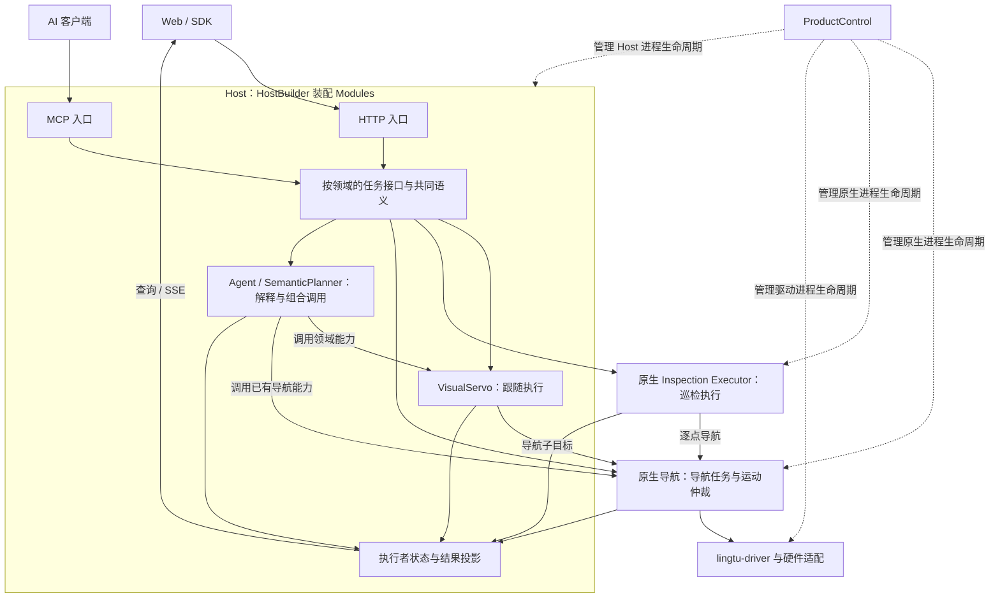

# LingTu 任务接口设计

初稿：2026-10-13；代码梳理更新：2026-10-16。状态：总体架构提案与实现核对；
Follow 的首批生命周期已实现，验证层级为本地契约。
本文把 [Spot 公开架构研究](spot.md) 收敛为 LingTu 的职责和接口约定。
现有实现、依赖方向与运动所有权仍以 [Architecture](../architecture.md) 为准。
Follow 首批实现在已有 Host 和原生导航接口上完成，没有迁移协议或新增运行进程。
后续 Agent、入口对齐、巡检复用和分层资格验证见 [下一阶段升级计划](plan.md)。
2026-10-20 补齐的对话控制目标、功能范围、已有/待补能力与用户验收场景也维护在该计划中；
人物算法修复是其中的观测与身份切片，不替代对话指代、持续任务和停止/接管闭环。
相机来源、共同观测、语义记忆与原生运动之间的完整分工见
[相机、语义与运动架构](../design/autonomy.md)；先固定观测依据，再连接父子任务结果。
当前代码阅读入口统一放在 [Decision README](../../src/decision/README.md)。本文第 8 节
记录已核实的职责问题和整理顺序；后续功能扩展先以这份现状为依据。

## 已落地的 Follow 边界

VisualServo 现在拥有稳定的 `follow_task_id`，并绑定当前 `product_session_id`。
HTTP `POST /api/v1/visual_servo` 的 `mode=follow`、MCP `start_follow` / `follow_person`
调用同一执行者；按引用查询和取消使用 `get_follow_task` / `cancel_follow_task`，
HTTP 对应 `GET /api/v1/follow/{follow_task_id}` 和 `POST .../cancel`。
查询和取消必须携带原 Product session。具体请求见 [API](../api.md)。

状态采用最少的三种：`running -> cancelling -> cancelled`。选人、跟随、暂时丢失、
重识别、导航受阻是运行阶段，不因一个子目标到达就把持续跟随标记完成。
取消先使旧视觉回调失效，再按 ID 取消尚未结束的导航子目标；ACK 只表示受理，
匹配的强类型 `NavigationGoalStatus` 才能确认子任务终态。
取消失败或反馈未知时保持未结束；显式再次取消可以重试仍属该任务的目标。

同一时刻只接纳一项视觉执行。旧 Follow 尚未结束时新请求返回 `follow_busy`，
不增加并行任务调度器；结束后可开始新任务，旧取消和延迟事件不会影响它。
网页保存并使用明确引用，无引用的旧 `stop` 不能取消 Follow；Find 保留原有停止入口。
语义 Follow 交接也保留引用，旧指令取消不再发布无范围的 Follow stop。
完整 Agent 父任务结果传播仍属于下一阶段。

记录仅保留在本次 Host 的最近 64 次 Follow 执行中；每项保留最近 128 个已结束
导航子任务及所有尚未结束的子任务。提供 client/request ID 时，保留记录内的相同
start 返回原任务，参数冲突拒绝；Gateway 另沿用原 CommandJournal 窗口。
不承诺重启后的请求去重或自动恢复。重启时 GoalService 先取消同一 Product session
账本中遗留的视觉子任务，收齐原生终态前拒绝新 Follow。

本地回归入口：
[Follow 生命周期](../../tests/runtime/test_follow_lifecycle.py)、
[导航受理和恢复](../../tests/nav/services/test_goal_service.py)、
[Gateway](../../tests/gateway/test_gateway_commands.py)、
[连续观测与重识别](../../tests/runtime/test_follow_person_selection.py)。
这些测试使用原有 Host 端口和任务账本，并以可控原生反馈验证契约；不证明原生进程、
仿真物理或机器狗实测通过。以下通用 TaskDef/TaskView 名称仍是设计用语，没有引入
五个统一类、任务数据库或 Mission 引擎。

## 1. 这一层负责什么

目标：让 Web、SDK 和 MCP 用相同的业务规则调用已有能力，查询由执行者确认的进展，
并取消自己指定的任务。它是一组按领域组织的稳定接口，不预设一个统一任务管理进程。

它维护能力说明、请求/结果的共同含义、领域任务引用及对外状态投影。
运行中的任务状态仍由各领域执行者维护。具体业务校验、失败策略和任务终态由执行者
裁定，接口入口不得另外推进一份状态机。

它的实际收益应当可观察：同一个取消动作不会在网页和 MCP 中产生不同含义；
调用方不用知道 Follow 每次刷新了哪个原生导航目标；重连后能够定位同一项执行；
命令 ACK、动作完成和原生停止证据不再互相替代。

如果一个新增类只是转发方法，而没有集中这些规则，就不单独建立该类。
同进程模块继续通过已有注册接口和类型消息连接，跨进程继续沿用 DDS。

对外能力按实际业务分组，不把每个分组做成新进程，也不把所有操作都改造成 Task：

| 业务入口 | 内容与既有所有者 | 此次整理方式 |
| --- | --- | --- |
| 机器人状态与控制 | 原生状态、控制权、停止/急停，Gateway 投影 | 沿用已有权威状态与独立控制入口 |
| 地图与地点 | mapd 的地图工件、保存操作、地点；SLAM 的定位事实 | 地图保存继续使用已有 `operation_id`，不伪装成导航任务；活动地图切换仍归 ProductControl |
| 导航 | 目标、预览、任务状态及任务控制 | 保留现有导航任务契约 |
| 巡检 | Route、执行、采集证据与报告 | 保留 Route 与一次执行的分离 |
| 跟随 | 目标人物、重识别、导航子目标 | 补齐 VisualServo 的执行身份、查询与取消 |
| 感知与记忆 | 场景对象、图像、观测、语义记忆查询 | 作为数据查询或被任务调用的能力，不因一次读取而创建任务 |
| 语义任务 | 指令解释、Agent 执行与领域任务关联 | 接入已存在的 Agent/语义所有者，并补执行结果关系 |
| 产品运行管理 | ProductControl 的切换、就绪、进程生命周期 | 与业务任务分开；不并入公共任务执行层 |

模型服务是感知/决策能力的计算依赖，不直接获得运动控制权。
下面的共同任务契约只适用于具有执行生命周期的业务；状态查询、媒体流和地图操作
继续使用各自已有的接口。这避免将“统一入口”做成无所不包的任务对象。

图中 Contract 表示共同接口约定，不是新增服务或允许 Gateway 跨层导入实现。
巡检已在原生端执行，不搬进 Host；MCP 与 HTTP 都通过已有装配和注册边界找到执行者。

## 2. 描述、执行、请求、证据分开

| 概念 | 回答的问题 | 对应现有内容 |
| --- | --- | --- |
| 任务描述 | 要做什么，参数和失败策略是什么？ | 巡检 `Route`；语义 `TaskPlan/SubGoal`；跟随目标描述 |
| 本次执行 | 这次执行到哪，谁拥有它，是否结束？ | 原生导航/巡检 `task_id`；Agent `run_id`；待补的 Follow 执行标识 |
| 控制请求 | 哪一次开始、暂停、取消请求？是否只是重复提交？ | `request_id` 与现有命令回执 |
| 观测和结果 | 完成的依据是什么，采集于何时何地？ | 原生反馈、人物身份/位置、巡检证据与报告 |

同一巡检 Route 可以启动多次执行；每次启动使用明确的路线版本和地图身份。
一项 Follow 执行可以产生多个导航子目标；人物重新识别不自动创建新 Follow 执行。
修改 Follow 的目标人物属于目标替换，不能悄悄重写旧任务的历史。

现在 `TaskPlan` 同时含有步骤描述、状态和重试字段。阶段二接入真实执行时，应把
运行进度归到已有 Agent/语义执行记录中，保留描述的含义；不为此先构建通用工作流 DSL。
`decompose_task` 和 `resolve_task_step` 目前只解析/定位候选，不负责自动跑完整份计划。

任务引用使用领域种类和该领域已有的 ID，避免再生成一套平行公共 ID：

- 导航和巡检引用自己的 `task_id`，Agent 引用现有 `run_id`。
- Follow 的独立执行标识由 VisualServo 管理，为 `follow_task_id`。
- `product_session_id` 始终只标识整套 Product 运行。
- `target_identity_id` 表示人物身份，`native_track_id` 表示暂时的感知轨迹。
- 原生事件的 `boot_id` 和 `sequence` 留在内部，不成为客户端任务身份。

实现时共同结构限定为以下含义，名称先作为设计用语，不要求创建五个公共类：

| 结构 | 最小内容及约束 |
| --- | --- |
| `TaskDef` | `kind` 与对应领域的强类型描述；直接复用 Route、Goal、跟随目标或 Agent instruction，不引入无类型万能参数字典 |
| `TaskRef` | `kind + product_session_id + 领域原有标识`；按种类携带 `task_id`、`follow_task_id` 或 `run_id`，不再分配一套通用 ID |
| `TaskControl` | `TaskRef + operation + client_id + request_id + reason`；修改操作必须匹配原受理记录的运行上下文 |
| `TaskReceipt` | `accepted + request_id + TaskRef（已受理时）+ reason`；只确认本次请求受理，不预填执行成功 |
| `TaskView` | `TaskRef + 领域状态/阶段 + terminal + result + reason + available_operations`，按实际关联情况附带运动证据与领域细节 |

例如 Follow 引用的形状是 `kind=follow, product_session_id=..., follow_task_id=...`。
查询找不到 owner 或已超出保留范围时，返回明确的不可用原因，不能构造成功终态。
历史保留能力由领域声明，不在每个事件上重复推断。机器人当前全局运动状态是独立
信息；`TaskView` 只附带能够关联到本执行的运动证据。

## 3. 对外保持少量操作与明确结果

以下是接口语义，不是已经注册的新 HTTP 路由，也不要求每个执行者继承同一基类。
先保留现有导航、巡检路径和 SDK；缺失的领域能力逐项补齐。

| 操作 | 语义与执行者责任 |
| --- | --- |
| 查看能力 | 当前 Product 是否装配该能力、运行条件是否满足、支持哪些操作 |
| 开始 | 使用领域描述提交；执行者接受后返回本次执行引用，失败则给出明确拒绝原因 |
| 查询 | 按执行引用返回当前进展、阶段原因、已产生结果及可用操作 |
| 取消 | 取消指定执行及其拥有的子任务；返回取消受理后继续查询最终结果 |
| 暂停 / 恢复 | 仅由已实现该语义的领域声明支持；不通过改状态标签假装暂停 |

订阅属于传输适配：SSE 或未来流式接口推送 `TaskView` 的变化，不要求每个执行者
实现一个新的订阅协议。连接断开后用查询恢复当前事实。
能力声明给出 `supported_operations`，每次查询的 `available_operations` 则反映
当前状态；例如“支持恢复”与“现在允许恢复”是两件事。

外部应当区分四件事：

1. 请求是否被接受。HTTP、MCP 或未来 gRPC 的传输成功不替代这个结果。
2. 任务的当前状态与具体阶段。例如跟随在重新识别、巡检在等待采集。
3. 任务的业务结果。例如导航到达、采集成功、查找未命中、任务取消。
4. 原生运动证据。运动是否放行、当前观测是否静止、停止确认是否完成。

共同含义不要求所有领域使用同一套内部枚举，也不改变现有原生状态。
尚未确认的结果保留未知/处理中，不能因一个缓存为空就写成完成。
可用能力也要区分“有代码”“当前已装配”“当前可执行”；模型可用不代表导航就绪。

全局停止/急停继续是独立的机器人控制入口。取消一项 Follow 或 Agent 子任务，
不得被工具入口转换成取消另一项任务或触发整机停止的通用命令。

## 4. 状态和控制权只认已有执行者

| 所有者 | 继续拥有的职责 | 本次接口层不接管的内容 |
| --- | --- | --- |
| ProductControl | Product 切换、进程、RunPlan、就绪与回滚 | 不承担业务步骤调度 |
| mapd / SLAM | 地图工件、运行地图与定位 | 接口层不复制地图/定位状态的算法所有权 |
| 原生导航与 GoalService | 导航任务、命令回执、历史、运动仲裁与终态 | Follow、Agent 不能根据自己的距离判断覆盖原生结果 |
| 原生 Inspection Executor | 点/循环推进、停留、动作请求、失败策略 | Gateway 不再按定时器推进巡检 |
| VisualServo | 人物目标、跟随阶段、子目标归属、取消协调 | 不直接写速度，不假造原生终态 |
| Agent / SemanticPlanner | 意图解释、语义目标、组合调用与所属指令状态 | 语言回复不决定运动是否成功 |
| Gateway / MCP / SDK | 协议适配、请求边界、调用和状态呈现 | 不各自维护另一份任务执行状态 |
| lingtu-driver | 检查后的命令输出与平台适配 | 不接受绕过原生仲裁的跟随速度通道 |

同一套底盘仍由现有原生控制权管理。多个入口不等于可以并行启动多个互相争抢运动的
执行者；忙碌、接管、替换和恢复沿用原生及领域所有者的明确结果。
第一批不增加全局队列或跨领域自动抢占调度器。

重试使用现有请求身份，保留 CommandJournal 的当前进程和保留窗口边界。
MCP 与 HTTP 必须进入同一个执行者的受理方法，不能一边有回执/归属，一边直接调用
一个绕过任务身份的旧技能。接口层不能宣称所有入口、所有重启场景都有 exactly-once。

取消、暂停、恢复必须携带或由受理记录解析出原来的 `product_session_id`，并在执行者
处核对；与当前运行不匹配时拒绝修改。旧任务历史若仍可查询，保留其真实历史结果，
不因新 Product 启动就改写为中断。地图身份变化由原生导航/巡检判定，不把旧地图的
目标坐标套到新地图继续执行。Product 和活动地图切换仍经 ProductControl。

能力来源是选定 RunPlan、实际装配的 owner 及其就绪事实，不按“有相机”推断。
第一批用已有 `tracking` Product 验收 Follow；`nav:camera` 没有 Follow owner，
不公布可调用的 Follow。其他 Product 按实际声明与装配报告，不在本提案中硬编码禁用。

Follow 与 Agent 各自维护当前执行拥有的已接受子任务集合，并复用已有意图版本/
取消机制约束异步回调。Follow 刷新目标只追加或更新子任务关系，不改变父任务标识。
取消先冻结该执行的新提交和异步回调，再按 ID 取消其尚未结束的子任务；旧集合与
新执行分开。旧取消不能走“取消所有 visual tasks”而误伤新的 Follow。
取消成功只在归属子任务收到匹配终态后确认；证据不可用时报告未确认或中断，
不能把未知停止状态当成取消成功。该逻辑留在现有 owner，不抽成通用父子任务引擎。

运行重启后的语义按所有者声明：

| 所有者 | 记录与重启语义 |
| --- | --- |
| 导航 | 账本用于恢复/核对事实，查询历史不会重放运动命令 |
| 巡检 | 复用原生 checkpoint 和任务记录；恢复点不等于恢复旧运动或采集，遵守已有显式 resume 及连续性确认条件 |
| Follow | 第一批仅当前 Host 内可查询；重启后人物参考丢失，旧父查询报告 `owner_unavailable`/`status_unknown`；按 ID 取消当前 Product session 中恢复出的孤儿视觉子任务，并等待原生结果 |
| Agent | 当前 `AgentRun` 是进程内记录；重启后不冒充可恢复执行，不自动重新调用运动工具 |

Follow 接纳新执行前，应先完成当前运行内恢复出的孤儿视觉子任务收敛，避免新旧所有者
混杂。Host 重启后不得自动重发旧 start；同一 Host 内的重试仍受现有 CommandJournal
保留窗口限制。超过窗口或无法确认执行者连续性时，客户端不得自动重发启动；
保留范围由能力说明明确提供，不以网络重连成功代替执行者连续性。
状态连接断开、视觉数据过期、Host 重启分别处理，沿用
[Spot 对照方案](spot.md) 的边界。

## 5. 用两个真实场景检验这个设计

**三点巡检。** 使用当前 Route 的地图、版本、点和 `capture:overview` 描述启动。
原生 Executor 负责导航、稳定检查、停留、请求采集并等待结果，再推进下一点。
页面、SDK、MCP 查询同一个巡检任务；路线后续编辑不改变这次执行的描述快照。
拍到图片与某个视觉检查得到结论分别记录，未启用的分析动作不作为可执行能力。

**持续跟随。** 由 VisualServo 接受目标描述或当前人物选择，创建 Follow 执行。
感知轨迹号可变化，人物身份需要多视角和连续三帧核验；导航子目标可刷新，Follow
执行身份保持不变。用户取消后禁止新目标发布，并取消该任务拥有的导航子任务。
匹配的原生终态经停止屏障后到达，才能作为该子任务的停止证据。
未曾下发导航时，结束选人任务不等于确认整机物理停稳。

同一张任务卡应显示任务进度、视觉阶段与原生运动事实，而不要求用户理解每次内部
目标替换。它也不能通过固定显示一个人物 ID 掩盖错误重识别。

## 6. 实施边界与顺序

Follow 的首批实现遵循本提案，不新建 `MissionService`、`TaskManager`、通用任务表或 gRPC 服务器。
共同契约落在现有共享类型与领域接口中；HTTP 请求/返回仍由 Pydantic/OpenAPI 定义，
原生消息由 DDS IDL 定义。需要跨层共享的类型使用现有 runtime 消息/契约位置，
不让下层导入 Gateway schema。

1. **先补 Follow。** 已在现有 VisualServo、命令消息、Gateway、Host 接线和客户端中
   增加稳定执行引用及查询/取消；已完成本地契约验证，现有 `tracking` Product 的
   原生仿真与实机验收仍待完成。
   保留普通导航和巡检现有接口，暂不为统一命名而搬迁目录或修改全部路由。
2. **再接 Agent。** 由 Agent 的 `run_id` 关联被调用的领域任务；既有动态工具循环
   保留，任务描述需要执行时逐步接入真实完成反馈，不以解析成功代表完成。
3. **对齐入口。** 同一执行从 Web 发起、SDK 查询、MCP 取消，得到一致结果。
   只有被第二个真实调用方复用的公共逻辑才抽取，避免先搭空转的框架。
4. **最后评估传输。** 按相同输入和硬件测编码、网络、排队、模型与帧龄。
   有收益才局部加入二进制传输或 gRPC；媒体和原生控制保留各自协议。

代码改动前必须说清楚的结果现在已有边界：一个任务由谁拥有、引用多久有效、取消
影响哪些子任务、哪些反馈能结束任务、哪些能力当前不支持。实现验收围绕这些行为，
以及旧请求不能取消新任务、旧终态不能结束新执行、任务接受不等于已运动。

四条代表性验收沿真实调用路径进行：Follow F1 更新 g1/g2 后取消，再发起 F2，旧事件
不结束 F2；start 丢响应后在同一 Host 重试，再经历 Host 重启，不重复启动或伪造恢复；
`tracking -> nav:camera` 切换后，旧运行引用不能修改新运行且 Follow 能力不再可用；
Agent 取消只收敛自己的子任务，不取消后来由操作者发起的导航。

相关代码入口：

- [巡检 Route / Executor 契约](../../src/nav/inspection/inspection.hpp)
- [语义任务描述](../../src/decision/tasks/decomposition.py)
- [Agent 执行](../../src/decision/modules/agent_planner.py)
- [跟随执行](../../src/decision/modules/visual_servo.py)
- [现有命令回执](../../src/gateway/services/commands.py)
- [原生目标反馈接线](../../src/lingtu/assembly/host/wiring/semantic.py)
- [tracking Product](../../config/system/products/tracking.yaml)

本提案不改变实机能力证据：板端模型输出、相机标定、深度遮挡和实际跟随仍需按
[人物跟随记录](person-follow.md) 中的缺口继续验证。

## 7. 自然语言任务规划：2026-10-16 论文核对

状态：基于原文的工程建议；尚未实现真实 LLM 拆解闭环，不代表学界只有一种架构。
本次核对范围为截至 2026-10-16 的公开版本，重点是任务理解、环境依据、重规划触发和执行接口。

### 直接建议

继续以 VL-Nav 为找物任务主参考；借鉴 SysNav 的房间级搜索分工和事件触发的执行反馈。
自由自然语言任务默认经过真实 LLM/VLM 理解，输出当前系统支持的符号任务。
目标坐标来自观测与地图，路径和运动由原生导航决定。规则保留给停止、明确命令及回归基线。

### 官方原文依据

| 工作与核对版本 | 可借鉴的具体做法 | 证据范围 |
| --- | --- | --- |
| [VL-Nav v7](https://arxiv.org/html/2502.00931v7#S3.SS1)，2026-07-14，arXiv 标注 IROS 2026 | Qwen3-VL 利用场景图与最佳视角图像拆解 exploration/go-to，子任务结束后更新计划 | TIAMAT 仿真和实机；最直接匹配我们的抽象找物目标 |
| [SysNav v1](https://arxiv.org/html/2603.06914v1#S4)，2026-03-06 预印本 | VLM 决定房间之间的搜索顺序，室内覆盖与底层运动由各自模块完成 | HM3D/MP3D 等仿真与轮式、Go2、G1 实机；ObjectNav 不等于完整的自由语言任务拆解 |
| [ViTL v1](https://arxiv.org/html/2606.30696v1#S4.SS1)，2026-06-29 预印本 | 用一次 LLM 调用提取顺序/选择约束，转成 LTL/DFA；观测更新驱动目标调整 | HM3D 仿真；文中把操作动词约化为到达对象，没有验证实际清洁或操作 |
| [VLAs-as-Tools v1](https://arxiv.org/html/2605.13119v1#S4.SS1)，2026-05-13 预印本 | 高层模型调用有界技能，技能回传执行进度，按事件重规划 | 操作任务基准；借鉴双向接口，不把其 VLA 训练结果当作 LingTu 导航证据 |
| [Vesta](https://research.nvidia.com/labs/gear/vesta/)，2026-06，[原文](https://arxiv.org/abs/2606.20905) | 将多种高层能力统一到带多模态记忆的规划模型，结合历史判断下一子任务 | 真机操作与导航评测分开；官方导航演示仍使用底层控制器 |
| [TANGO v2](https://arxiv.org/abs/2609.09158v2)，2026-10-01 | 语言和 RGB 直接条件化全身关节动作，是另一条 VLA 路线 | G1 人形导航；需要专门的仿真行为数据和训练，不是调用通用 API 即能替换原生导航 |

另外核对了 [G0.5](https://arxiv.org/abs/2608.11739)（2026-08-12）：统一生成推理与动作 token。
它说明领域同时存在统一模型路线，不能把模块化分层说成所有论文的一致结论。
我们的选择依据是现有 C++ 导航能力、数据和算力条件，而不是宣称另一条路线不可行。

### 当前代码事实

- 上一轮水瓶用例关闭 `_init_backends`，只配置真实 GoalResolver；目标类别来自受控检测。
  该测试证明共同观测和导航交接，没有调用 LLM，也没有启用 TaskDecomposer。
- `semantic_planner.py::_decompose` 在规则无法解析时返回 `needs_llm` 和提示词。
  当前单次 instruction 分支随后停止，没有自动完成模型拆解请求。
- 当前 `_decompose` 的非 `rules` 分支只是返回原始指令；设置 `decomposer="llm"`
  本身不会产生真实 LLM 拆解。Agent 另有模型工具循环，不能据此推断该入口已接通。
- `TaskDecomposer` 已有提示词构造与结构化响应解析，`LLMModule` 已有模型请求/响应，
  Agent 和语义执行器已有任务归属；下一步应连接这些现有能力。

### 建议的工程约定

1. 自由语言入口真实调用模型理解意图、目标属性/关系和必要顺序；不再以别名表代表通用理解。
   停止/取消继续走现有即时控制入口。
2. 模型只看到可执行技能及当前能力。找物技能内部负责搜索、观察位置、接近和确认，
   简单请求允许只生成一个 find 子任务；不强迫每句话都拆成固定三步。
3. 提供当前场景摘要、对象候选与图像证据、已尝试区域和真实任务反馈。
   模型提出的类别是查询条件，不能冒充实际检测或坐标。
4. 执行当前子任务，遇到完成、受阻、候选不符、区域搜索结束或用户修改时更新计划；
   不把高层模型放进逐帧控制循环。
5. 完成条件由技能返回可核对的结果；导航到达和视觉确认分别记录。
6. 首版沿用现有任务列表与状态；ViTL 的顺序约束有参考价值，暂不引入完整 LTL/DFA 框架。

### 后续功能实施与验收

以下是职责整理之后的功能工作，不表示本轮已经接通；先完成第 8 节的现状梳理。

- 先把真实模型请求接到现有任务解析器，保留模型原始响应及解析后的任务计划。
- 用“帮我找一瓶水”“先去会议室，再找桌子旁边的水瓶”“这个不是我要的，找另一瓶”
  检查单目标、顺序/关系和反馈修正；另外验证不支持的抓取/递送不会被默认为可执行。
- Agent 关联并等待各步真实任务反馈；语义执行器继续通过共同观测和原生预览选择目标。
- 记录实际模型标识、输入上下文、输出计划、耗时、执行引用和最终结果。
  规则、mock、真实 API、图像回放、仿真运动分别标记，不混算成功率。

此节是研究和实现交接。后续本地收口调用了已配置模型 API 做无运动工具选择检查，
但没有部署、上传或执行机器人运动；结果见第 8 节证据边界。

## 8. 现有代码分工与整理顺序

2026-10-17 按当前工作区复核。第 1—3 项已开始落实到运行逻辑；本节同时保留仍未完成的
TaskPlan/任务记忆边界。
详细调用图和接口位置只维护在 [Decision README](../../src/decision/README.md)，
外部 HTTP 清单仍由 [API](../api.md) 维护，不复制出第二套接口目录。

### 应保留的分工

| 所有者 | 负责的事实或状态 | 需要守住的边界 |
| --- | --- | --- |
| Gateway / MCP | 外部请求、参数适配、回执和状态展示 | 不负责推进任务或运行模型；受理不是完成 |
| `runtime.module` | `@skill` 标记和参数 Schema | 不决定找物、跟随和导航的业务含义 |
| `AgentPlannerModule` / `AgentLoop` | 当前 Agent run、模型消息、工具调用与所属任务等待 | 运动结果来自领域执行者；当前状态只在进程内。Follow 中的 FIND 只表示人物选择，不触发找物的对象确认门 |
| `TaskPlan` / `TaskDecomposer` | 符号步骤、顺序、解析及步骤状态 | 目前不驱动 AgentLoop，也不是可恢复执行器 |
| `SemanticPlannerModule` | 当前语义指令、对象候选、观察位置、目标核验与所属导航任务 | 坐标依据来自观测；路径和运动决定来自原生导航 |
| `VisualServoModule` | 人物身份、视觉阶段、Follow 任务与导航子任务 | 保留多视角和连续三帧核验；子目标到达不代表持续跟随结束 |
| Perception / Memory | 当前观测事实 / 历史语义上下文 | 场景记忆不等于任务经历；记忆坐标不直接授权运动 |
| 原生 navigation | 全局/局部规划、实际执行、终态与运动仲裁 | Python 交目标和查结果，不接管高频局部控制 |

这里的分工不要求增加目录、进程或新的 Module。`@skill` 声明、MCP 传输和模型工具格式
转换放在不同位置是合理分工；它们之间真正需要一致的是技能名称、归属和参数。

### 已核实的混杂点

1. **普通入口已收拢到 Agent，两个计划机制仍存在。** HTTP `/instruction` 和 MCP
   `send_instruction` 现在优先创建 Agent run，并返回 `run_id`；没有 Agent 的 Host 才保留
   语义 instruction stream fallback。`TaskPlan` 可解析和逐步更新，但仍没有成为 Agent 的
   统一执行计划。显式 `decompose_task` 返回的 `needs_llm` 仍只是待处理提示词。
2. **语义规划器同时持有多类状态。** 指令解析、目标绑定、模型请求、导航执行、到达核验、
   LERa 恢复都在同一个 Module 内。已有 `goals/`、`semantic_navigation/`、`tasks/`
   等算法位置可以复用；不能把每个状态机拆成一个新的 Host Module。
3. **同名找物行为不同。** MCP 的 `VisualServo.find_object` 直接切换视觉搜索模式，
   Agent 的 `_tool_find_object` 则提交有归属的语义指令并等待反馈。前者没有独立找物任务
   引用、查询和取消接口，不能用同名工具推断两条路径已经等价。
4. **技能发现差异已于 2026-10-17 收拢。** MCP 与 Agent 使用 `runtime.skills.discover_skills()`，
   同实例别名去重，不同 owner 同名报错；MCP 的明确 fallback 与 Agent 的工具过滤仍属于各自调用方。
   `@skill(...)` 增加用途、参数说明、对象输出 schema 和只读提示，首批用于 Follow、导航及语义接口。
   没有新增任务状态机；受理、查询、取消与真实执行的区别写入模型实际消费的描述。
5. **模型配置已经对齐，客户端生命周期仍分开。** assembly 将同一组 backend、model、
   base URL、密钥环境变量名和单次请求 timeout 传给 `LLMModule` 与 Agent；AgentLoop 还用
   独立总时限约束每次模型调用。配置一致不证明模型质量，两者也没有被强制共享客户端。
6. **任务记忆尚未串联。** Agent 有本轮消息历史，Memory 有场景记录，导航有持久账本；
   已搜区域、排除候选、真实失败结果尚未成为统一的任务经历并持续提供给重规划。
   保存任务历史与恢复运动是两种行为，后者需要另行定义显式恢复条件。

### 后续整理按这个顺序进行

以下顺序中第 1—3 项已完成本地代码和定向验证；第 4 项未完成。元数据、接线和
受控生命周期验证不代表真实连续 RGB-D、正式保存地图、仿真或实机验收。
每一项应独立可回退，先保持现有调用方可用；不创建新的 Mission 框架。
功能方法固定以 [VL-Nav v7 的方法对应与产品约束](vlnav.md) 为主线。
技能发现和模型配置整理是工程工作；后续找物、记忆和重规划改动必须说明论文依据、
产品适配差异和相同条件下的验证，不能将模块重排或新增 API 当作论文复现。

| 顺序 | 具体调整位置与范围 | 必须保持的行为及验证 |
| --- | --- | --- |
| 1. 对齐技能目录（已实施，本地契约验证） | `runtime/module.py`、`runtime/skills.py`、MCP 与 Agent 适配；既有 `@skill` 支持配置式声明，统一 descriptor、owner 和对象结果编码 | 同一实例的别名不重复；多个 owner 不静默覆盖；Agent 运动专用处理和递归/控制工具过滤保留。新增 `test_skill_contract.py`、`test_skill_domains.py`，并覆盖 MCP、Agent 与 Follow 原有回归 |
| 2. 对齐模型配置（已实施，定向回归通过） | `assembly/host/stacks/semantic_tasks.py`、`modules/agent_planner.py`、现有 `llm/client.py`；实际调用者使用明确的已解析模型配置 | 替身检查 model、URL、密钥变量名和超时；不输出密钥。真实 API 结果单独记录，不能算导航验收 |
| 3. 收拢找物执行职责（已完成本地代码和定向验证） | 普通 HTTP/MCP 入口优先创建 Agent run；Semantic 通用 `send_instruction` 不再作为第二个 `@skill` owner；`semantic_navigation/search.py` 和原生 semantic views 客户端支持无候选时搜索 | 原生桥 37 项、真实 CycloneDDS 关联/超时、搜索状态 7 项及相关语义/Agent 回归通过；搜索到达后仍必须等更新鲜观测。视觉 Find 模式仍是独立的较薄接口；正式地图和实机未验收 |
| 4. 接通任务计划与记忆 | 在上述职责稳定后，复用 Agent 与 `TaskPlan` 连接真实模型拆解、当前步骤、子任务结果和最小任务经历 | 这是功能扩展。先验收本轮任务中的找物和重规划，再决定历史保存及显式恢复；不把通用重启恢复作为首次找水演示的前置条件 |

第 3、4 项的直接回归入口是
[Agent 生命周期](../../tests/decision/test_agent_task_lifecycle.py)、
[语义任务生命周期](../../tests/decision/test_semantic_planner_task_lifecycle.py)、
[共同观测](../../tests/decision/test_semantic_observation.py) 和
[任务流程](../../tests/integration/semantic/test_task_flow.py)。
应保留相机重启、地图切换、旧原生终态、取消范围及对象确认用例；不靠改成功条件使回归通过。

当前仿真入口 `sim/evaluation/task_flow.py` 是第 4 项之前的只读语义落地门。它从 MuJoCo
模型读取固定桌子和箱子的 `model_truth` 位姿，再用生产 `TaskDecomposer` 和
`SemanticPlannerModule` 将“先去会议室，然后找到桌子旁边的箱子”分别落到 fixture
SceneGraph。模型结构化响应、感知标签、房间层次和 `near` 关系都是固定测试输入；该用例
不运行真实视觉、机器人动力学或任务执行。两个 grounding 完成后，原始 `TaskPlan` 仍保持
两个步骤均为 `pending`，且不发布运动命令。原生导航路径和运动仍需通过
`sim/scripts/mujoco/native_navigation_acceptance.py` 单独验收。

### 本轮完成与证据边界

原现状核对、包级代码导航和整理顺序保留。2026-10-17 已实施第 1 项技能契约与发现收拢，
代码、声明用法和结果边界见 [runtime skill contract](../../src/runtime/README.md#skill-contract)。
输出对象 schema 和行为提示按
[MCP 2025-11-25 tools 规范](https://modelcontextprotocol.io/specification/2025-11-25/server/tools) 适配；
这是接口工程依据，不作为 VL-Nav 或其他导航论文的复现结果。模型配置、Agent-first
受理、run 查询/定向取消、执行证据门控、原生视点客户端与搜索状态机已有代码及
本地定向回归。完整结果见 `build/semantic-acceptance-20261017/README.md`：native bridge
37 项、搜索 7 项、语义相关 157 项、Follow 95 项、最终 Agent/导航/生命周期/集成 103 项、HTTP 4 项、
架构 16 项和正式变体/stack 5 项通过；WSL 原生构建与真实 CycloneDDS 关联/超时检查通过。
之前共同观测的 196 项本地通过记录保留在 `artifacts/semantic-observation-20261016/`，
不作为本轮重构通过或真实模型找物成功的证据。本轮新增本地技能契约和适配回归；
真实模型 API 仍与导航执行分开：生产 Agent 工具格式中，单步找水/跟随分别在 17.4/18.2 s
选择检测/Follow 工具；继续找水的两次尝试均在首个模型响应前 30 s 超时，handler 未执行。
因此不能宣称真实 provider 全链成功。新增的 MuJoCo 证据仅覆盖 fixture 语义 grounding，
没有新增仿真运动或实机运动证据，也没有提交或发布。
最终直接受影响的 Agent、导航工具、任务生命周期和普通入口集成回归为 103 项通过。
FIND 任务额外要求对象确认，普通坐标到达不能作为找到目标；默认单目标找物保留用户原始指令。
Follow 直接读取同一领域任务的终态，外部取消后结束 Agent，不让下一轮模型重新启动跟随。

### 用户能够感知的任务过程

产品入口首先需要让用户知道任务是否收到、目前在做什么、为什么等待、怎样取消，以及
结果的证据是什么。界面不直接展示内部日志或模拟的思考过程，不用固定进度条假装任务正在推进。

| 用户看到的状态 | 实际依据 |
| --- | --- |
| 指令已受理，正在理解 | Gateway 返回本次 `run_id`；还没有领域提交时不显示导航或搜索已经开始 |
| 搜索、规划、前往观察位置 | 当前 run 的领域任务状态；观察移动次数是派发次数，不能冒充已到达的地点数量 |
| 发现候选，正在确认 | 当前任务进入视觉核验；一次匹配仍不等于找到目标 |
| 持续跟随、重新识别、目标暂时丢失 | 同一 Follow 引用的实际 phase，多视角和连续观测核验继续有效 |
| 取消已请求，等待任务结束 | 模型循环可以先取消；原生子任务仍未终止时 `stop_confirmed=false` |
| 任务停止已确认 | 自己的原生/Follow 子任务报告终态，或从未派发运动；不扩大解释为实机速度证明物理停稳 |
| 完成或失败 | 领域执行证据和 Agent 终态；模型摘要不充当找到、取走或送达物品的证据 |

Web 保留当前任务 ID，查询真实阶段并提供定向取消；旧请求、旧聊天和迟到状态不能覆盖新任务。
消息服务携带 `run_id`，Agent 失败原因和原生导航拒绝原因可从查询读取。只读拆解预览、
统一 TaskPlan 执行、任务经历及复杂指令闭环仍是后续工作；此次任务卡没有将它们伪装成已实现。
