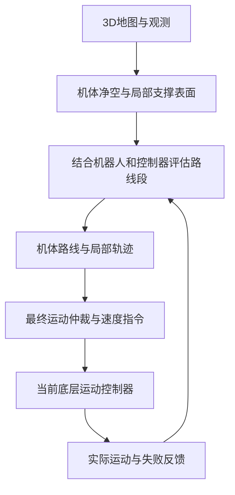

# 可穿越性与足部规划：三条技术路线的职责和接入条件

> 历史实验记录：2026-10-27 已从当前导航代码删除逐脚接地证明和承重门槛。本文的旧测试结果保留用于溯源，不是当前运行规则；当前实现见 [组合碰撞模型设计](../design/navigation-body-model-and-motion-posture.md)。

日期：2026-10-25。继续自 [支撑参考实现审阅](support-reference-review-20261025.md)。
本轮是原论文、固定源码与当前控制接口的深入核查；没有运行上游或改动产品运动算法。

后续实现已开始：[共享支撑函数的余量分离与50项回归](support-margin-fix-20261025.md)。
研究结论与已实现行为的边界在该记录中分别说明。

## 直接回答

导航应判断“所选机器人使用实际控制器，能否通过这一段地形”。足部规划是部分
系统实现这个目标的方法。ArtPlanner 不输出逐步足迹；感知 NMPC 会通过优化机身、
关节和接触力改变足端运动；TAMOLS 将目标落脚位置显式列为优化变量。三者不是
同一层的三个替代导航器，不能并排理解成选一个整体移植。

可穿越性也不是一块地面的固有颜色。应至少说明机器人、控制器、方向、速度与
起始状态。地面分割提供表面与几何证据，不能独立回答运动能否完成。

## 四个容易混淆的问题

| 问题 | 评估对象 | 输出的物理含义 |
|---|---|---|
| 地形/表面提取 | 点云、占据与局部表面 | 哪些高度位置有表面、法向/粗糙度/孔洞是什么 |
| 可落脚性 steppability | 某个表面小区域 | 这片表面能否考虑作为接触候选 |
| 可穿越性 traversability | 机器人从一种状态到另一种状态的运动 | 这个控制器能否完成、代价多大、实测失败在哪 |
| 落脚与运动规划 | 接触位置、关节、机身、接触阶段 | 具体如何执行下一段运动 |

一个表面可落脚，不代表腿够得到。每条腿各有一个候选点，不代表四脚组合能平衡。
某个构型可以站住，不代表可以从邻近构型走到它。最后一种差异解释了为什么只查
离散姿态的路线仍可能无法执行。

“可穿越性”的研究表达可写成

`T(局部3D地图, 起始状态, 目标变化; 机器人, 控制器, 速度指令)`。

这是条件关系的说明，不要求产品新增这样一个通用大接口。当前实现完全可以在已有
边查询与评估工具内表达这些条件。已知地面几何与控制器运动能力应该分别有证据。

## 三条路线：真正的变量、输出与限制

| 路线 | 优化/搜索内容 | 足部位置如何处理 | 接触时序 | 输出与执行 |
|---|---|---|---|---|
| ArtPlanner | 机体位姿路线及边的代价/风险 | 每条腿的可达体积与合格地面相交，不输出逐次落脚点 | 交给配套运动控制器 | 机体路径→路径跟踪→运动控制器 |
| Perceptive NMPC | 机身状态、关节运动、接触力；含输入滤波增广 | 足点由机身/关节经 FK 计算，随优化变化；落脚区域预先选择 | 单次求解内使用给定模式序列；执行接触反馈可更新后续计划 | 力/关节速度计划→执行参考→WBC→力矩 |
| TAMOLS | 6D机身轨迹系数、目标落脚点、辅助变量 | 未来落脚点显式优化；已承重脚受初始条件约束；摆腿轨迹另生成 | 固定步态给出抬脚/落脚时刻 | 机身/摆腿参考→WBC |

### ArtPlanner：与当前导航职责最接近

阅读 [ArtPlanner v1](https://arxiv.org/html/2303.01420v1) 的1.5、2.1–2.3及公开实现。
其两种几何查询语义相反：躯干不应与障碍相交，足部可达盒需要与可落脚地形相交。
默认方法进一步用模拟生成的运动数据学习路线边的耗时、能量和失败风险。
因此它同时使用几何筛选与控制器经验，而非为每条腿在线解一串准确落脚点。

公开代码固定于 `2f3fde68b8ac55f6f91083acc4d09df2b10f3c1f`：

- [ValidityCheckerFeet::isValid](https://github.com/leggedrobotics/art_planner/blob/2f3fde68b8ac55f6f91083acc4d09df2b10f3c1f/art_planner/src/validity_checker/validity_checker_feet.cpp)：足部可达盒。
- [MotionCostObjective::motionCost](https://github.com/leggedrobotics/art_planner/blob/2f3fde68b8ac55f6f91083acc4d09df2b10f3c1f/art_planner/src/objectives/motion_cost_objective.cpp)：插值边查询和风险阈值。
- [Converter::pathOmplToRos](https://github.com/leggedrobotics/art_planner/blob/2f3fde68b8ac55f6f91083acc4d09df2b10f3c1f/art_planner_ros/src/converter.cpp)：输出每个机体位置与朝向；没有足端命令。

对 LingTu 的推论：可以先保持导航发机体运动指令的边界，把“能否通过”的判断与
实际控制器的实验能力对齐。借鉴学习代价的**数据含义**，不意味着现在就引入神经网络。
从现有控制器固定场景的闭环结果开始，先知道哪些边确实能走、为何停下。

还有一处命名差别：ArtPlanner 在机器周围的局部地图上规划导航路线。
论文里的 local navigation 与我们 SCAN 的局部样条、NMPC的全身运动层不是同一个层级。

### 感知 NMPC：会规划足端，但不是全局自由搜索所有足迹

依据 [Perceptive Locomotion v1](https://arxiv.org/html/2208.08373v1) IV–VI、VII-D：
足部XYZ并非独立状态槽位；改变机身与关节，FK得到的足端位置也随之改变。
控制器先选择足端的局部地形区域，在该区域和给定接触阶段内优化运动。
它没有在一个NLP里自由切换任意踏石和所有步态。输出也不能直接替换速度命令，
其后需要全身控制器转成力矩。

在固定 OCS2 `26386754b8bf31ab78b503971d0cbf4fdbcd7cb4` 中：

- [SwitchedModelPrecomputation](https://github.com/leggedrobotics/ocs2/blob/26386754b8bf31ab78b503971d0cbf4fdbcd7cb4/ocs2_robotic_examples/ocs2_perceptive_anymal/ocs2_switched_model_interface/src/core/SwitchedModelPrecomputation.cpp#L147-L211)：由状态计算足点/导数，按接触相位准备碰撞几何。
- [SwingTrajectoryPlanner](https://github.com/leggedrobotics/ocs2/blob/26386754b8bf31ab78b503971d0cbf4fdbcd7cb4/ocs2_robotic_examples/ocs2_perceptive_anymal/ocs2_switched_model_interface/src/foot_planner/SwingTrajectoryPlanner.cpp#L355-L420)：在优化前选区域。

对 LingTu 的推论：若以后接入地形感知的全身控制，应先确认传感、关节/力矩权限、
接触反馈、状态估计和执行链。仅复制一个足端多边形约束不能赋予当前速度接口相同能力。
当前可先借鉴“允许接触表面”与“其余部位避障”的职责分工。

### TAMOLS：显式落脚点与机身轨迹联合优化

依据 [TAMOLS v2](https://arxiv.org/html/2206.14049v2) II-A、V、VI：
它用固定步态确定接触事件，并把未来落脚点与机身轨迹一起优化；通过简化稳定性
模型消去规划问题中的显式接触力。摆腿轨迹和WBC补齐执行。因此能优化落脚并不等于
在线搜索步态时序，更不等于只凭地形图就能使用它。

它的不同地形层也有不同用途：实际足点地形、边缘梯度、机身参考高度不能混用。
机身参考高度可跨过缝隙平滑，物理接触仍需落实到真实表面。不能把平滑参考高度
填回我们的占据地图作为真实支撑。

对 LingTu 的推论：最值得借鉴的是避免逐腿独立落点与机身运动相互不相容，以及
明确近似模型的边界。本轮没有验证原作者完整软件，不将第三方复刻等同于原实现。

## 为什么“地面的可穿越性”还需要机器人与控制器条件

以下是根据上面职责与本地实验作出的工程推论，并非三篇论文共同定义的统一公式。

1. **同一个空带，沿着走与横穿不同。** 纵向槽允许轮足沿两侧连续承重；横向断口
   要求轮子经过边缘或腿抬起跨越。只给区域一个统一不可通行标记会丢失方向。
2. **同一段路，直行和转向不同。** 机身转弯扫过的空间、轮足位置及侧向运动能力
   变化。两个端点都能站立，连接运动仍可能不成立。
3. **同一几何，控制器不同结果不同。** 滚动控制器和有精确落脚能力的步行控制器，
   对断口和踏石的能力不同。用理论可达范围替代实际控制范围会误放行。
4. **同一控制器，速度和进入状态不同。** 速度影响刹停、滚越边缘和侧向响应；
   在稳定状态能通过，不说明从失衡或错误支撑状态出发同样能通过。

这也解释为什么“分割出地面”是必要输入，却不足以成为完整答案。楼梯上每级踏面
都可以分割为地面，但台阶高度、腿部行程、摆腿净空、控制器能力仍决定能不能上楼。
同一XY存在上下楼板时，应保留各表面及其连接，不用单张投影高度图授权通行。

## 当前系统应如何采用这些结论

本轮独立核查的当前源码边界：

- `src/nav/cpp/endpoint/nav/dds/runtime.cpp::toDdsFinalVelocity` 和
  `src/drivers/real/motion/core.hpp::Velocity` 连接 vx、vy、yaw_rate。
- `src/drivers/real/motion/robots/unitree/go2/go2.cpp::move` 调用
  `SportClient::Move`；Doso 适配器调用 Brainstem 的三轴速度 move。
- `src/drivers/real/motion/body.hpp::Body` 当前没有足端目标或接触时序命令。
  Go2 的关节角反馈可以帮助重建当前几何，但不等于未来接触计划。
- 本轮Thunder实验的4998策略输入包含惯性、关节、速度参考和上次动作，没有地形
  高程与目标足点。它是当前策略能力测量，不能视为精确落脚控制的验证。
- 当前 `config/robots/unitree/go2/robot.yaml` 的 `navigation_body_file` 为空，
  注释选择正式单yaw OBB；固定多部件BODY2是离线资产。本系列历史实验中的
  多部件能力描述不能直接当作当前产品默认接线。

近期仍由原生3D导航规划机体路线、局部轨迹和最终速度。支撑判定先明确其物理对象，
之后用所选平台的实际控制器验证。足部规划是否成为运行时能力，要由可用控制接口决定。

这里的路线段评估属于现有导航查询和实验工具，不表示新建独立服务或改用2D代价图。
如果未来采用感知 NMPC 或 TAMOLS，底层运动控制路径需要另行实现；不能把它们的
足点或力参考直接塞进当前速度消息。

### 最小的深入推进顺序

1. **定义与测量一致。** 先修中心支撑、真实接触区域、碰撞/扫掠余量混用；
   使用已有同姿态记录定位误拒，保留实际净空与浮空拒绝。这个阶段只证明几何含义。
2. **在路线段上测现有控制器。** 平地、临墙、不同方向断口、坡/台阶分别记录
   命令/速度、到达、漂移、接触、退出原因。先区分测试规则中止和物理失败。
3. **闭环校准可穿越范围。** 用同一地图、方向、速度、机器人和策略，让原生规划
   与实际控制一起运行，记录几何接受却执行失败、几何拒绝却实际能走两类结果。
4. **有明确缺口再选运动层。** 若需要精确跨踏石，而现控制器不能选择落脚，
   再评估感知控制器接入。不能因地形可达就默认厂商控制器会完成指定落脚。

不应现在照搬ANYmal学习权重、临时取消所有中心查询、放松未知地面、在每个全局
候选中求全身NLP。已知错误可以在现有函数内收窄修正，控制器能力以实际闭环结果为准。

## 进一步核对：ArtPlanner 能否结合速度底层，SCAN 已考虑什么

### 速度接口相容，运动风险需要本平台依据

ArtPlanner 是导航规划器。固定版本
[converter.cpp:32](https://github.com/leggedrobotics/art_planner/blob/2f3fde68b8ac55f6f91083acc4d09df2b10f3c1f/art_planner_ros/src/converter.cpp#L32)
输出机体路径；
[path_follower.py:173](https://github.com/leggedrobotics/art_planner/blob/2f3fde68b8ac55f6f91083acc4d09df2b10f3c1f/art_planner_ros/scripts/path_follower.py#L173)
中的示例跟踪器输出机器人坐标下的 vx、vy、yaw rate。
[README:85](https://github.com/leggedrobotics/art_planner/blob/2f3fde68b8ac55f6f91083acc4d09df2b10f3c1f/README.md#L85)
明确另行启动运动控制器，且示例跟踪器不属于受支持产品组件。
因此“底层只收速度，所以不能接ArtPlanner”不成立。

真正的迁移限制见
[README:107](https://github.com/leggedrobotics/art_planner/blob/2f3fde68b8ac55f6f91083acc4d09df2b10f3c1f/README.md#L107)：
提供的风险权重针对ANYmal策略训练，训练环境未提供。接口相容不等于风险已经适配。
不能把ANYmal策略的通过预测直接当作Go2/Thunder的已验证能力。

### SCAN考虑机体轨迹的几何可行性，没有足端规划

原论文：[SCAN-Planner v1](https://arxiv.org/html/2606.19555v1)。其核心包括位置B-spline、
朝向相关碰撞体、路线高度趋势与投影搜索。论文中的地形穿越能力和实机楼梯结果，
不表示优化变量包含脚的位置、步态或接触力。

本仓库固定上游 `348e8a590a50a5a6bbab8d8c6dcfd171f009be26`；需区别上游方法、
LingTu可选几何能力与产品实际接线：

| 问题 | 当前处理 | 能证明的范围 |
|---|---|---|
| 机身会不会撞墙/悬垂物 | SCAN Grid读取3D碰撞数据，按所选机体几何查询 | 所选固定包络与地图之间的几何碰撞 |
| 局部轨迹是否平滑、速度/加速度是否超限 | B-spline代价和导数检查 | 机体参考轨迹约束，非接触动力学稳定 |
| 局部路径是否保留路线高度趋势 | 初始化、投影引导与参考拟合 | 不等于轮足可靠承重 |
| 普通自主路线的支撑/坡度/步高 | OctoPlanner3D负责；普通SCAN请求不再灌入重复地面高度检查 | 全局几何准入条件，不是每足未来接触计划 |
| 新圆弧的支撑 | pose blend分支额外传入高度/容差，Grid做全足迹检查 | 合成圆弧的地面几何检查；其全足迹假设仍需修订 |
| 可选多部件body的接触部件 | 若模型标记support_required则调用共享支撑函数 | 固定部件姿态的支撑，不是步态优化 |
| 下一脚踩哪里、抬脚多高、何时承重 | 没有对应决策变量/输出 | 由实际运动控制器处理；SCAN未证明其实现 |

代码入口：

- `planning/local/scan/upstream/bspline_opt/bspline_optimizer.cpp::calcFeasibilityCost`
  与 `uniform_bspline.cpp::checkFeasibility`：轨迹速度/加速度。
- `planning/local/scan/grid.cpp::Grid::bodyPoseOccupancy`：可选高度支撑、部件支撑、碰撞。
- `endpoint/nav/app/config/build.cpp::buildLocalPlannerParams`：全局地形约束的职责说明。
- `navigation/executor.cpp` 的普通请求与 `pose_blend_` 分支：支撑参数是否启用。

进一步区分两种“动态”：Grid可以结合预测障碍检查时间相关碰撞，Executor还做制动
几何判断；它们与摩擦、接触力、关节力矩和质心平衡的全身动力学是不同问题。
楼梯模式的速度/朝向限制与底层profile反馈，也不能等同于生成足迹。

当前Go2正式单OBB不包含真实足部的接触标签，因此不能用“Grid有support_required分支”
声称产品已验证四足承重。普通双圆柱模式读取膨胀碰撞图，也不能把无碰撞等同于有支撑。

### 对当前产品的结论

ArtPlanner对腿部可达与策略相关运动代价更有针对性；SCAN对3D局部避障、平滑轨迹和
朝向相关机体碰撞更直接。二者并不存在已被本轮实验证实的全面优劣关系。

优先研究把ArtPlanner的可达/能力评估思想用在现有3D路线准入与候选选择中，再由SCAN
生成并检查局部轨迹，最终仍经原生仲裁发速度。若局部改线离开原全局路线，应对新增
路线几何重新做相容的地形判断；不能假定全局路线曾通过，任意局部改线都能走。
这属于已有查询职责的接合，不要求新增ROS进程、地图所有者或第二套最终运动出口。

在声称它更适合本平台之前，应以同一地图、控制器、机体尺寸、任务、速度和闭环
跟踪设置对照成功/失败原因及计算耗时。本轮没有执行这样的替换对照。

## 本轮材料与证据范围

- [NMPC变量与执行链独立核查](../../build/support-reference-research-20261025/nmpc-variables.md)
- ArtPlanner 固定源码保存在 `build/support-reference-research-20261025/art_planner/`。
- 原论文读取版本：ArtPlanner v1，Perceptive Locomotion v1，TAMOLS v2。
- 没有运行三套上游控制器，所述性能不作为 LingTu 已达成结果。
- 本轮没有新物理实验，既有10例实验仍为Thunder能力测试；不能代表Go2迈腿或产品闭环。
