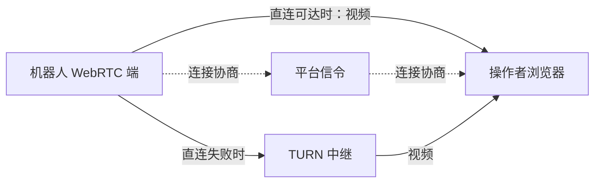
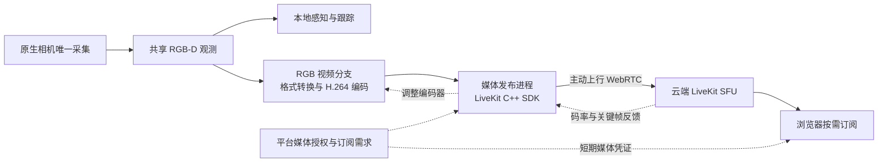

# 多机器人远程图传

**日期：**2026-10-17  
**状态：**原生 SHM → GStreamer → WHEP → 浏览器已在本地实际解码播放。Product/RunPlan 视频声明、非阻断启动、状态与停止基础已实现，并完成本地契约及临时 systemd 服务验证；目标板硬编、实机完整 Product 启停及公网资格待验。  
**需求：**多台机器狗统一接入平台，远程低带宽观看。多设备管理不等于同一路视频必须多人观看；
优先允许机器人与操作者直接传输，不把云端转发设为前置条件。

## 结论

**2026-10-17 续订正：云端媒体转发不是必需。** 先前从 fleet 直接推导云端 SFU 过早。
当前优先验证 **原生相机单次采集 → 板端 H.264 编码 → 机器人上的 WebRTC 端 → 浏览器直连**。
平台负责设备发现、授权与信令交换，可以不承载视频；跨公网直连失败时，TURN 提供媒体中继。
同一路视频有多个观察者且机器人上行吃紧、或有集中录制/分发需求时，再选择 SFU。

本轮已经完成原生 GStreamer WHEP 直连验证，go2rtc 保留为参考链路。下文的 LiveKit
编码接入与云端分发研究是 SFU 分支候选；其 SDK 通常连接 LiveKit SFU，不能关掉服务器
就当作 P2P SDK。JPEG 继续作为后备显示路径。

开发依赖已经用户批准并实际构建，固定为 GStreamer 1.28.8、gst-plugins-rs 0.15.4。
当前最大的前置不确定性转为目标板编码器、BSP 与感知同时运行时的负载。
本地使用显式 `x264enc` 和 16×16 合成源，不代表已在 Jetson 上完成硬编或真实 RGB-D 性能验证。

## 直连、信令、中继与分发

| 功能 | 是否传视频数据 | 是否必需经过云端 |
| --- | --- | --- |
| 信令 | 交换 SDP/ICE 等连接信息，流量很小 | 需要交换方式；可复用平台，也可在局域网本地完成 |
| STUN | 协助发现网络映射，不转发视频 | 公网穿透常用；可直达的局域网不依赖公网 STUN |
| TURN | 转发该 WebRTC 连接的加密媒体 | 直连失败的回退；不保证每次都需要 |
| SFU | 接收发布流，再分发给多个订阅者 | 一种媒体拓扑选择，不是 WebRTC 必需条件 |

局域网、可路由 IPv6 或可穿透 NAT 的网络可以直接传输；运营商 NAT、企业防火墙和 UDP
限制可能迫使中继。CGNAT 并非一律无法直连，STUN 也不保证所有网络可直连。
必须检查 ICE 实际选中的路径并测带宽，不能只看页面或 WebSocket 已连接。

同一台机器人向 3 个直连观看者发送 1 Mbps 视频，通常约需 3 Mbps 上行；
可以复用编码结果，不代表一定编码 3 次。TURN 仍是每个 peer 连接的中继，不替代 SFU 的
一次发布、多读者分发。SFU 模式可让机器人上行约 1 Mbps，由服务器承担约 3 Mbps 出口。
这些是单流净载荷算例，不含协议/重传开销。

中继和 SFU 也可部署在机房、现场边缘服务器或其他双方可达主机上；云只是部署位置之一。
依据：[WebRTC Peer Connections](https://webrtc.org/getting-started/peer-connections)、
[TURN](https://webrtc.org/getting-started/turn-server)、
[LiveKit SFU](https://docs.livekit.io/reference/internals/livekit-sfu/)。

## 先分清三层

| 层 | 解决的问题 | 本次选择 |
| --- | --- | --- |
| 编码 | 每秒产生多少视频数据、画质与编码开销 | H.264 首发，目标硬件支持时硬编 |
| 传输 | 建连、丢包、拥塞反馈、浏览器播放 | WebRTC；标准推流互操作可用 WHIP |
| 媒体服务 | 直连端点、网络中继或多人媒体分发 | 先验证板端直连；TURN 回退；SFU 分支再选 LiveKit |

RTSP 是媒体会话/传输接入方案，不是视频编码；同一段同码率 H.264 换成 RTSP
不会凭协议名称大幅省流量。普通 Web 页面也不能直接把 RTSP URL 当 `<video>` 播放。
RTSP 适合已有网络摄像头或局域网工具，再经媒体服务送到浏览器。

WHIP 是发布方向的 HTTP 信令协议，RFC 9725；WHEP 是读取方向的接口约定，不能把
RFC 9725 引用成 WHEP。HTTP 交换 SDP 后，媒体走 WebRTC，不是持续上传 HTTP 图片。
LiveKit 原生客户端使用自己的 SDK/信令，**不要求在它前后再串 WHIP/WHEP 网关**。
依据：[RFC 9725](https://www.rfc-editor.org/rfc/rfc9725.html)、
[MediaMTX WebRTC](https://mediamtx.org/docs/features/webrtc-specific-features)。

## 当前仓库事实

主入口是 [`lingtu_camera_webrtc`](../../src/drivers/real/camera/native/video/README.md)：
独立前台 C++ 程序只读现有彩色 SHM，最新 RGB/BGR 帧交给 GStreamer，原生 WHEP 端点
直接向浏览器发送 WebRTC。Gateway 只代理状态、SDP 和会话 DELETE，不传视频载荷。
相机仍是唯一设备 owner，感知继续消费原始 RGB-D；来源换代、尺寸或格式变化会释放旧会话。

`lingtu_camera_video` 的 FFmpeg 分支，以及 GStreamer 的 `--output FILE|-` 分支保留为
Annex-B H.264 参考输出。文件分支的固定帧率时间轴与 WHEP 的管线时钟分开处理。
JSONL 的 `submit_us` 只是送入 FFmpeg 的时间，不能当作完整编码或端到端延迟。
媒体程序已声明为相机预览变体的独立 Product 进程，由 RunPlan 与 ProductControl 管理。
本地事务测试与临时 systemd 服务验证已完成；实机完整 Product 验收仍待机器人连接。

| 位置 | 实际实现 | 与远程平台的差距 |
| --- | --- | --- |
| [原生相机](../../src/drivers/real/camera/native/) | 负责设备采集，RGB-D/内参通过 SHM 提供 | 应复用，不能再开一套 UVC 采集 |
| [原生视频分支](../../src/drivers/real/camera/native/video/) | 最新彩色 SHM → GStreamer 编码/WHEP；文件与 FFmpeg 参考分支保留 | 本地软件链路通过；目标板硬编、负载与受管生命周期待验 |
| [Host 相机适配](../../src/drivers/real/camera/dds_module.py) | 读取 SHM，发布共同图像/内参端口 | 名称中 DDS 不代表原始视频经公网 DDS |
| [JPEG relay](../../src/drivers/real/camera_jpeg_relay.py) | 默认质量 60、10 FPS 编码目标，只取最新原始帧 | 逐帧 JPEG，无视频帧间压缩；不作现场性能承诺 |
| [Gateway 图传](../../src/gateway/routes/realtime.py) | `/ws/camera` 发送最新 JPEG、序列去重 | 多客户端各发一份；公网 TCP 缓冲仍可能增延迟 |
| [Scene](../../web/src/components/SceneView.tsx) / [Console](../../web/src/components/CameraFeed.tsx) | 共用 WHEP 生命周期、实际解码新鲜度与 JPEG 后备；旋转来自配置 | 公网、多机订阅与实际负载待验 |
| [go2rtc 模板](../../config/go2rtc.yaml) | 消费原生程序读取同一 SHM 后输出的 H.264，不另开设备 | 参考链路；固定码率外置流不构成编码反馈闭环 |
| [WHEP hook](../../web/src/hooks/useWHEP.ts) | 通用媒体状态、配置 ICE、协商超时、重连、迟到会话清理 | 公网 TURN 需部署与验证；不是设备身份/平台订阅实现 |

原生 WHEP 已接入 Product/RunPlan，预览就绪失败明确降级，不阻断正常的核心启动。
go2rtc 仍是独立参考链路。
现有 [Gateway 媒体说明](../../src/gateway/README.md#camera-transport)仍描述已实现行为。
新平台方案不得被反写成已经部署。

## 媒体服务比较

| 方案 | 强项 | 我们仍需承担的部分 | 判断 |
| --- | --- | --- | --- |
| go2rtc | 单机摄像头聚合、RTSP/WebRTC、复用现有接入；转码由 FFmpeg 承担 | 设备身份、平台订阅、跨公网接入和权限业务 | 可评估为板端 WebRTC 端与本地工具 |
| MediaMTX | 单个媒体服务，RTSP/SRT/WHIP/WHEP、多读者转发、路径鉴权 | 平台订阅策略、画质档位和设备业务；不自动把单路编码变多档 | 标准协议媒体网关的候选 |
| LiveKit | SFU、Room/Participant/Track、SDK、选择性订阅、媒体权限、TURN | 机器人管理业务、板端采集/编码、按需上行和实际硬件验证 | 同一路多人分发时的首选候选 |
| SRS | 多协议直播接入和分发 | 机器人身份与交互媒体应用层仍需建设 | 有大规模直播/广播需求再评估 |

这些都是媒体能力，任何一个都不能自动替我们完成地图、任务生命周期和运动控制。
已有 RTSP 摄像头多、只需要视频网关时，应选 MediaMTX，而不是为了“平台”二字强上 SDK。
是否采用 LiveKit 取决于同一路观看人数、机器人上行和集中处理需求，而非设备数量本身。

依据：[go2rtc](https://github.com/AlexxIT/go2rtc)、
[MediaMTX 简介](https://mediamtx.org/docs/kickoff/introduction)、
[MediaMTX 架构](https://mediamtx.org/docs/features/architecture)、
[LiveKit SFU](https://docs.livekit.io/reference/internals/livekit-sfu/)、
[SRS](https://github.com/ossrs/srs)。

## 实现方案复核：2026-10-17

本次重新检索并核对上游接口，结论是：**单次采集、彩色帧独立消费的边界继续保留；
当前 FFmpeg/libx264 分支作为正确性基准和可显式选择的软件路径；正式板端优先验证
GStreamer 硬编，先用已有 go2rtc 接入建立播放基准，再验证 WebRTC 与编码器的自适应闭环。**
长期产品主候选与发布门槛见下节；go2rtc 不因最易接入而自动成为最终主链路。
这是依据接口和当前仓库作出的选择，
尚无这些方案在同一目标板上的性能排名。

这些项目承担不同层次，可以组合使用：

| 方案 / 项目 | 上游实际提供什么 | LingTu 的用途与缺口 |
| --- | --- | --- |
| 当前 SHM → FFmpeg → Annex-B | 已有代码、本地编码解码与生命周期测试 | 保留为验证基准；默认 CPU 编码，尚无媒体时间绑定、动态码率/IDR 反馈 |
| go2rtc | `exec` 读取外部程序 stdout 的 H.264，提供 WebRTC 与 STUN/TURN 配置 | 与现有码流接口最接近；可先验证浏览器播放，需另接来源身份、观看需求和编码反馈 |
| GStreamer + NVIDIA 编码插件 | `appsrc` 注入现有帧与 PTS；格式转换、NVMM、`nvv4l2h264enc` | 目标板编码的优先候选；需核对实际 BSP/插件，RGB/BGR 到支持格式通常仍有转换与复制 |
| GStreamer `webrtcsink` | 集成 WebRTC、信令接口、拥塞控制与每个观看者的编码管线 | 可作完整直连方案对照；预编码输入不会自动控制上游编码器；原始帧输入可能按观看者分别编码 |
| MediaMTX | RTSP/RTP/WHIP 等接入，WebRTC/WHEP、多读者、录制和控制接口 | 当标准媒体网关能力成为需求时替换 go2rtc 评估；不要求部署在云上，不负责我们的板端硬编 |
| jetson-utils / jetson-inference | 现有图像帧经 `videoOutput`、GStreamer 硬编送入内置 WebRTC 服务 | 学习 Jetson 上的具体实现；不整体接管相机，不将 Jetson 专用库变成所有平台的公共依赖 |
| LiveKit | C++ 预编码视频入口、完整编码帧与采集时间、IDR/码率反馈、SFU 分发 | 同一路多人观看或集中媒体平台时评估；仍需板端编码和反馈执行，不是首版 P2P 的必需项 |
| libdatachannel / libwebrtc | 底层 WebRTC 媒体与连接能力 | 可控性强，但引入更多原生接入、信令和反馈维护；当前优先采用现成媒体端 |

关键接口依据：

- [go2rtc Exec](https://github.com/AlexxIT/go2rtc/blob/master/internal/exec/README.md)：
  明确支持 stdout H.264/H.265 码流，因此当前程序有可直接试接的下游；
  [WebRTC 配置](https://github.com/AlexxIT/go2rtc/blob/master/internal/webrtc/README.md)提供 STUN/TURN。
  LingTu 已完成该参考链路的实际播放；从 RTCP 到外置编码器的控制闭环仍未接入。
- [NVIDIA Accelerated GStreamer](https://docs.nvidia.com/jetson/archives/r38.2/DeveloperGuide/SD/Multimedia/AcceleratedGstreamer.html)
  给出硬编、格式和编码控制接口；[appsrc](https://gstreamer.freedesktop.org/documentation/app/appsrc.html)
  接收应用已有 buffer。现有 SHM 时间戳是 Unix 纳秒，必须映射到管线的相对媒体时间，
  不能直接把绝对 Unix 值当运行时 PTS；来源代次/序号仍需明确绑定到编码帧。
- [rswebrtc](https://gstreamer.freedesktop.org/documentation/rswebrtc/index.html)和
  [webrtcsink](https://gstreamer.freedesktop.org/documentation/rswebrtc/webrtcsink.html)
  提供集成方案。其对自己创建的编码器的拥塞控制，不能直接外推为对任意外置编码器生效。
  插件为 gst-plugins-rs 的一部分，基础 GStreamer 已安装不表示该插件存在。
- [MediaMTX 架构](https://mediamtx.org/docs/features/architecture)是一个 publisher/source 对应一个 path，
  再分发给 readers；[GStreamer 接入](https://mediamtx.org/docs/publish/gstreamer)提供 RTSP/RTP/WHIP 路径。
  官方 WHIP 示例要求 GStreamer 至少 1.22，不能直接套到未知 BSP。
- [jetson-inference WebRTC 实现](https://github.com/dusty-nv/jetson-inference/blob/master/docs/webrtc-server.md)
  展示 `videoOutput` 与硬编、多个浏览器观看者的组合。示例中的采集入口不替代 LingTu 的相机 owner。
- [LiveKit 预编码发布](https://docs.livekit.io/transport/media/pre-encoded/)要求完整 access unit、
  帧类型、采集时间和分辨率，并提供关键帧与码率反馈。预编码单层输入不自动产生多档编码。
- [libdatachannel](https://github.com/paullouisageneau/libdatachannel)与
  [libwebrtc 原生开发](https://webrtc.googlesource.com/src/+/main/docs/native-code/development/README.md)
  作为底层接入的成本对照，当前不选择自行组合完整 WebRTC 应用。

机器人平台还参考了 Foxglove：
[Remote Access](https://docs.foxglove.dev/docs/fleet/remote-access)将图像转为可适应带宽的 WebRTC
视频轨，深度作为数据传输，并使用托管 SFU 做多观看者分发；自定义非 ROS 系统可接 SDK。
这支持“本地算法保留 RGB-D、操作者视频独立传输”的分工，也说明其托管架构有自己的分发选择，
不能据此推导 LingTu 必须经过云端。
[CompressedVideo](https://docs.foxglove.dev/docs/sdk/schemas/compressed-video)把采集时间、相机坐标系
和一整帧压缩数据一起定义，值得用于改进我们的编码输出合同；其中 `frame_id` 是坐标系，
不能当作 LingTu 的逐帧序号。

下一次资格比较固定同一实际视频源：JPEG 与 SHM → GStreamer 硬编 → 原生 WHEP，
需要定位编码/媒体差异时再使用已有 go2rtc 参考链路。固定尺寸、帧率和画质目标，记录实际码率、CPU/硬编负载、
采集到显示延迟、首帧、弱网恢复和无人观看时负载。硬编解决编码开销，动态码率和关键帧反馈
解决弱网恢复，两者分别验收。硬编或新媒体端正式纳入运行前，仍遵守依赖审批和 ProductControl 边界。

### 长期产品评分与选择

用户进一步明确：产品要长期使用、持续迭代，首发也要有可展示的真实质量。
因此不把最快接入作为主要选择依据。以下为完整方案的**工程适配预评分**，每项 0–10 分，
按权重合成百分制并四舍五入。分数依据上游机制、LingTu 需求以及需要自己承担的工程工作，
不是故障率、时延或板端性能实测，也不是第三方项目的官方评分。
预评分接近的方案须由目标板对照实验决定；不以分数代替不满足要求时的淘汰。

| 维度 | 权重 | 评分依据 |
| --- | --- | --- |
| 实时与弱网恢复 | 30% | 编码反馈、关键帧恢复、排队控制与媒体时间 |
| 稳定恢复与长期维护 | 25% | 重连、来源切换、依赖与自有维护责任 |
| 板端效率 | 20% | 硬编接入、转换/复制、多个观看者的资源开销 |
| 观测与平台运维 | 15% | 会话状态、指标、故障定位、批量运维接口 |
| 直连优先的部署匹配 | 10% | 一人看一机、P2P/TURN、自主管理和可选集中分发 |

| 完整候选方案 | 实时/弱网 | 稳定/维护 | 板端效率 | 观测/运维 | 部署匹配 | 综合 |
| --- | ---: | ---: | ---: | ---: | ---: | ---: |
| GStreamer 原始帧 → 硬编集成 → webrtcsink | 9 | 8 | 9 | 8 | 9 | **86** |
| GStreamer 硬编 → LiveKit SFU | 9 | 9 | 9 | 9 | 4 | **85（集中分发条件方案）** |
| GStreamer 硬编 → MediaMTX → WebRTC | 6 | 9 | 9 | 9 | 9 | **81** |
| GStreamer 硬编 → go2rtc → WebRTC | 6 | 8 | 9 | 7 | 9 | **76** |
| FFmpeg/libx264 → go2rtc → WebRTC | 6 | 7 | 5 | 6 | 9 | **64** |
| GStreamer 硬编 → 自行集成 libdatachannel | 6 | 4 | 9 | 5 | 10 | **64** |

分数的几个必要限定：

- webrtcsink 的高分以**由其控制实际硬编编码器**、主要一人看一机为条件。
  Rust 插件/BSP 不兼容、只能软件编码、或多观看者重复编码超出预算，都会使该方案不满足选择条件。
  给它一个外置固定码率的 H.264 流，不能沿用表中的实时/弱网分数。
- LiveKit 的预编码反馈有官方接口，但仍须传回我们的编码器并证明生效。
  该路线需要一个 SFU（可在本地/边缘/云端）；默认直连的需求不能仅靠其高总分被取消。
- MediaMTX/go2rtc 行按硬编预编码流接入、尚无上游自适应反馈连接来评估。
  完成反馈与实机验证后应重新评估；这里没有断言这两个上游项目不能用于优秀产品。
- MediaMTX 较高的运维预评分来自其明确的
  [Control API](https://mediamtx.org/docs/features/control-api)和
  [Prometheus 指标](https://mediamtx.org/docs/features/metrics)，不是我们测得它比 go2rtc 更少崩溃。
- FFmpeg 行评的是 `libx264` 软件编码组合，不是对所有 FFmpeg 硬编能力的评分。
  表中完整组合尚未在同一目标板完成对照。当前已完成本地软件编码的参考链路和原生 WHEP，
  这些证据不能代替表中的目标板效率与弱网资格。

**选择：GStreamer 驱动的硬编和 WebRTC 自适应闭环作为长期主候选，默认直连、TURN 回退；
go2rtc 用于尽快建立完整播放对照。** 先验证 webrtcsink 在正式目标 BSP 上能否实际控制硬编，
达到下面的发布要求后定版。若该候选不适配正式 BSP，则采用已验证硬编加现成媒体端，
并显式补齐反馈。多人观看/集中分发成为实际需求时，再选 SFU，不同时建设两套常驻媒体链。

首版质量目标如下。这些是待验收目标，不是当前性能结果：

| 质量 | 初始验收目标 / 条件 |
| --- | --- |
| 图像与延迟 | 目标 720p、20 FPS；目标设备支持该档位时，同网采集到显示 p95 ≤ 250 ms；远程在 RTT ≤ 80 ms、随机丢包 ≤ 1%、带宽 ≥ 实际视频码率 1.5 倍的明确条件下 p95 ≤ 500 ms |
| 弱网 | 在受控限带宽与 1–3% 丢包下，验证编码码率/必要时分辨率下降、关键帧恢复与队列不持续增长；回到正常网络后自动恢复 |
| 重连与来源 | 稳定网络恢复或相机重新出帧后，目标 3 s 内自动恢复观看；设备/相机/会话切换不得混入旧来源画面 |
| 连续运行 | 首发前完成 24 h 持续运行及 100 次连接/断开，检查进程回收、预热后内存趋势与实际编码实例数量 |
| 可观测性与资源 | 显示画面新鲜度；记录采集、编码、发送、解码、显示各阶段时间以及码率、丢包、重连原因；与不开视频的感知/定位基线对照，不超出目标平台实时预算；无人观看时停止非必要编码与发送 |

上述网络条件的定义和测量方式在实测前固定。采集到显示延迟使用经验证的时钟同步或
画面拍摄计时器测量，不能拿 RTT 或 `submit_us` 代替。出现失败时先定位具体阶段，
再决定调编码、网络或接收显示，不用提高配置值掩盖排队。

当前交付状态：最新帧、来源代次、编码、原生 WHEP 实际浏览器播放及会话释放已本地验证；
目标硬编、真实相机到浏览器性能、弱网反馈、按需观看及 Product 受管生命周期尚未验收。
32 帧编码解码测试与连续合成源播放证明软件合同，不是实际平台性能结果。

## SFU 分支的候选结构与责任

本节以已决定使用 SFU 为条件，不是直连方案的必经链路。

- **原生相机**保持唯一设备 owner。媒体分支读已有帧，不允许 go2rtc/FFmpeg/SDK 再次采集同一设备。
- **编码/发布**使用有界队列，网络阻塞不得拖住采集和感知。作为新受管原生进程时必须进入
  声明与 RunPlan，由 ProductControl 管生命周期；不能让 Gateway 私自启动第二套进程链。
- **平台媒体服务**负责转发，不处理导航。先单节点，不引入 Kubernetes 或多区域。
  LiveKit 官方说明单节点无外部依赖，多节点才需要 Redis 路由；令牌服务、TLS 和 TURN
  仍需按部署环境配置。
- **平台业务**维护真实机器人与媒体身份的对应、观看授权和上行需求；LiveKit 不替代机器人注册中心。
  Room 按站点/授权范围分组，Participant 对应机器人发布者，Track 对应相机。首版关闭自动订阅所有轨道，
  只订阅屏幕可见、授权可看的画面。隐藏卡片不是权限隔离。
- **任务和运动**继续通过现有类型化 API、原生仲裁和 driver。不能因为 SDK 有 DataChannel/RPC，
  就另建直接下发速度的旁路。媒体连接成功不表示定位/运动已就绪。

原始深度、内参、标定和共同观测时间留在本地算法链；远程视频以操作者查看为用途。
远程点云也需独立限制更新频率和显示数据量，不能在压低视频码率后仍持续上传全量点云。

## SFU 分支的 C++ 预编码入口

当前官方文档明确 C++ SDK **1.11.0 起**支持 `EncodedVideoSource`。
输入完整 H.264 access unit，包含采集时间和关键帧标记；关键帧携带 SPS/PPS。
SDK 打包发布已有编码数据，无需额外解码重编码，也无需为这条路径部署 Ingress。
`takeFeedback()` 可取关键帧与目标码率/帧率请求，我们必须把它们接回编码器。

它只提供**一个空间层**，示例关闭 simulcast；SDK不能从一份编码帧生成多档视频。
该接口也有数据复制，不能宣称全链路零拷贝。
依据：[预编码发布](https://docs.livekit.io/transport/media/pre-encoded/)。

上游 README 声明支持 Linux x64/arm64，但这不证明任意 JetPack 已有可直接运行的发行包。
源构建涉及 C++、Rust FFI、Protobuf/Abseil 等，部署要核对 glibc、libcurl 和所选 tag。
第一步必须做目标 ARM64 镜像的构建/运行验证；不在主程序中盲目升级公共依赖。
依据：[C++ SDK](https://github.com/livekit/client-sdk-cpp)、
[构建说明](https://github.com/livekit/client-sdk-cpp/blob/main/docs/building.md)。

LiveKit 也公开了 raw-frame 自动硬编能力，那是另一种接法。我们优先掌握既有 SHM 与
编码支路，再用预编码发布；这样编码负载、采集所有权和反馈生效位置更清楚。
依据：[硬编码支持](https://docs.livekit.io/robotics/media/video/encoders/)。

## 板端编码与弱网

历史实机记录包含 Orin NX，但产品仍按 RobotConfig 和运行环境选择能力。
首个候选为 `appsrc → 颜色转换/NVMM → nvv4l2h264enc → appsink → 发布`。
SHM CPU 图像到 NVMM 可能需要拷贝/转换，不能预先当作零拷贝。
具体格式、stride、编码属性和动态 bitrate 可写性须对目标 JetPack 验证。

H.264 首版使用浏览器兼容配置、无 B 帧，先测 1–2 秒关键帧间隔，再按首帧和丢包恢复结果调整。
这只是测试起点，不是普适最优值。新观看者和恢复请求触发 IDR，而不是等待很长 GOP。
视频队列满时优先在**编码前丢旧原始帧**；不能把 JPEG 的“随便丢整帧”策略直接搬到
编码后的 H.264 P 帧，否则会破坏参考依赖。

Orin Nano 没有 NVENC，不能套用 Orin NX 的硬编性能假设；其他板卡须依据厂商编码能力适配。
首发选择 H.264 是为浏览器兼容和可用编码器；H.265/AV1 的硬件与浏览器支持需单独测试。

依据：[NVIDIA Accelerated GStreamer](https://docs.nvidia.com/jetson/archives/r39.2/DeveloperGuide/SD/Multimedia/AcceleratedGstreamer.html)、
[Orin Nano 软件编码](https://docs.nvidia.com/jetson/archives/r38.4/DeveloperGuide/SD/Multimedia/SoftwareEncodeInOrinNano.html)、
[GStreamer appsrc](https://gstreamer.freedesktop.org/documentation/app/appsrc.html)、
[queue](https://gstreamer.freedesktop.org/documentation/coreelements/queue.html)。
这些是上游版本资料，不能把 r39.2 命令直接当作本机 BSP 配置。

## 怎样真正节省带宽

1. **无人观看时不持续传视频。** 保持机器人状态在线，若需要缩略图则按需或低频请求。
   停止媒体上行不停止原生采集、感知或导航。首个订阅与最后一个离开需要平台向机器人传达需求，
   单纯让浏览器取消订阅不能证明机器人停止上行。
2. **多宫格用低档，选中的机器人升档。** 首版一条可调流按最高有效观看需求选档。
   同一机器人的所有观看者共用这一档；同时兼顾高低质量观看者的能力有限。
3. **按观看拓扑计算上行。** 单观看者直连没有媒体服务器出口；多观看者直连每个连接都需发送。
   SFU 分支让编码流只上传一次，由服务器复制。服务器出口和用户下载仍随订阅数增加。
4. **反馈必须到编码器。** 目标码率超过真实链路容量时主动降码率/帧率/分辨率，不能依赖积压后再播放。
5. **后续有证据再加双流。** 同源 `preview`/`main` 是两次编码、两份上行，不是免费层级。
   只有不同观看需求同时存在且硬件负载允许时启用；或者采用经过验证的 simulcast。

LiveKit adaptive subscription、simulcast 与 dynacast有对应能力，但都依赖发布端提供的实际层和反馈。
预编码单层不能承诺“每个浏览器独立变清晰度”。云端转码可以补层，却不能节省机器人已经发出的
高清上行，且增加云端计算与延迟，因此不作为首版默认。
依据：[媒体编码与分层](https://docs.livekit.io/transport/media/advanced/)、
[选择性订阅](https://docs.livekit.io/transport/media/subscribe/)。

### 建议测试档位，非实测性能

| 模式 | 初始尺寸/帧率 | 起始码率预算 | 启用条件 |
| --- | --- | --- | --- |
| 无人观看 | 无连续视频 | 0 视频码率，仍有状态/信令 | 不要求云录像 |
| 宫格预览 | 640×360，5–10 FPS | 0.15–0.4 Mbps | 卡片可见 |
| 选中查看 | 960×540 或 1280×720，15–20 FPS | 0.8–1.5 Mbps | 主画面可见 |
| 临时检查 | 1920×1080，20–30 FPS | 2–4 Mbps | 有带宽且人工选择 |

暗光、快速运动和复杂点纹理会改变压缩需求。上述预算必须用我们的实际相机片段验证可读性，
不承诺某个码率一定能看清小目标，也不为了画面清晰挤占任务控制流量。

计算示例（使用十进制单位，仅视频净载荷）：

- 16 台全部 1.2 Mbps：合计 **19.2 Mbps ≈ 8.64 GB/小时**。
- 15 台 0.25 Mbps 预览 + 1 台 1.2 Mbps 主画面：**4.95 Mbps ≈ 2.23 GB/小时**。
- 相同假设下减少约 **74%**；这是订阅/档位策略的算术结果，不是编码实测收益。
- 若采用 SFU 且 3 人看同一组流，机器人总上行仍约 4.95 Mbps，云端出口约 14.85 Mbps。
  若全部独立 P2P 连接，机器人总上行净载荷约 14.85 Mbps。
  若同时上传主、辅两轨，应把两轨相加。

计算式：`GB/h = Mbps × 3600 / 8 / 1000 = Mbps × 0.45`。
协议、重传、TURN和运营商计费会增加真实流量；需要采集接口计数或实际账单校准。

## 公网、4G 与建站

### 自建还是托管

若“更方便”主要指免维护媒体服务器，LiveKit Cloud 可以先用于验证；官方说明托管与
自建复用核心 API/SDK，后续可迁移。若强调部署控制，则先单节点自建。
两者都要实测运营商路径和区域延迟，云服务不会自动解决板端采集/硬编接入。
本轮未比较实时套餐价格，也未开通付费服务。
依据：[自建与 Cloud](https://docs.livekit.io/transport/self-hosting/)。

如果用户的“rtsc”实际指腾讯 **TRTC**，它属于托管 RTC，不是 RTSP 协议。
腾讯官方也有自定义采集入口，可以绕过 SDK 自带采集而使用自己的帧；但所查通用页面
不能证明目标 Jetson Linux ARM64 的预编码/硬编可用性，因此本报告不把它当作已验证的
替代 SDK。要选它应另核对具体 Linux 产品包、原始帧/预编码入口和实际报价。
依据：[TRTC 自定义采集](https://trtc.io/document/35158)。

### 网络接入

机器人可主动连接平台信令，再与浏览器协商直连。若选择 SFU 分支，则主动连接固定媒体服务，
避免要求每台机器人有可入站公网地址。
浏览器通过 HTTPS 打开平台，但 HTTPS 能打开不代表 WebRTC 媒体必然可通。
优先 UDP，提供 ICE/TCP 和 TURN/TLS 回退，使用目标部署自己的可达地址与凭证。
CGNAT 下主动连接简化部署，不是“所有运营商都必然能打通”的保证。

LiveKit 端口资料区分 API/WebSocket、UDP 媒体、ICE/TCP 和 TURN；443 上的 HTTPS 代理
不能自动代替 UDP/SRTP。可信 TLS、房间发布/订阅授权、媒体 token由服务端签发是
公网多机器人场景本身所需，长期服务密钥不能放进浏览器。
依据：[LiveKit 端口](https://docs.livekit.io/transport/self-hosting/ports-firewall/)、
[TURN](https://webrtc.org/getting-started/turn-server)。

选择 SFU 分支时，首个自建部署只需媒体服务器、TLS/可达媒体端口、短期令牌接口和现有业务页面。
地点按机器人与操作者的实际 RTT 选择，不能因为某台 GPU 服务器已空闲就默认适合图传。
不转码的 SFU 主要关注网络与 CPU，不要求云端 GPU。

如果实际运营商链路让 WebRTC 上行难以达到要求，可专项比较 SRT 上行到 MediaMTX、
再 WebRTC 下行；SRT 的重传缓冲和更复杂链路有代价，不默认再串一级服务器。
Tailscale可用于维护与试验，但 VPN/DERP不是视频压缩器；DERP中继可能限制吞吐，
不将其作为多机视频主骨干的无条件性能承诺。
依据：[MediaMTX SRT](https://mediamtx.org/docs/publish/srt-clients)、
[Tailscale 连接方式](https://tailscale.com/docs/reference/connection-types)。

## 下一阶段资格测试

| 场景 | 具体要证明什么 | 失败后怎样调整 |
| --- | --- | --- |
| 单机兼容 | 实际 ARM64/BSP 硬编能接受现有帧；板端 WebRTC 端可读编码流；RGB-D 采集不受影响 | 调整编码/媒体实现，保留单采集边界 |
| 同视频比较 | JPEG 与 H.264 在相同场景/尺寸/帧率下的实际上行、CPU、画质和延迟 | 调 bitrate/GOP/格式转换，不先扩平台 |
| 公网单路 | 记录直连成功率、实际 ICE 路径、TURN 回退；Wi-Fi/移动网络/禁 UDP/重连均有结果 | 修正信令、ICE与可达媒体端口，实测中继占比 |
| 两机三观看者 | 对照 P2P 随观看者增长的上行与 SFU 分发成本；无人看时视频上行停止 | 依据上行与需求选择是否引入 SFU，修订订阅生命周期 |
| 真实多宫格 | 可见性/选中切档、相机重启、运行会话切换均不会显示错误设备或旧画面 | 修身份与帧新鲜度，再考虑双流 |

先做同一段真实 RGB-D 录像回放与原生编码测试，再接相机；两者分别记录，不能用回放证明实时采集。
收集实际发送/接收 Mbps、编码耗时、解码 FPS、丢包、冻结、RTT、首帧与恢复时间及长期内存趋势。
`getStats` 的 RTT 不是采集到显示的延迟；要用可信采集时间、同步时钟误差或摄像头拍计时器的方法验证。
关注主画面 p50/p95 和冻结区间，而不是只报平均 FPS。
依据：[W3C WebRTC stats](https://www.w3.org/TR/webrtc-stats/)。

LiveKit 的帧元数据能力可传 capture timestamp/frame ID，与现有 source epoch/机器人身份一起
关联原始观测；不得把媒体连接 ID 当作 Product 的运行身份。采用前验证选定 SDK 的元数据组合与
接收端支持，系统时间不同步时不显示虚假的端到端毫秒值。
依据：[帧元数据](https://docs.livekit.io/transport/media/frame-metadata/)。

## 本轮边界

已有两条实际浏览器解码证据：**SHM → GStreamer x264enc → 原生 WHEP → 浏览器**，
以及 **SHM → GStreamer x264enc → H.264 → go2rtc 1.9.10 → 浏览器**。
原生链路使用已构建的隔离 GStreamer 1.28.8 + gst-plugins-rs 0.15.4，运行时无 go2rtc 中间层。
来源暂停/换代会撤下旧画面并自动恢复，关闭后 peer/session 被回收；媒体服务重启后无需刷新即可返回 WebRTC。

这些是 16×16 合成源和软件 `x264enc` 的协议、解码与生命周期结果；尚无目标板硬编、
真实 RGB-D 负载、公网/TURN、SFU 或正式 Product 媒体进程验收。相机 owner 和 RobotConfig
未改变，没有提交、推送或部署到机器人。下一步是正式生命周期接入与目标板资格。
本地证据：[原生 WHEP 报告](../../build/camera_video_whep_tests/index.html)、
[详细结果](../../build/camera_video_whep_tests/RESULTS.md)。

## 实现计划与监督记录

2026-10-17：用户要求按长期产品方向开始实现，并由主代理监督。
本轮交付目标为已有彩色 SHM 经原生 GStreamer 会话送达浏览器，保留来源与时间，
能够正确停止、重连和清理旧连接。先完成本地可复现链路，目标板硬编单独验收。

| 步骤 | 责任与文件范围 | 完成条件 | 状态 |
| --- | --- | --- | --- |
| 1. 合同与依赖 | 主代理：本计划、构建环境、接口 | 明确相机 owner、视频会话 owner、播放端点与实际依赖 | 本地完成；隔离 1.28.8/0.15.4 已实际构建，30 个工厂检查通过，Rust 锁已固定 |
| 2. 原生视频会话 | 原生实现代理：`camera/native/video/gst.*`、`stream_main.cpp` 与原生测试 | appsrc 原始帧与媒体时间；来源改变隔离；实际编码器可见；会话停止有界 | 本地完成；文件 32 帧解码与原生 WHEP 实际播放通过，PTS 时钟修正通过回归 |
| 3. 浏览器生命周期 | Web 实现代理：`useWHEP` 与定向测试 | 旧协商不能覆盖新连接；停止清理；断线重连；原有预览可用 | 本地完成；16 项定向测试，停帧、换代、关闭、后备与服务恢复有浏览器证据 |
| 4. 播放接入与构建 | 主代理：Gateway 信令、CMake、配置、现有页面接入 | 浏览器可连接选定媒体端；Gateway 不启动原生进程、不转发视频载荷 | 本地完成；Scene/Console 共用接口，原生 WHEP 无 go2rtc 中间层，生产构建通过 |
| 5. 集成监督与证据 | 主代理：原生与 Web 定向测试、连续 SHM 夹具、浏览器检查 | 真正解码显示；停止/重连/来源切换可复现；记录实际输出与限制 | 本地完成；JSON、截图、失败记录与修复结果已保留，性能资格不外推 |
| 6. 正式生命周期与板端资格 | 主代理：Product/RunPlan 声明、ProductControl 受管启停、目标平台实测 | 唯一采集、readiness、硬编与感知负载、弱网和持续运行；随后公网、多机 | 本地代码与契约、临时 systemd 服务通过；实机完整 Product、目标板和公网仍待验 |

监督方式：各实现代理只修改分配文件；主代理检查交接接口、处理集成、运行受影响的验证，
发现失败先修复再更新记录。不以代理的完成描述代替实际测试，也不把软件编码记录成硬编结果。
依赖已获用户批准用于开发验证，并固定版本。没有提交、推送或部署未审核内容。

### 本地验收记录（2026-10-17）

- 原生 WHEP：连续合成 SHM → `x264enc` → `whepserversink` → 实际浏览器解码。
  正常播放、暂停撤旧帧、502→503 来源恢复、关闭清理、JPEG 后备、媒体服务重启自动恢复均有截图和 JSON。
  关闭后原生 `active_consumers=0`，Gateway 会话 DELETE 返回 200；运行时未经过 go2rtc。
- 原生回归：既有系统 1.24 参考环境 6 组 CTest 通过；最新隔离 1.28 的
  `camera_video_gstreamer` 通过（1.64 s），覆盖实际 WHEP 管线时钟。
  CLI 再次将两代各 16 帧 RGB/BGR 解出 32 帧，检查行填充、旧帧、换代与无帧超时。
  记录：`build/camera_video_whep_tests/evidence/video-gst-cli-rttgisn0/`。
- Gateway 原有信令与 bootstrap 38 项通过；本轮协商预算修正后的 7 项定向回归通过。
  Web 16 项定向测试、TypeScript、受影响文件 ESLint/Python Ruff 与生产构建通过；
  构建保留已有约 564 KB 的 Three.js chunk 警告。

### 实测发现与修正

1. **协商预算不一致。** 上游原生 WHEP 最多等待约 30 s 完成 ICE gathering，原来的两侧
   5 s 会提前撤销有效请求。Gateway 改为有总期限的 `asyncio.wait_for(..., 35 s)`，浏览器
   POST 预算为 40 s。超时仍会释放旧连接、退避重连和回收迟到的 Location。
2. **首帧计时过早。** 首帧期限从 transport `connected` 后开始，避免协商阶段误报缺帧；
   播放后仍按最后实际解码帧的 3 s 新鲜度判断冻结。稳定播放约每秒发布健康状态，
   不是逐帧触发 React 更新。
3. **媒体 PTS 超前管线。** 原先用 GStreamer 初始化前取得的首帧建立零点，耗时初始化后，
   后续帧可能落在管线时钟的未来，`clocksync` 因而长时间等待。WHEP 改为
   `PTS = max(0, pipeline_running_time − capture_age)`；指标记录
   `last_pts_ns <= last_running_time_ns`。文件 H.264/FD 分支的固定时间轴保持原语义。

暂停/换代记录保留了两次约 32.5 s 的上游超时/500，之后成功自动恢复；首轮协商记录约 9.676 s，
成功恢复轮的 839 ms、服务重启后成功轮的 954 ms 均只是该次协商耗时，不是整个恢复过程或
采集到显示延迟。最终恢复成功不能作为产品首帧、恢复时延或弱网指标达标的证明。

Windows/WSL 中实际选中的 UDP candidate pair 为 `succeeded`、`nominated`，有完整请求/响应。
浏览器使用可达的 WSL 地址；HTTP localhost 转发不能代替 ICE 媒体可达性，mDNS 日志没有阻断
这次实际媒体连接。该地址仅属于测试，不写入 RobotConfig；未增加 GLib 主循环或强改 ICE 角色。

### 依赖与证据保存

GStreamer 1.28.8、gst-plugins-rs 0.15.4、Rust 1.92.0 和 cargo-c 0.10.21 已实际构建/使用，
30 个必要工厂逐个加载通过。固定入口为 `scripts/build/locks/video.json` 与
`video-cargo.lock`；准备脚本使用 `cargo cbuild/cinstall --locked`。
上游 release commit 将 Git 依赖改为 crates.io 而未同步 Cargo.lock，首次实际解析调整 68 项选择；
已保存这份成功构建的完整锁，原锁与差异在 `build/deps/video/logs/`。

首次 Rust 最终编译期间 WSL 重启清空 `/tmp`，已安装的 C prefix 与旧证据仍在。
恢复仅补 Rust 插件；脚本源码、工具与中间物现使用
`${XDG_CACHE_HOME:-${HOME}/.cache}/lingtu/video/`，安装位置为 `build/deps/video/prefix/`。
此次开发构建显式关闭 Cargo release debug 与 LTO，4 个任务并行；直接 `cbuild/cinstall --locked`
分别 2.63 s、1.94 s 复用产物完成，未重新编译依赖。此记录不用于目标板性能结论。

夹具：`web/tests/fixtures/video-check.*`。最新证据：`build/camera_video_whep_tests/`；
旧 go2rtc 参考证据：`build/camera_video_gst_tests/`。红色 H.264 和蓝色 JPEG 只标识合成测试传输，
不是机器人实拍。全部本轮记录留在本地，未提交、推送或上传。
验证结束已停止本轮拥有的媒体/Gateway/Vite/写入夹具，删除测试 SHM；两份原生运行指标
最终为 `stopped`，最后一次关闭后仍为 `active_consumers=0`。

## 正式启停接入（2026-10-17，本地基础已实现）

本节描述已实现的本地基础，不能代替实机完整生命周期验收。首期接入 `map/camera`、
`nav/camera`；随后补齐 `tracking/camera`，复用同一个视频角色与原有跟随链。
三个 Product 的 `sim` 实现均明确只支持 `standard`，不把本地合成源验证记成仿真
或实机图传验收。tracking 标准变体仍保留原有相机感知，仅预览编码由 camera 变体增加。

### 参考产品与取舍

- [MediaMTX 官方部署](https://mediamtx.org/docs/features/start-on-boot)直接以独立 systemd
  单元执行媒体程序。借鉴独立服务与系统进程管理；其最小示例没有 `Restart=`，不能将它
  引用为自动恢复已经得到产品验证的证据。
- [Frigate 官方 Restream](https://docs.frigate.video/configuration/restream/)让检测和实时
  预览共享一个相机连接。借鉴采集源复用；LingTu 已有原始 RGB-D SHM，继续从这里分支，
  不改用 RTSP，也不引入 Frigate 或 MediaMTX 依赖。
- [Spot CAM 官方接口](https://dev.bostondynamics.com/python/examples/spot_cam/readme)
  单独提供 WebRTC 和 Stream Quality 功能。它支持媒体接口独立的划分，不能用来推断
  Spot 内部的 systemd 或进程重启方式。

### 最小改动

1. Product 的相机预览变体显式选择 `video`；`real` Env 将其映射到一个
   `lt-video.service`，RunPlan 保留该进程。启动顺序在 camera 之后，停止顺序在 camera
   之前。相机仍唯一采集；视频只读同一个彩色 SHM。
2. 现有 ProcessSpec/RunPlan 只增加一个“是否阻断 Product 激活”的布尔语义，默认阻断，
   仅本轮预览视频允许降级；取值由 Product 决定。复用现有 SystemdRunner，视频启动或
   就绪失败必须写入 `degraded`，但不触发导航回滚。可选视频只做一次就绪探测，
   不等待观看者；状态查询会重新探测，来源恢复后解除降级。核心失败仍回滚全部已启动的目标进程，
   包括视频；停止失败也不能因视频非关键而被吞掉。
3. 复用原生服务状态文件约定，分别报告进程存活、当前来源帧是否新鲜、WHEP 入口是否
   可达。`OPTIONS` 成功不等于有新画面。浏览器的实际解码状态独立报告，不作为机器人
   Product 启动门槛；没有观看者也可以完成启动。
4. Host 的媒体端点来自同一 RunPlan/session 环境，Gateway 仍只代理信令。服务单元只
   执行已经解析的参数，不解析 Product、不拉起相机、导航或 Host。标准变体不启动视频。
5. 普通的相机换代、缺帧与浏览器掉线在原有媒体/客户端链路内处理。WHEP 程序已将
   5 秒缺帧退出改为报告缺帧并等待有效来源，避免一次相机重启永久丢失预览；
   文件输出分支的有界失败语义保持不变。真正的编码错误或进程崩溃明确报告失败。

降级只针对视频预览分支，不改变已有 Product 对相机采集的要求。必需的相机进程失败
仍按原合同处理；Follow 的原始观测失效仍应停止跟随，不能用预览降级绕开运动门控。

不通过 camera 单元的 `Wants=` 隐藏启动视频；这会让实际进程清单超出 RunPlan。
[systemd 官方语义](https://github.com/systemd/systemd/blob/main/man/systemd.unit.xml)
中的 `After=` 只保证顺序，不保证新帧。现有仓库明确约束 Product mode units 不自行
自动重启（`tests/runtime/test_thunder_native_watchdog_contract.py`）；本轮沿用该约定，
不偷偷增加 `Restart=on-failure`、watchdog 或另一套恢复管理器。进程崩溃后的自动拉起
不属于本轮已具备的能力，若后续需要，应在同一 ProductControl 所有权下单独定义。

### 本轮收口证据

| 场景 | 必须观察到的结果 |
| --- | --- |
| 启动预览变体，无浏览器 | RunPlan 含视频；单一相机采集；核心正常激活，不等用户打开网页 |
| 仅视频未安装、编码器不可用或读取输入失效 | 明确报告媒体不可用；其他必需进程正常时，核心不因预览失败回滚 |
| 核心进程启动失败 | 按原事务回滚；本轮已启动的视频一并停止 |
| 相机重启或断流超过 5 秒后恢复 | 撤下旧帧；识别新来源并恢复播放，不重启相机或导航来修视频 |
| 切换到 standard 或停止 Product | 视频按计划停止，会话、端口和编码资源释放，无旧实例残留 |
| 打开、关闭和重新打开浏览器 | 实际 H.264 解码成功；关闭释放会话；不会因为关闭网页停止机器人 |

先验证解析与事务行为，再用现有连续 SHM 夹具验证服务启停和浏览器恢复。
目标板硬编、真实 RGB-D 并行负载、端到端延迟和公网测试仍分别验收，不由本轮结果代替。

### 开发环境与实际服务记录

已固定并实际加载的开发环境为 WSL Ubuntu 24.04 x86_64、GStreamer 1.28.8、
gst-plugins-rs 0.15.4；`whepserversink`、`x264enc` 可用，`nvv4l2h264enc` 在该开发机上不可用。
开发测试明确选择 `x264enc`，不将它记录成板端硬编。

目标配置模板为 [`config/video.env.example`](../../config/video.env.example)。服务启动时
不下载或编译依赖，要求明确配置编码器和已有运行时环境。构建助手已生成可重定位的
`env.sh`，发布安装会携带对应架构的库、插件与扫描器，并拒绝架构不匹配的运行时。
本轮开发运行时仍是 x86_64，不能复制到 ARM 板；机器人接入后须为实际架构/BSP 构建
或配置运行时，资格验证单独记录。

本地临时 systemd 服务使用真实 `run_video.sh` 和 RunPlan 角色校验，输入仍为合成 SHM，
没有启动整套机器人 Product。实际记录：601 代来源就绪 → 断流超过 6 秒 → 同一进程等待
→ 602 代来源恢复 → 正常停止，MainPID/InvocationID 不变、`NRestarts=0`，停止后
`ready=false`、WHEP 端口释放、测试 SHM 删除。记录及失败原因见
[`本轮结果`](../../build/camera_video_foundation_tests/RESULTS.md)。

最后一轮服务测试使用标准构建、CMake 安装并迁移后的程序与运行库。迁移后以全新
GStreamer registry 加载 `whepserversink` 成功，发布打包自测通过，包中包含视频程序、
对应架构的库、插件、工具与扫描器；不依赖原构建目录的动态库路径。

RunPlan 内部格式更新为 v11，旧文件由 ProductControl 重新生成，不建立迁移或兼容管理层。

### tracking 接入与连续负载（2026-10-17）

real 增加 `tracking/camera`，默认 standard 保留原有感知与仿真链，视频仍只读同一彩色
SHM。同步/异步 SDK 补齐开始、双 ID 查询和定向取消；640×480 SHM→共同观测→Follow→
Gateway 组件集成验证源重启、地图切换、三帧身份核验与旧取消隔离，模型输出为受控输入。

实际尺寸合成 RGB-D、感知和 H.264 软件编码并行时，发现旧限频将读取/校验/复制/提交
耗时叠加到周期。改为从本次 SHM 读取开始计时，不补发旧帧；相同 20 秒输入解码帧数
由 254 增至 373，双时钟确认轮为 382。确认轮单调时钟处理 p95：无视频 92.73 ms / 有视频
96.61 ms。原始 wall-clock 跳变、首帧峰值和中间未达标结果全部保留。
详细过程见[本地验收记录](../../build/tracking-video-check/README.md)；该结果不代表
真实模型、完整 tracking Product、浏览器与感知并行、公网或实机性能验收。
