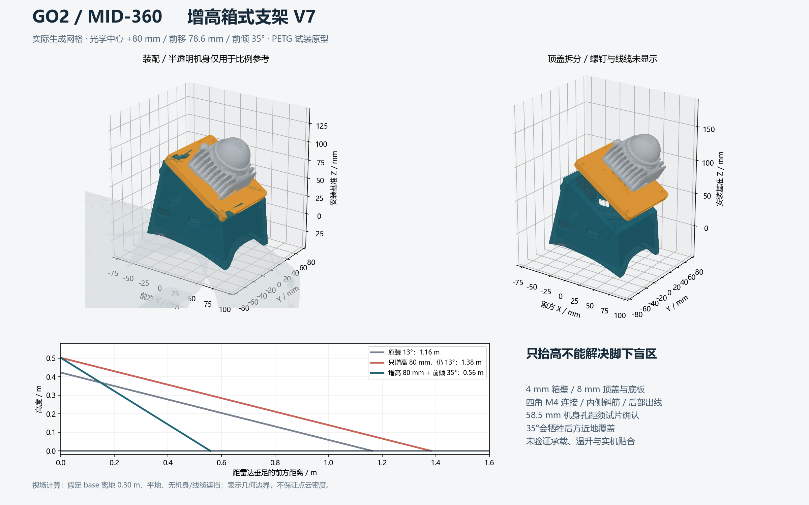

# Go2 EDU / MID-360 增高箱式支架 V7

这是可切片的 **箱式试装原型**：箱式主体、内侧斜筋、可拆倾斜顶盖、四角 M4 连接、后部理线口。雷达完全位于箱体外，不能把光学窗口封进盒子。尚未验证实机承载、温升或疲劳，不能作为“已经可靠”的生产件。

**本轮打印选择（用户于 2026-09-29 更新）：H2C，3 号槽蓝色 PLA，箱体、顶盖、左右贴合垫四件同盘。** 切片和发送时使用实际对应的 PLA 耗材配置及槽位，不能沿用此前 PETG 的参数。STL 尺寸不变。



## 设计判断与外部依据

- [Go2 + Jetson 顶置 MID-360 社区支架](https://github.com/AlanZhu2006/Go2-Jetson-MID360-Mount)明确以减少机身、Jetson 和线束遮挡为设计动机。它支持前上方布局的方向，不证明我们当前故障一定由安装位置导致。
- [PathOn 的 Go2 悬臂支架](https://www.pathon.ai/opensource/robots/livox-mid360-go2-mount)把雷达放到头部前方，采用打印件与 T-track 底座。这里借鉴前移和保留视场；未复制其 STL。
- [GO2-EDU-sensor_layout](https://github.com/zhechen003/GO2-EDU-sensor_layout)提供雷达、相机和快拆分件设计。这里保留可拆顶盖，方便紧固与理线，不额外加入快拆机构。
- [GLIM 的 Go2/MID-360 用户反馈](https://github.com/koide3/glim/issues/309)报告了约 13° 安装姿态与地图倾斜配置问题；这是外参相关反馈，不是高度不足的证据。
- [Livox 官方下载页及手册](https://www.livoxtech.com/mid-360/downloads)提供视场、安装界面和散热要求。孔距沿用本仓库已从官方 CAD 提取的 48×36 mm，设备底部为 4×M3。

## 尺寸和接口

所有输出 STL 单位为毫米。X 向机器狗前方、Y 向左、Z 向上。

| 项目 | 当前原型 |
|---|---|
| 光学中心，base 坐标 | `[0.240, 0, 0.20262] m` |
| 相对现装名义光学中心 | 前移 78.57 mm，增高 80 mm |
| 前倾角 | 35° 固定角，参数修改后重生成 |
| 箱体壁厚 | 名义 4 mm；局部斜筋与螺柱加厚 |
| 底板 | 随名义机身曲面，名义厚 8 mm；孔周加厚 |
| 顶盖 | 110×100×8 mm，圆角，底面朝下打印 |
| 顶盖连接 | 4×M4，孔中心 90×84 mm，箱体内侧六角螺母座 |
| MID-360 接口 | 48×36 mm，4×Ø3.4 mm 通孔 |
| 机身接口 | 暂用两孔横向中心距 58.5 mm，Ø3.6 mm；装机前必须实物确认 |
| 结构采样 | 箱体网格步长 0.65 mm；不等于打印或装配精度 |

58.5 mm 源自既有社区模型，不是现场测量。社区文中的 55.10 mm 是内侧参考尺寸，不能直接作为中心距。实际孔径、螺纹深度、壳体承载面尚未确认。新结构没有虚构四个机器人安装孔。

## 为什么同时改变高度与角度

以 base 离地 0.30 m 为算例，忽略遮挡，MID-360 最低边界相对雷达水平面约向下 7°。正前方地面交点距雷达垂足约为 `h / tan(pitch + 7°)`：

| 安装 | 光学中心离地 | 前方地面边界 |
|---|---:|---:|
| 当前名义 13° | 0.423 m | 1.16 m |
| 仅增高 80 mm，仍 13° | 0.503 m | 1.38 m |
| 增高 80 mm、前倾 35° | 0.503 m | 0.56 m |

这是几何边界，不是点云密度或实际可见地面保证。增加前倾会牺牲后方近地覆盖；仍不能从这个位置直接看到机身正下方。要补齐保存地图的地面，需要从其他位置看到它。尚未把未知的 NX、全部线束、螺钉头和相机实物装配纳入遮挡检查。

## 打印与紧固

1. 可先打印 `print/hole_gauge.stl` 核对 58.5 mm 孔距。**本轮用户于 2026-09-29 明确选择先打印整套试装原型，接受安装接口可能需要修改重打**；因此箱体、顶盖、左右贴合垫同批排版，不再等待试片。正式装机前仍需核对 M3 接口、实际孔距和可承载位置。
2. `box.stl` 已侧放，主要 XZ 承力路径尽量位于层内；曲面、内腔及螺母座按切片预览添加可清除的支撑。不要假定它无需支撑。
3. `lid.stl` 已平放；左右曲面配合垫分别打印。主体与垫片沿用已有 Go2 网格的名义曲面，安装前修配到稳定接触；不能靠强拧螺钉把悬空底座压到壳体上。
4. 起始切片建议：0.4 mm 喷嘴、0.20 mm 层高、6 道墙、8 层顶底、40–50% gyroid。孔周、四角和底部连接处使用局部实心；最终依耗材及打印机调整，不据此宣称承载等级。
5. 雷达先装到顶盖，再将箱体固定到机身，最后装顶盖。M4 螺母先放入箱体角座；可在组装时临时固定，螺钉拧紧后靠六角座止转。

标准紧固件为金属，所有定制结构件为打印件：

- MID-360：4×M3×12，8 mm 顶盖时名义入设备 4 mm；加垫片后重算，**不得超过官方 5 mm 孔深**。
- 顶盖：4×M4×25、4×M4 六角螺母、4×平垫片，试配实际座深和螺钉伸出。
- 机身：2×M3 和平垫片；**长度待实测螺纹深度后选取**，不能沿用雷达螺钉长度。

本轮按用户选择使用蓝色 PLA 试装，不给未经测试的强度承诺。参数文件、几何报告及 URDF 中的实心质量估算仍采用原设计的 PETG 密度 1270 kg/m³，不代表本次 PLA 切片重量；实际用料以最终 PLA 切片结果为准。雷达约 265 g，但机器人冲击、长杠杆、两颗机身螺钉和塑料蠕变决定结构可靠性，不能只按静态重量判断。

### 底部怎么拧到机身

顶盖拆下时，从箱体内部向下安装两颗机身螺钉。连接顺序是：

```text
M3 螺钉头 + 金属平垫片
          ↓
箱体底部加厚孔座（不是直接压在薄侧壁上）
          ↓
左右曲面贴合垫各一块
          ↓
机身对应的原有螺纹安装孔
```

孔座提供平整的垫片接触面；贴合垫承担名义曲面配合。先固定箱体，再装带雷达的顶盖，避免顶盖挡住螺丝刀。不得在未知承载位置钻孔或靠大力拧紧消除底座翘曲。

`check_fasteners.py` 对实际生成的箱体/垫片网格做了抽样穿透检查：两侧 M3 杆部通道畅通，拆盖后的直径 12 mm 竖直工具通道没有被筋和顶盖螺柱挡住，垫片支承面连续。孔座上表面到名义机身接触面约 **14.4 mm**；机身螺钉的头下长度需再加金属垫片厚度和实际啮合深度，并受机身可用孔深限制。该检查不验证实体孔距、机身内螺纹或打印后的孔径。

## 温升与装机

Livox 推荐金属安装面帮助散热。这个全打印顶盖不满足该推荐，通风孔不能替代金属导热。装机后需记录实际工作温度、塑料软化/变形和紧固保持情况；未通过前不将其作为连续作业版本。若失败，应改散热接口，而不是继续增厚塑料。

更换安装后更新实际 `base -> LiDAR` 的平移和旋转，并验证点云地面姿态。**不要把支架角度写进 MID-360 内置 LiDAR↔IMU 的厂内外参。** 本目录不修改实机 RobotConfig、SLAM 配置、原支架或导航状态。

## 交付与校核

- `print/`：箱体、顶盖、左右配合垫、孔距试片。
- `parameters.json`、`generate_box.py`：参数和可修改的生成源。
- `preview.png`、`design-sheet.pdf`：真实生成网格的预览及视场算例。
- `geometry_report.json`：尺寸、实心质量估算、连通性、闭合边检查、名义最低扫描锥间距。

在现有 conda 环境运行 `generate_box.py`，再运行 `preview_box.py`。生成时检查闭合边、单一连通体及打印结构相对最低扫描锥的顶点间距；失败则停止输出成功报告。检查未覆盖网格自交、所有装配干涉、有限元、热分析和实机强度。

本轮只交付原型，不宣称解决了导航地图稀疏问题。先确认安装接口与静态贴合，再做温升/松动和低速振动检查，最后对比相同区域、相同时长的地面点覆盖。

## V7 URDF 与 SLAM 外参交接

`export_mount.py` 从本目录同一份参数生成以下候选文件，不修改现用配置：

- `web/public/assets/robots/go2/urdf/go2_mid360_raised_box.urdf`：保留原机全部关节和内置 IMU，增加箱体、顶盖、垫片、`livox_frame` 和 `livox_imu`。
- `web/public/assets/robots/go2/meshes/mid360_raised_box/`：米制显示网格。只对显示网格简化，打印 STL 不变；URDF 碰撞使用零件包围盒，惯量为实心名义估算，雷达惯量为箱体近似。
- `candidate/robot.yaml`、`candidate/mid360_ltlio.yaml`：生成时现用配置的快照，只改变安装外参，并将 SLAM 标定状态设为 `unverified`。
- `candidate/go2UrdfSpec.ts`：网页的配套显示树。网页读取此生成代码，不会因为新增 URDF 文件就自动切换。
- `candidate/transforms.json`：名义外参、装配包围范围和未安装状态。

坐标遵循机身 X 向前、Y 向左、Z 向上。这里 `base` 对应运行时机身 `body` 的原点；不改名或重定义 `map`、`odom`、`body`。

| 项目 | V7 名义值 |
|---|---|
| `T_body_lidar` 平移 | `[0.240, 0, 0.20262]` m |
| `T_body_lidar` RPY | `[0, 0.6108652381980153, 0]` rad，即前倾 35° |
| `T_body_imu` 平移 | `[0.22370448011537075, 0.02329, 0.16016967100610818]` m |
| LiDAR 内部外参 | 保持原 `r_il`、`t_il` 不变 |

原生 SLAM 使用 `T_body_imu`，且通过 `T_body_lidar = T_body_imu * T_imu_lidar` 重建光学中心。生成器使用该等式的逆变换推导，不能只改 URDF 或只把高度加到 IMU 平移上。

安装后再执行以下交接：

1. 确认机械贴合、紧固和实际安装方向，测量光学中心与机身原点的关系。若与 CAD 名义值不同，先改参数并重新生成候选。
2. 对比当时最新配置，仅合并候选中的 LiDAR 六个安装外参及 SLAM 两个 `navigation_body_from_imu_*` 字段；不要用候选旧快照覆盖后来修改的其他配置。
3. 同步网页显示树与模型资源。13° 支架还在机器狗上时，不启用 V7 配置或显示树。
4. 通过既有 ProductControl 流程停止并重新初始化 SLAM，做静止地面姿态、机身位姿及转动时点云一致性验证，之后才记录实机标定结果。旧地图不因支架改变而必然失效，但必须重新定位验证，不能延续旧外参下正在运行的滤波状态。
5. 另行核对局部规划的上方净空：新装配最高约 `body.z + 0.232 m`，当前 `collision_clearance_above = 0.10 m`，SCAN 不读取这些 URDF 碰撞链接。换装后的上方碰撞覆盖尚未完成；不能仅凭模型显示正确宣称可导航，也不要为支架把全车水平包络重新放大。

本地验证：`tests/tools/test_go2_raised_box.py` 四项通过，覆盖原机器人关节保留、URDF/RobotConfig/SLAM 变换一致性、候选只修改安装标定、米制网格与装配坐标匹配。未做实机安装或运动验证。
