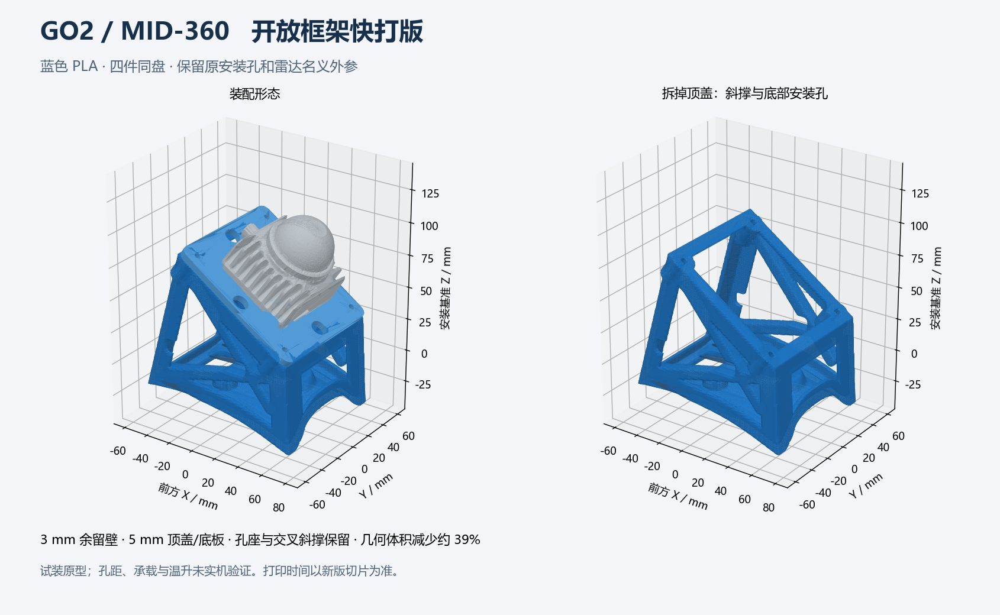

# V7 快打试装原型

用户要求缩短原版 23 小时 17 分的整盘时间。本目录单独保存开放框架版，不覆盖原封闭箱体 STL。

打印四件：`print/box.stl`、`lid.stl`、`left_pad.stl`、`right_pad.stl`，原尺寸同盘，H2C 蓝色 PLA 3 号槽（当前 B3）。框架 STL 已侧放，盖板已平放。切片耗时、支撑和耗材以 `H2C_preparation` 的实际结果为准，不以减重比例换算工时。

| 项目 | 原箱体 | 快打版 |
|---|---|---|
| 侧面 | 封闭板为主 | 大开窗，保留边框和交叉斜撑 |
| 余留壁厚 | 4 mm | 3 mm |
| 底板 / 顶盖 | 8 / 8 mm | 5 / 5 mm |
| 两个机身螺钉孔座 | 加厚、平垫片座 | 保留 |
| 光学中心与角度 | `[0.24,0,0.20262] m`，35° | 不变 |
| 机身孔距 | 名义 58.5 mm | 不变，未实测 |
| 四件名义实心体积 | 原版基线 | 减少约 39% |

目前四件实心 PLA 质量估算约 256.8 g（假定密度 1240 kg/m³），这不是含支撑的实际切片重量。建议用 H2C 已支持的较粗层高、4 道墙、约 20% 填充作为试装切片起点，孔周保持足够实体；不通过盲目加速机器运动缩短工时。

## 螺钉变化

- **MID-360 改用 4×M3×8**：顶盖厚 5 mm，不加垫片时名义入设备 3 mm。加垫片后核对剩余啮合长度。不能沿用原版 M3×12，它会名义伸入 7 mm，超过设备 5 mm 孔深。
- 顶盖四角 M4×25 加螺母和平垫片。座面已上移到新盖板底面，螺母口袋同步移动，盖板不会悬空 3 mm；装配时核对螺钉伸出。
- 机身两颗 M3 的头下长度，仍按约 14.4 mm 的打印件夹持厚度、金属垫片和机身实际可用螺纹深度选取。

## 已检查与边界

生成器检查各零件闭合、单连通及名义扫描锥间距；`check_fasteners.py` 检查机身 M3 杆部通道、垫片座及拆盖后工具通道，结果见 `fastener_report.json`。

用户已接受安装接口可能需要修改重打。本版减少了覆盖板和材料，未证明与箱体版同等刚度；先做孔距、贴合和静止采集试装，不能据网格检查宣称抗冲击、温升或连续导航验证通过。雷达底部仍为塑料安装面，不满足原手册推荐的金属散热安装面。

配套显示 URDF 为 `web/public/assets/robots/go2/urdf/go2_mid360_raised_frame.urdf`，外参候选在 `candidate/`。雷达位姿保持不变；现用机器人配置不修改。运行 `generate_fast.py` 可重新生成几何、紧固通道报告及配套模型，再运行 `preview_fast.py` 生成预览。
